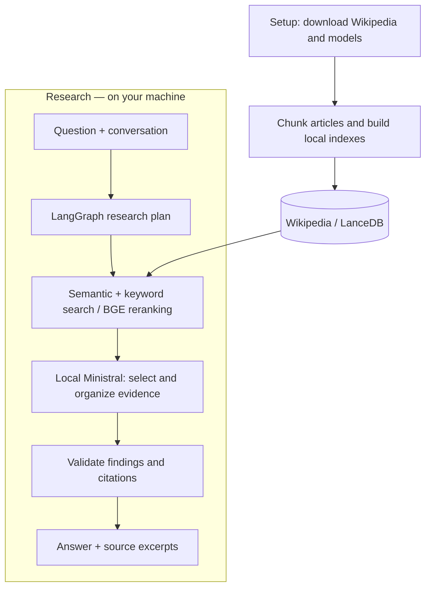

# Atlas Localis

**Wikipedia research, entirely on your machine.**

Atlas Localis combines a local Wikipedia database, semantic search and a Mistral language model in one research application. Download the knowledge and models, build the index, and ask questions **without an internet connection**. Search, retrieval, inference and orchestration all run locally.

The premise was simple: if the internet goes down, the laptop should still have something useful to say.


*A real answer from the local model, with citations into the downloaded Wikipedia snapshot. [Open the source evidence](docs/images/atlas-localis-evidence.png) · [View the welcome screen](docs/images/atlas-localis-welcome.png)*

## From a question to its sources

Ask about an event, compare developments or trace a chronology. Atlas Localis plans the research, retrieves passages and assembles a cited answer. Follow-up questions retain context; citations open the exact supporting excerpts.

Research uses the installed **Simple English Wikipedia** snapshot. Missing evidence can produce a partial answer, explicit gaps or a request for clarification.

## What runs locally

| Part | Implementation |
| --- | --- |
| **Knowledge pipeline** | Scripts download Wikipedia and verified model files, chunk articles, generate embeddings and build the local indexes. |
| **Search and retrieval** | **LanceDB** stores text and vectors. **E5** supplies semantic embeddings; keyword and vector results are combined with reciprocal rank fusion, then reranked by **BGE**. |
| **Language model** | Mistral's **Ministral-3-8B-Instruct** runs in 4-bit GGUF format through **llama.cpp**, with Apple Metal acceleration. |
| **Research orchestration** | **Python, LangGraph and Pydantic** coordinate up to three research tasks, validate structured findings and assemble the answer with numbered citations. |
| **Application** | A terminal-inspired **Streamlit** chat and a CLI share the same execution engine and result format. |
| **Diagnostics** | Local **JSONL logs, SQLite metrics and OpenTelemetry spans** make runs inspectable. |



Internet access belongs to installation, downloads and explicit updates. During research, models load from local files and configured runtime services use loopback connections. No hosted LLM, cloud database or API key is required.

## Engineering choices that matter

- **Make evidence inspectable.** Source-bound findings, excerpt offsets and hashes connect each citation to local text. Generation favors faithful source wording over free-form paraphrase.
- **Work within one machine's resources.** Shared model caches, bounded concurrency, deadlines and cancellation control execution. UI, CLI and evaluation use the same lifecycle.
- **Keep updates recoverable.** Checkpointed builds, validated snapshots, atomic activation and rollback keep unfinished indexes out of the running application.
- **Test the system without loading the models.** Real temporary LanceDB databases and injected models exercise retrieval, graphs and process ownership. Recorded release checks passed **765 model-free tests**; real-model acceptance is separate.

[Architecture](docs/dev/architecture.md) · [Data lifecycle](docs/dev/data-lifecycle.md) · [Tests and evaluation](docs/dev/testing.md)

## Run it

Supported target: **macOS on Apple Silicon, CPython 3.12**. Follow the [setup guide](docs/dev/setup.md) for prerequisites, including the pinned native llama.cpp build. Then, from the repository root:

```bash
# First-time setup: install dependencies, download assets and build the database.
ATLAS_SETUP_PYTHON=python3.12 bash scripts/setup.sh
```

Setup checks for a **40 GiB free-space reserve**; a full corpus build takes hours. After it completes, start the local services in separate terminals:

```bash
# Terminal 1
bash scripts/start_model_stack.sh

# Terminal 2
bash scripts/run_ui.sh
```

Open **http://127.0.0.1:8501** and try “When did the Roman Republic end?” The [developer guide](docs/dev/README.md) covers CLI usage, configuration and troubleshooting.

## A note on scope

Citations establish where an answer came from, not whether it is historically correct. Coverage depends on the installed snapshot, and source context can be incomplete. Python-side offline safeguards are tested; full browser/native-process network-isolation testing remains pending. [Known limitations](docs/dev/testing.md#known-limitations) also cover the pinned native runtime issue.
