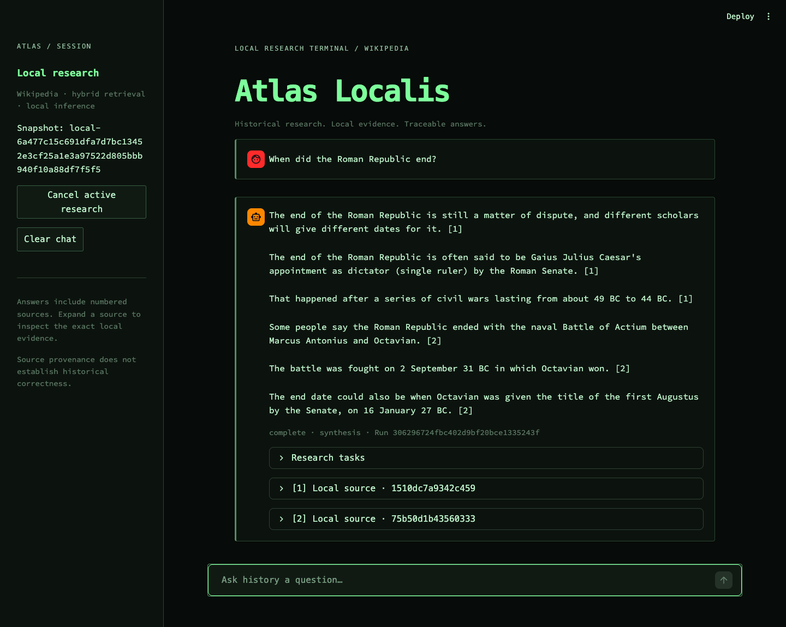
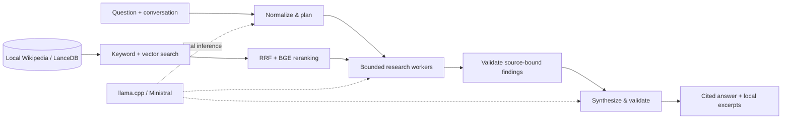

# Atlas Localis

### Historical research. Local evidence. Traceable answers.

Atlas Localis is a local-first research application that turns historical questions into **bounded research tasks and cited answers over Wikipedia**. It combines LangGraph orchestration, hybrid retrieval and local model inference in a terminal-inspired chat interface built for Apple Silicon.

**Python 3.12 · LangGraph · LanceDB · llama.cpp / Metal · Streamlit · OpenTelemetry**



*Live local research over Wikipedia. [Inspect an expanded source](docs/images/atlas-localis-evidence.png) · [View the welcome screen](docs/images/atlas-localis-welcome.png).*

## From question to evidence

Ask a question, follow the research progress, and inspect the local excerpts behind each numbered citation. Follow-up questions use bounded conversation context. Questions without sufficient evidence can return partial answers, evidence gaps or a request for clarification.

- **Local at question time:** Wikipedia indexes, embeddings, reranking and generation run on your machine. Downloads belong to explicit setup and update commands.
- **Hybrid retrieval:** LanceDB full-text and vector search combine through reciprocal rank fusion, followed by BGE cross-encoder reranking.
- **Bounded orchestration:** a supervisor plans up to three tasks; isolated research workers retrieve evidence and validate findings, with at most one repair.
- **Source-bound answers:** constrained generation selects verbatim findings; code validates source references and constructs citations with inspectable excerpts.
- **One execution contract:** chat, CLI and evaluation share the same application lifecycle and typed result.

## How it works



E5 supplies local embeddings. LangGraph owns orchestration. The application pins a corpus snapshot, controls shared model resources, and emits progress events before delivering the validated answer. JSONL logs, SQLite metrics and OpenTelemetry spans make execution inspectable.

## Engineering highlights

| Challenge | Implementation |
| --- | --- |
| Keep evidence traceable across research tasks | Typed Pydantic contracts, excerpt offsets and hashes, task provenance, deterministic citation numbering |
| Coordinate local models within resource limits | Separate worker/model/accelerator admission, cancellation and deadlines, shared resource cache, process ownership |
| Update a corpus without exposing a partial index | Resumable build checkpoints, validated snapshots, atomic activation and explicit rollback |
| Keep presentation consistent | One application factory and canonical result for UI, CLI, preflight and evaluation |
| Test without downloading models | Injected resources, real temporary LanceDB fixtures, graph/process tests and separate real-model acceptance |

Explore the [architecture](docs/dev/architecture.md), [data lifecycle](docs/dev/data-lifecycle.md) or [source code](src/workbench).

## Run it

The supported target is **macOS on Apple Silicon with CPython 3.12**. First-time provisioning requires pinned native/model assets, substantial disk space and hours for a full Wikipedia index. Follow the [setup guide](docs/dev/setup.md) before launching.

With assets already provisioned, run these in separate terminals from the repository root:

```bash
bash scripts/start_model_stack.sh
```

```bash
bash scripts/run_ui.sh
```

Open **http://127.0.0.1:8501**. Try “When did the Roman Republic end?” or ask for a comparison or chronology.

Prefer the terminal? With the UI stopped and your environment activated:

```bash
python scripts/run_agent_chat.py "When did the Roman Republic end?"
```

## Scope

Atlas Localis is an engineering portfolio project for local historical research. Source-bound output favors auditability over fluent paraphrase; citations establish provenance, not historical correctness. Corpus coverage and source context can limit answers. See [testing and known limitations](docs/dev/testing.md) for verification boundaries and the pinned native runtime issue.

[Developer guide](docs/dev/README.md) · [Configuration](docs/dev/configuration.md) · [Observability](docs/dev/observability.md)
