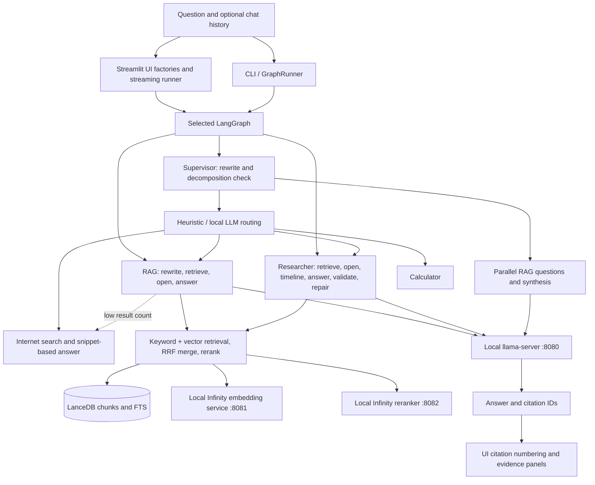

# Atlas Localis — Project Status Audit

## 1. Executive Summary

| Question | Verdict |
|---|---|
| Codebase structurally intact? | Yes |
| Unit tests healthy? | Partial |
| Runnable immediately? | Partial |
| Runnable using existing local assets? | Yes |
| Fresh clone reproducible from docs? | No |
| Documentation current? | Partial |
| Significant redundant/legacy material? | Yes |
| GitHub rename fully reflected locally? | No |
| Ready to link from CV today? | No |

The project has substantially survived: the Python environment, both GGUF models, configured embedding/reranker weights, Wikipedia dump, articles, chunks, and working LanceDB/FTS data are present. At the start of the audit none of the three model services was running; the Streamlit page nevertheless loads, but answering a normal RAG question requires starting those services. A temporary, download-disabled stack successfully ran real hybrid retrieval, HTTP embeddings, HTTP reranking, and local Ministral generation against the existing database, producing an answer with a known chunk citation. No assets need downloading or rebuilding to restore this machine's basic RAG operation. The default test command aborts during collection because pre-existing, uncommitted decomposer changes removed a helper still imported by its tests; excluding that file yields **781 passed, 1 skipped, 23 deselected**, with no assertion failures. All 121 inspected Python files compile, but Ruff reports 31 violations. Fresh-clone instructions are blocked by a placeholder clone command, a nonexistent ingest script, an omitted chunking step, and omitted embedding/reranking setup. Configuration and observability documentation overstate how consistently settings are applied, and the tool-extension example cannot instantiate its documented class. The GitHub rename works through the old remote URL, but local branding and the remote remain old. This is a technically substantial working prototype whose public setup and evidence need correction before CV presentation; successful execution is not evidence of answer accuracy or comprehensive evaluation quality.

## 2. Audit Environment

### Scope and preservation

Audit conducted **17 October 2026, approximately 13:13–13:22 CEST (Europe/Berlin, UTC+02:00)**. Findings concern the **working tree as found**, not just committed `main`. Only this report was added to the checkout. No application/configuration/test files were edited, no dependencies installed/uninstalled/upgraded, no datasets or weights downloaded, no indexes rebuilt, no remotes changed, and no commits made.

Tests and smoke scripts ran with bytecode/cache writing disabled where applicable, and a temporary working directory for generated logs, metrics, and test assets. Temporary service output and Infinity runtime cache were also directed to temporary storage and removed afterwards. Model access was forced offline using `HF_HUB_OFFLINE=1` and `TRANSFORMERS_OFFLINE=1`. Network reads were limited to repository verification and a HEAD request to the model URL; the RAG diagnostic disabled web search in memory. Tests' own fixture/mocking behavior was retained.

| Item | Observed value |
|---|---|
| Root | `/Users/alistair/Documents/101_Coding/Projects/AgenticAI/agentic_workbench` |
| OS | macOS 26.5.2, build 25F84; Darwin 25.5.0 |
| Architecture | arm64 / Apple Silicon; Metal inference verified outside the diagnostic sandbox |
| Branch / upstream | `main` / `origin/main` |
| HEAD | `6f42433a008c3c205c7b4bc662c9e4026534da80` |
| Commit date / subject | `2026-03-03T22:48:46+01:00` / `zwischen` |
| Local versus cached origin/main | `git rev-list --left-right --count main...origin/main` → `0 0` |
| Live remote main | Both old and canonical URLs returned this same SHA through `git ls-remote` |
| Fetch and push remote | `https://github.com/amwaddell/AgenticWorkench.git` |
| Environment | Existing `.venv`, created from `/opt/anaconda3/bin/python3` |
| Audit interpreter | `<root>/.venv/bin/python`, Python 3.12.7, Anaconda build |
| Default shell Python | `/opt/homebrew/bin/python3`, Python 3.14.6; bare `python` not found |
| Editor | Tracked `.vscode/settings.json` selects `${workspaceFolder}/.venv/bin/python` |

Initial `git status --short`:

```text
 M src/workbench/graphs/decomposer.py
 M src/workbench/graphs/supervisor_graph.py
```

There were **two modified tracked files and no reported untracked files**. The original changes total 331 insertions / 196 deletions across those files. They introduce citation-label synthesis and safer handling of `None` state values; they were not made by this audit. The decomposer test import failure is specific to this working-tree/API mismatch: committed HEAD still defines `_format_sub_answers`, whereas the working tree replaces that pathway with label-aware helpers. The committed HEAD suite was not separately executed.

The checkout directory retains `agentic_workbench`. The old remote remains functional through GitHub's repository redirect: it is stale naming, **not currently a broken remote**. The sandbox's first remote query failed DNS resolution; the permitted read-only query outside it succeeded for both URLs. Upstream tracking is valid, and live remote main matches local HEAD, without fetching or altering refs.

## 3. Current Architecture

The implementation has **three supported LangGraph workflows**, declared in `systems/runner.py:SUPPORTED_GRAPHS`. There is no remaining legacy AgentLoop package. “Production path” below means the supported application path, not a claim of production deployment.



### Components and actual call paths

| Component | Implementation / evidence | Status |
|---|---|---|
| Unified CLI/API runner | `systems/runner.py:GraphRunner`, lazily builds clients/searchers/store/tools, then compiles and invokes a graph inside a run context | Active |
| UI | `ui/streamlit_app.py` → cached factories in `ui/components.py` → `ui/graph_runner.py:run_graph_streaming` | Active, separate assembly/execution path from GraphRunner |
| RAG graph | `graphs/rag_graph.py`: rewrite chat query → retrieve → optional count-based web fallback → open top chunks → answer | Active; real invocation verified |
| Researcher graph | `graphs/researcher_graph.py`: retrieve → open → timeline → answer → validate → conditional repair → validation again | Active, fake-based tests; not rerun with real inference during audit |
| Supervisor | `graphs/supervisor_graph.py`: rewrite → decomposition check; either parallel RAG/synthesis or route to specialist → normalize/merge | Active; compiles and routing tests pass; decomposer test file cannot collect |
| Query router | `graphs/routing/heuristic.py`, `llm_router.py`, constants: `local_rag`, `web_research`, `timeline_research`, `math` | Active; hybrid uses heuristics and local LLM fallback |
| Decomposition | `graphs/decomposer.py`: LLM SINGLE/JSON parsing, up to five subquestions, `ThreadPoolExecutor` with default four workers, deterministic ordering, synthesis | Active in supervisor by default; local changes uncommitted and incompletely verified |
| Wikipedia retrieval | `tools/search_wikipedia.py` → `HybridRetriever`; `tools/open_chunk.py` → `ChunkStore` | Active; corpus is local, no Wikipedia HTTP request per local lookup |
| Keyword retrieval | `retrieval/keyword_search.py`: LanceDB FTS over `text` | Active, real query verified |
| Vector retrieval | `retrieval/vector_search.py`: embed query → LanceDB nearest-neighbor search; returned distance transformed to score | Active; stored-vector self-query and real embedded query verified |
| Fusion | `retrieval/hybrid.py`: reciprocal rank fusion, deduplicate by chunk ID, deterministic tie-breaking | Active, tested |
| Reranking | HTTP factory default → `HTTPReranker`; optional local `CrossEncoderReranker` remains | Active by default; actual RAG retrieval traversed HTTP reranking |
| Embeddings | `data_build/http_embedder.py` default; local sentence-transformers adapter retained in `data_build/embeddings.py` | Active; both HTTP and cached local inference verified |
| LLM | `models/llamacpp_server.py`: POST `/v1/chat/completions`, response/token accounting, typed errors | Active; wrapper exercised by real RAG |
| Prompts/citations | `prompting/prompt_builder.py`, text templates, `prompting/citations.py` | Active; known-ID extraction, policy checks, UI numberization tested |
| Citation repair | Researcher uses `RESEARCHER_STRICT`: at least one citation, paragraph density ≥0.5, timeline support IDs, at most one repair | Active researcher feature; checks identifiers/density, not truth of claims |
| Decomposition citation labels | Working-tree helpers map IDs to `REF_A1` etc., then reverse mapping and strip invalid bracket tokens | Active local change; test coverage currently blocked; checked-in synthesis template still describes chunk IDs |
| Web search | `tools/web_search.py`: DuckDuckGo default, Tavily optional; RAG fallback and supervisor web route use results/snippets | Optional capability, **enabled by default**; external provider health not tested |
| Source fetching | `tools/source_fetch.py`: HTTP fetch/BeautifulSoup text extraction | Exported and tested, but no supported graph/runner call site found; not part of current web-answer path |
| Calculator | `tools/utility/calculator.py`, safe arithmetic execution; supervisor math route, optional LLM expression extraction | Active supervisor capability; tests pass |
| Date utility | `tools/utility/dates.py`, normalization and ToolSpec adapter | Exported and tested, but no supervisor date route or runner wiring; standalone utility |
| Evaluation | `evaluation/datasets.py`, `measures.py`, `reports.py`; script converts graph dicts to `AgentState` | Active optional harness, 20 built-in history questions; assembly differs from UI/runner |
| Observability | `observability/tracing.py`, `phoenix.py`, `logging.py`, `metrics.py` | Active spans/logs/SQLite; Phoenix export needs explicit wiring, see §8 |
| Context packing | `retrieval/context_builder.py:SimpleContextBuilder` | Apparently unused by supported graphs; configured context budget/diversity not enforced through it |
| Registry/interfaces | `core/registry.py`, `core/interfaces.py`; LLM constructor registered at import | Supported abstractions/tests, but normal runner uses direct factories rather than registry-based construction |
| AgentState | `agents/state.py` | Keep: evidence types used by prompts/tools/graphs and evaluation; not evidence that AgentLoop still exists |

A normal API execution is: question → `GraphRunner.run` → build local clients and LanceDB adapters → selected graph → `SearchWikipediaTool` → keyword + vector → RRF → reranker → `OpenChunkTool` → prompt → llama.cpp → answer/citation dict. UI uses equivalent factories but streams **node updates**, accumulates them, and numberizes citations. It does not stream model tokens through the LLM client.

The vector store holds vectors but reports **no ANN vector index**: the only listed secondary index is FTS. Vector search works without ANN; do not confuse “no ANN acceleration index” with “missing vectors/database.”

### Offline and internet behavior

**The default configuration is not strictly offline.** `web_search.enabled: true` creates the DuckDuckGo tool. RAG branches to web search when retrieval yields fewer than the configured count (default 2); this is a result-count threshold, not a calibrated relevance score. Supervisor can route explicitly to web for recency terms such as `latest`, `today`, `2026`, news, prices, or weather, and its RAG subgraph can also fall back. Decomposed questions use that same RAG subgraph. The researcher graph itself has no web branch.

With cached weights, local service URLs, and web search disabled, local retrieval, embeddings, reranking, LLM generation, timeline generation, routing, decomposition, citation handling, logging, and metrics can operate offline. Calculator/date utilities are local. Hugging Face model loading can otherwise perform metadata checks or first-load downloads; the offline environment flags used here prevent those. Phoenix defaults to localhost, but its exporter endpoint can be changed via `PHOENIX_ENDPOINT`. LLM/embedding/reranker URLs are configurable and need not remain local. SourceFetch contacts arbitrary URLs only when explicitly used; it is not currently wired into the application graphs.

## 4. Runtime Dependency Matrix

“Running” describes **initial and final state**, after all temporary diagnostics were stopped.

| Component | Expected | Present? | Running? | Healthy? | Action required |
|---|---|---:|---:|---|---|
| LLM | `data/models/Ministral-3-8B-Instruct-2512-Q4_K_M.gguf`; localhost:8080 | Yes | No | Loaded; API and generation worked on repeat probe; one initial transient HTTP 500 | Start existing llama-server; no download |
| Embeddings | `intfloat/multilingual-e5-base`, HTTP `/embeddings`, 127.0.0.1:8081 | Yes, cached; Infinity installed | No | Started offline; query yielded normalized 768-vector | Start existing Infinity service |
| Reranker | `BAAI/bge-reranker-v2-m3`, HTTP `/rerank`, 127.0.0.1:8082 | Yes, cached; Infinity installed | No | Started offline; real hybrid retrieval/answer completed with reranker enabled | Start existing Infinity service |
| Raw Wikipedia | `data/raw/wikipedia/simplewiki-latest-pages-articles.xml.bz2` | Yes | n/a | Entire bz2 stream read successfully, including integrity checks | None |
| Processed articles | `data/processed/wikipedia_articles.parquet` | Yes | n/a | Footer/sample readable; 277,095 rows | None |
| Ingest manifest | `data/processed/wikipedia_articles_manifest.yaml` | Yes | n/a | Readable; count agrees with parquet | None |
| Chunks | `data/processed/chunks.parquet` | Yes | n/a | Readable; 430,910 distinct IDs, same set as DB | None |
| Chunk manifest | `data/processed/chunks_manifest.yaml` | Yes | n/a | Readable; paragraph-aware character chunking, count agrees | None |
| LanceDB | `data/indexes/active/lancedb`, table `chunks` | Yes | n/a | Opens, counts, FTS and vector queries succeed | None; do not rebuild |
| Keyword index | `chunks` table, FTS `text_idx` on `text` | Yes | n/a | Real “Roman Republic” search succeeds | None |
| Streamlit | UI code, Streamlit 1.54.0, port 8501 when launched | Yes | No | AppTest rendered page, no exceptions/errors, chat input present | Launch UI with `.venv` activated |
| Phoenix | Optional trace viewer, port 6006 | Yes, package/CLI in `.venv` | No | Availability probe negative; viewer not started/tested | Optional; normal runner also needs exporter wiring to show traces |

### Exact local asset inventory

Paths are relative to the repository unless explicitly absolute. Filesystem times below are displayed in Europe/Berlin.

| Asset | Bytes | Last modified |
|---|---:|---|
| `data/models/Ministral-3-8B-Instruct-2512-Q4_K_M.gguf` | 5,198,911,904 | 2026-02-23 07:40:48 |
| `data/models/Ministral-8B-Instruct-2410-Q4_K_M.gguf` | 4,911,500,096 | 2026-02-11 08:26:15 |
| `data/raw/wikipedia/simplewiki-latest-pages-articles.xml.bz2` | 342,917,678 | 2026-02-11 19:03:29 |
| `data/processed/wikipedia_articles.parquet` | 170,684,868 | 2026-02-11 19:31:37 |
| `data/processed/wikipedia_articles_manifest.yaml` | 312 | 2026-02-11 19:31:37 |
| `data/processed/chunks.parquet` | 179,851,051 | 2026-02-12 14:44:26 |
| `data/processed/chunks_manifest.yaml` | 299 | 2026-02-12 14:44:26 |

The older 2410 GGUF is **not selected by the launcher** and consumes about 4.57 GiB; it is an alternative/rollback asset, not required for the current default. No claim is made that it can be removed without the owner's decision.

Relevant Hugging Face cache root: `/Users/alistair/.cache/huggingface/hub`.

| Model cache directory | Snapshot revision | Verified local files |
|---|---|---|
| `models--intfloat--multilingual-e5-base` | `835193815a3936a24a0ee7dc9e3d48c1fbb19c55` | 10 files, no broken snapshot links; 1,134,534,380 logical bytes; `model.safetensors` 1,112,201,288 bytes, modified 2026-02-13 14:56:00 |
| `models--BAAI--bge-reranker-v2-m3` | `953dc6f6f85a1b2dbfca4c34a2796e7dde08d41e` | 7 files, no broken snapshot links; 2,293,259,337 logical bytes; `model.safetensors` 2,271,071,852 bytes, modified 2026-02-14 21:49:20 |

Both snapshots actually loaded in offline services; file presence alone was not the health criterion. Other cache directories include Alibaba GTE multilingual (~599 MiB), Alibaba custom implementation (~72 KiB), and Qwen3-Embedding-0.6B (~1.1 GiB). These are not selected by current defaults. Cache lock directories also mention Snowflake and all-MiniLM, but **a lock directory is not proof that weights exist**; those model snapshots were not found in this hub listing. No project-specific cache path overrides were needed to find the active models. `.infinity_cache/` exists in the checkout but was empty as found.

Approximate allocated disk use from `du -sh`: `data/models` 9.4 GiB, `data/indexes` 1.7 GiB, `data/processed` 334 MiB, `data/raw` 327 MiB, `.venv` 1.6 GiB, shared Hugging Face hub 4.9 GiB. The latter includes unrelated/alternative models. Thus the README's **~2 GB total requirement is false even for the selected GGUF alone**. Peak build disk/RAM requirements were not benchmarked.

### Database and corpus consistency

`lancedb.connect(...)` opened the existing database under installed LanceDB 0.29.2. It lists one table, `chunks`, with **430,910 rows** and fields `chunk_id`, `document_id`, `title`, `section`, `text`, and `vector: fixed_size_list<float32>[768]`. The FTS index is `text_idx`; no ANN index is listed. The active table version is 843, dated 2026-02-14; version 842 completed the 430,910-row write on 2026-02-13. Historical table versions remain under the same table; no separate `data/indexes/snapshots` directory or alternative index directory was found.

The full chunk-ID sets from parquet and DB both contain 430,910 unique IDs, with **zero missing and zero extra IDs**. FTS returned Roman Republic/Pontifex Maximus evidence. Searching with an existing vector returned its own April chunk at distance 0.0. Three stored April vectors were compared with freshly computed, cached-local E5 passage embeddings: cosine similarity was approximately 0.999999999996–0.999999999998, maximum absolute differences below `3.8e-7`. This is strong sampled evidence that the existing vectors use the configured E5 model/passage-prefix normalization; it is not a substitute for a persisted model/revision build manifest.

The table schema metadata does not record an embedding model/revision, and no vector build manifest was found. The chunk manifest records `paragraph_aware`, `target=1000,max=1500,min=100`, 277,095 source articles, 430,910 chunks, average length 696.5 characters. The ingest manifest records 277,095 articles, 302,298,222 text characters and 1,890 skipped articles. These are internally consistent with the inspected artifacts. Parquet footer/sample and chunk IDs were read; full re-ingestion and exhaustive text/vector equivalence checks were not performed. Full bz2 decompression yielded 1,633,874,821 bytes without error; the entire XML was not reparsed.

Within `chunks.lance`, allocated use is approximately 1.5 GiB data, 96 MiB indexes, 33 MiB versions, and 3.3 MiB transactions. These are table storage/history, not automatically obsolete duplicate corpora. There is no evidence of database corruption or a LanceDB dependency incompatibility in the current environment.

## 5. Runnability Verdict

### 5.1 Runnable right now

**PARTIALLY.** The existing environment imports the application, all three graphs compile, keyword/vector data queries work, and the Streamlit page initializes with a chat input. At initial and final inspection ports **8080, 8081, 8082, 6006, and 8501** had no listeners. Normal default RAG inference therefore cannot answer until services start. The shell also lacks bare `python`, `pytest`, `ruff`, `streamlit`, and `infinity_emb` commands until `.venv/bin` is on PATH; this is an environment activation requirement, not a missing installation.

### 5.2 Runnable after starting existing services

**YES.** Directly started local services became healthy in roughly 10–24 seconds on the first diagnostic startup. The configured GGUF loaded through `/opt/homebrew/bin/llama-server`, **version 8130 (`ed4837891`)**, built for Darwin arm64. `/v1/models` reported `Ministral-3-8B-Instruct-2512-Q4_K_M.gguf`. Both the configured short model name and the GGUF filename were accepted by the chat API on repeat probing, so the naming difference is not an observed client incompatibility.

A real `GraphRunner.run('rag_graph', 'What is photosynthesis?')` then returned **20 retrieved / 5 opened chunks**, 1,525 prompt tokens, 128 completion tokens, one recognized citation (`484c63c578bf934e`), and `error: null`. That diagnostic used an in-memory absolute index path, `web_search.enabled=False`, temperature 0.1 and a deliberately short 128-token generation limit; it did not change config files. The resulting answer was cut at that token limit, and included content whose factual relevance was not judged. This proves the runtime pipeline, **not answer-quality readiness**.

One first-attempt LLM wrapper request returned HTTP 500 after startup. Its response body was not retained by the wrapper; the repeat startup returned HTTP 200 for two direct requests and the subsequent wrapper-based RAG generation. The cause is **UNKNOWN**; this was not reproducible enough to label the model/client permanently broken. Capture server stderr and HTTP response body if it recurs.

All temporary service process groups were terminated. A final unsandboxed `pgrep` for `llama-server|infinity_emb` and `lsof` on ports 8080–8082 returned no processes/listeners. No service was left running. Diagnostic caveats: an initial standalone reranker probe constructed an incomplete `Chunk` object and was rejected before its HTTP call; actual application retrieval subsequently exercised the real reranker successfully. A service-log decoding error occurred during final diagnostic reporting after termination signals had already been sent; the independent process/port check confirmed cleanup. Neither diagnostic harness error is an application failure.

### 5.3 Missing assets

**No required default runtime asset was found missing on this machine.** Model weights, embedding/reranker caches, processed/chunk data, raw source, vector rows and FTS all survived. Optional Phoenix is installed but stopped. Tavily availability/credentials and live DuckDuckGo operation are unverified and not needed for the verified local path. No rebuild/download was justified or performed.

For a fresh clone, all these large assets are intentionally absent: GGUF weights, embedding/reranker caches, raw dump, articles/chunks/manifests, and index. They must be acquired/generated, unlike the present checkout.

### 5.4 Exact minimum steps to restore operation

These are **commands for the owner to run later**, not changes made during this audit. Start from the repository root and activate the surviving environment in each terminal:

```bash
source .venv/bin/activate
export HF_HUB_OFFLINE=1 TRANSFORMERS_OFFLINE=1
```

Terminal 1, existing LLM (direct command avoids the stack launcher's shutdown ambiguity):

```bash
llama-server \
  --model data/models/Ministral-3-8B-Instruct-2512-Q4_K_M.gguf \
  --host 127.0.0.1 --port 8080 --n-gpu-layers -1 --ctx-size 8192
```

Terminal 2, existing embedding service:

```bash
infinity_emb v2 --model-id intfloat/multilingual-e5-base \
  --host 127.0.0.1 --port 8081 --engine torch
```

Terminal 3, existing reranking service:

```bash
infinity_emb v2 --model-id BAAI/bge-reranker-v2-m3 \
  --host 127.0.0.1 --port 8082 --engine torch
```

Terminal 4:

```bash
python scripts/preflight.py --no-phoenix
bash scripts/run_ui.sh
```

Stop each foreground service with Ctrl+C afterwards. These commands require **no pip installation, download, ingestion, chunking, or index build** on this machine. `bash scripts/start_model_server.sh` is also the checked-in equivalent LLM command. The Infinity wrapper scripts have an environment-mutation branch; the direct commands above avoid it.

For a fully local API question, with the services running, the existing API supports:

```python
from workbench.systems.runner import GraphRunner

runner = GraphRunner(config_overrides={"web_search": {"enabled": False}})
result = runner.run("rag_graph", "What is photosynthesis?")
print(result["answer_text"])
```

The existing UI has no comparable offline switch; the checked-in YAML enables web access. Do not describe the default UI as guaranteed offline.

### 5.5 Fresh-clone reproducibility

**NO when following the current documentation.** The repository contains most of the required pipeline, but the documented procedure is not a complete executable recipe. A clean install was deliberately not attempted.

| Step | Factual assessment |
|---|---|
| 1. Clone/install | README uses literal `<repo-url>` and `cd agentic-workbench`; neither specifies the canonical repository/directory. Editable install is present, but `pyproject.toml` declares no runtime dependencies; a separate requirements install is necessary. No venv creation/activation instructions, lock, or tested clean platform environment. |
| 2. Acquire model | Launcher names correct model and prints valid download URL when missing; it does not download. HEAD request resolved the URL. Missing-file example lacks a preceding `mkdir -p data/models`. README implies download-and-start as one step and understates disk. |
| 3. Acquire Wikipedia | Existing `download_wikipedia.sh` uses Wikimedia latest Simple English dump, curl resume and minimum-size check. Command exists; no download was performed. “latest” is not a pinned dataset/checksum. |
| 4. Ingest | README names nonexistent `scripts/ingest_wikipedia_dump.py`. Actual direct XML entry point is `scripts/run_ingest_wikipedia.py`. Fixture ingestion tests pass. |
| 5. Chunk | Required `python scripts/build_chunks.py` is absent from Quick Start. Vector builder requires its `chunks.parquet`. Actual chunker uses character sizes and CLI options, not documented token/heading settings. |
| 6. Embed/build DB | `build_vector_index.py` exists and supports HTTP/local modes. Default HTTP mode needs Infinity running **before** this step; README starts no embedding service. Infinity is undeclared in requirements. Local mode exists but needs weights/device availability. Full-corpus rebuild not benchmarked or run. |
| 7. Build keyword index | Existing script works against a built chunks table; FTS primitive verified in tests and current DB. Script hardcodes active path rather than reading configured path. |
| 8. Start services | LLM launcher requires native Homebrew llama.cpp, not the Python server suggested by requirements-models. Two additional Infinity services are required by defaults, but missing from README Quick Start. Script headers mention manual Infinity installation. |
| 9. Preflight | Script exists; checks graph compilation and basic services/DB. Its own failed result exits 0, and it does not establish complete retrieval/index/model compatibility or exporter wiring. |
| 10. UI | Launch script exists; UI initializes in current environment. Documented custom `--port` flag is wrong for Streamlit. Environment activation and all three services must be understood. |
| 11. Successful RAG question | Verified using surviving local artifacts. A fresh-clone end-to-end success is unverified and cannot be obtained by following Quick Start unchanged. |

## 6. Test and Static Analysis Results

No fixes, autoformatting, or lint autofixes were run.

| Check | Command / method | Result |
|---|---|---|
| Import | `.venv/bin/python -B -c 'import workbench; print(workbench.__file__)'` | Pass; resolves to this checkout's `src/workbench/__init__.py` |
| Compile | `compile(path.read_bytes(), str(path), 'exec')` for every `*.py` under `src`, `scripts`, `tests`, `examples` | **121 files pass**; no `.pyc` generated |
| Dependency consistency | `.venv/bin/python -B -m pip check` | **No broken requirements found** |
| Default pytest selection | Temporary-CWD pytest harness below, existing pyproject config | **Collection error**, exit 2; 23 integration tests deselected; no tests executed to completion |
| Remaining suite | Same harness with `--ignore=<root>/tests/test_decomposer.py` | **781 passed, 1 skipped, 23 deselected**, 10.83 seconds outside sandbox; 0 failed, 0 xfailed |
| Ruff | `.venv/bin/python -B -m ruff check --no-cache src/ tests/ scripts/ --output-format concise` | **31 violations**, exit 1 |
| Preflight | `PYTHONDONTWRITEBYTECODE=1 .venv/bin/python -B scripts/preflight.py --no-phoenix` | **3/6 passed**, LLM/embedding/reranker stopped; DB/graphs/Streamlit pass; **exit 0 despite failures** |
| Basic smoke | `scripts/smoke.py` via `runpy` in temporary CWD | Pass, prints `hello workbench`; no substantive application test |
| Graph smoke | `scripts/langgraph_smoke.py` via `runpy`, no PHOENIX_TRACE | Pass; two nodes, correct message and steps=2 |
| Observability smoke | `scripts/trace_smoke_test.py` via `runpy` in temporary CWD | Pass; 10 JSONL events, SQLite metrics, 3 component calls, 100/50 tokens, 1 retrieval record, console spans |
| UI initialization | `AppTest.from_file('src/workbench/ui/streamlit_app.py').run(timeout=20)` | No exceptions/errors; titles and chat input rendered |
| Live runtime | Temporary local stack + HTTP probes + GraphRunner as §5.2 | Local RAG succeeds; services stopped after probing |

The pytest command was executed through this harness to preserve the repository's existing generated state. `root` was the checkout root; the subset run added the indicated ignore argument. Both runs used `PYTHONDONTWRITEBYTECODE=1 HF_HUB_OFFLINE=1 TRANSFORMERS_OFFLINE=1` and `.venv/bin/python -B -`:

```python
import os, pathlib, tempfile, pytest
root = pathlib.Path.cwd()
with tempfile.TemporaryDirectory(prefix="atlas-audit-tests-") as d:
    os.chdir(d)
    raise SystemExit(pytest.main([
        "-c", str(root / "pyproject.toml"), str(root / "tests"),
        # Subset run only:
        # "--ignore=" + str(root / "tests/test_decomposer.py"),
        "-p", "no:cacheprovider", "--tb=short", "-ra",
    ]))
```

The successful outside-sandbox subset used `--tb=line` instead of `--tb=short`. `pyproject.toml` sets `addopts = "-q -m 'not integration'"`, so “pytest” is **not** all integration tests. Full model-server integration tests were not run during the temporary stack window. The default non-integration suite itself still loads real cached models in its small vector/reranker tests; “fast, no model server” does not mean no model assets are required.

### Failure and skip diagnosis

1. **Collection/API mismatch — real current test-suite breakage:** `tests/test_decomposer.py` imports `_format_sub_answers` at line 25, but the working-tree `graphs/decomposer.py` no longer exports that function. ImportError aborts collection. The file contains 35 test function definitions; none were exercised. This is stale tests relative to uncommitted implementation changes, not missing dependencies or assets. No shim was added and no file was temporarily restored.
2. **Sandbox hardware restriction — not a host macOS failure:** the first subset run produced nine setup errors in `TestVectorSearchSmall` when torch tried to use MPS, claiming MPS required macOS 13+ despite this host being macOS 26.5.2. The identical tests passed outside the sandbox, proving the restriction was diagnostic-environment access, not absent weights or a project regression. Affected names: `test_search_returns_requested_top_k`, `test_search_returns_all_when_top_k_exceeds_table`, `test_photosynthesis_query_finds_photosynthesis_chunk`, `test_gravity_query_finds_gravity_chunk`, `test_programming_query_finds_python_chunk`, `test_results_have_correct_source`, `test_results_have_positive_scores`, `test_results_are_sorted_by_score_descending`, `test_result_metadata_contains_title`.
3. **One tracing skip:** `tests/test_tracing_spans.py:177` skips when `start_run_span` spans are not captured by the test exporter due to global OTel context interference. Its message says core context behavior is verified by `test_run_span_with_context`. This limits exporter evidence; it is not a clean all-green suite.
4. **Service absence:** preflight's three runtime failures were connection failures to stopped localhost services. Subsequent temporary startups succeeded; not missing model/database failures.
5. **Version drift warning:** preflight calls deprecated `db.table_names()` under LanceDB 0.29.2. It works here with a warning. Pytest treats DeprecationWarning as error, but the preflight path was not executed inside that test policy.

Ruff breakdown: `E402` 3 (`scripts/build_vector_index.py` import-path setup); `B905` 9 (`zip` without `strict`); `B007` 1 (unused ingest loop variable); `F841` 5 (unused locals); `I001` 4 (test imports); `B011` 6 (`assert False` in tests); `B017` 1 (broad exception assertion); `F401` 2 (availability-check imports). Seven violations are in source/scripts and 24 in tests. They are static/style findings, not evidence that the verified runtime cannot execute.

## 7. Dependency / Environment Findings

The `.venv` remains usable and points to an existing Anaconda Python. Its shebangs embed the current absolute checkout path; physically renaming/moving the directory may break CLI entry points even though internal `workbench` imports can remain unchanged. `.venv` activation is necessary because the shell currently selects Homebrew Python 3.14.6 and no bare `python` executable.

| Dependency | Installed version |
|---|---|
| pip / pytest / Ruff | 26.0.1 / 9.0.2 / 0.15.0 |
| Pydantic / HTTPX / NumPy / pandas | 2.12.5 / 0.28.1 / 1.26.4 / 2.3.3 |
| LanceDB / PyArrow | 0.29.2 / 23.0.0 |
| sentence-transformers / torch / transformers | 3.4.1 / 2.8.0 / 4.57.6 |
| LangGraph / LangChain / langchain-core | 1.0.9 / 1.2.10 / 1.2.15 |
| Streamlit / Infinity | 1.54.0 / infinity-emb 0.0.77 |
| optimum | 1.23.3; `optimum.bettertransformer.BetterTransformer` imports successfully |
| Phoenix / Phoenix OTel | 12.35.0 / 0.14.0 |
| OpenInference LangChain instrumentation | 0.1.59 |
| OTel SDK / duckduckgo-search | 1.39.1 / 8.1.1 |

Installed versions are **the environment found today**, not a proven frozen record of March. File dates and broad requirements cannot establish a historical dependency set.

| Declaration | Finding |
|---|---|
| `pyproject.toml` | Distribution `agentic-workbench`, Python ≥3.11, setuptools build; **no `[project].dependencies`**, optional-dependency groups, lock, or upper Python bound. Editable installation alone installs no declared runtime stack. |
| `requirements.txt` | Most imported runtime libraries are declared, including Pydantic, HTTPX, YAML, LanceDB, PyArrow, NumPy, sentence-transformers, LangGraph/core, Streamlit and web dependencies. Broad `>=` floors allow very different future stacks. |
| Missing service dependency | **Infinity is not declared in any requirements file** despite default HTTP providers and launchers requiring `infinity_emb`. Its installation is only described in script comments/error messages. |
| `requirements-dev.txt` | Unpinned `pytest`, `ruff`; installed checks work, but future lint/test behavior can change. |
| `requirements-models.txt` | Entire file is comments. `pip install -r requirements-models.txt` installs nothing. It suggests `llama-cpp-python[server]`; current launcher uses native Homebrew `llama-server`. Those are different executables/install paths. |
| `requirements-phoenix.txt` | Optional Phoenix/OTel/OpenInference packages, broad lower bounds; installed here. Merely installing instrumentation does not activate it in normal runner/UI. |
| Potentially excessive requirements | High-level `langchain` has no direct application/script imports; `langchain-core` is used. pandas is primarily notebook/analysis support, not core retrieval. sentence-transformers remains justified by local alternatives, evaluation and tests even though default runtime is HTTP. Confirm transitive needs before removing anything. |
| Duplication | Split files are complementary rather than many duplicated runtime dependency entries. The larger duplication is handwritten component construction in runner, UI, evaluation and build scripts, with differing config behavior. |
| Optional external provider | Tavily is documented as a manual optional install and requires an API key; live operation not verified. |
| External executables | Native llama.cpp, curl, and download script's `bc`/`stat` are outside Python packaging; curl/bc/Homebrew are available here. |

There is **no tracked lockfile, constraints file, container image/environment definition, or CI environment**. Broad versions such as LanceDB ≥0.4 and LangGraph ≥0.2 do not express the exact APIs tested today. Current `pip check` only checks metadata dependency constraints; it cannot certify clean-install behavior, graph semantics, service compatibility, model availability or reproducible retrieval. A fresh installation today is **not expected to reliably reproduce the March environment** without additional version information. No clean environment was created to test that proposition.

## 8. Documentation Accuracy Audit

Classification is included in each problem description. **BLOCKER** means following that documented route cannot proceed successfully. Sections with correct information are explicitly distinguished below; stale naming is fully inventoried in §9.

| Severity | File | Section/reference | Problem | Code/config reality |
|---|---|---|---|---|
| BLOCKER | `README.md:9` | Quick Start / clone | Incorrect/incomplete placeholder clone URL and assumed directory | Canonical clone is `amwaddell/atlas-localis`; default checkout directory would be `atlas-localis` |
| BLOCKER | `README.md` | Quick Start / ingest | Incorrect script name `scripts/ingest_wikipedia_dump.py` | File does not exist; `scripts/run_ingest_wikipedia.py` exists |
| BLOCKER | `README.md` | Quick Start / index build | Incomplete: no chunk-build command | Vector builder requires `data/processed/chunks.parquet`, produced by `scripts/build_chunks.py` |
| BLOCKER | `README.md` | Quick Start / service order | Outdated/incomplete: build and runtime assume embeddings without starting service | Default embedding provider is HTTP :8081; must start Infinity before vector build; local override is supported |
| BLOCKER | `README.md`, requirements files | Install / runtime services | Incomplete: Infinity install and reranker startup absent from Quick Start | Both HTTP services are default, reranking enabled, Infinity absent from declared requirements |
| BLOCKER | `docs/adding-tools.md` | §1 Create the Tool Class | Incorrect API: implements `execute`, leaves abstract `run` undefined | `ToolSpec` requires subclass `run`; demonstrated TypeError on instantiation. Overriding execute also bypasses automatic validation/hooks |
| HIGH | `README.md` | Introduction | Misleading blanket “Everything runs on your machine” claim | Defaults allow DuckDuckGo web fallback and supervisor internet routes |
| HIGH | `README.md` | Requirements / ~2 GB disk | Incorrect by multiple gigabytes | Selected GGUF alone is 5,198,911,904 bytes; caches and DB add several more GB |
| HIGH | `README.md` | Download and start LLM | Misleading: one shell command does not acquire model | Launcher exits with download instructions when file missing; no automatic download or model-dir creation |
| HIGH | `README.md` | Migration from Legacy AgentLoop / project tree | Incorrect/outdated: `legacy/`, `agents.loops`, `agents.policies`, `ChatbotSystem` compatibility claims | Packages/shims removed; `tests/test_day8_cleanup.py` explicitly asserts these imports fail |
| HIGH | `docs/configuration.md` | Embeddings / Reranking | Outdated defaults: in-process sentence-transformers and cross_encoder | Current YAML uses HTTP services on :8081/:8082; local modes are alternatives, not removed functionality |
| HIGH | `docs/configuration.md` | Environment Variables | Incorrect `WORKBENCH_CONFIG` override | `load_config` does not read it; setting it to nonexistent path still loads defaults |
| HIGH | `docs/configuration.md` | Context Window | Misleading implied enforcement of max_tokens/max_chunks_per_doc | No supported graph/runner uses `SimpleContextBuilder` or these config values; prompt builder formats opened evidence directly |
| HIGH | `docs/configuration.md` | Chunking | Incorrect algorithm/units as effective build settings | YAML/docs say heading_aware and token sizes; build script selects fixed_size/paragraph_aware with CLI character sizes, ignoring those YAML knobs |
| HIGH | `docs/observability.md`, `README.md` | Phoenix / “run any graph — spans exported automatically” | Incorrect activation claim | Runner/UI call `setup_tracing` without an exporter. Only explicit `setup_phoenix_tracing`, or scripts wiring an exporter, exports to Phoenix |
| HIGH | `docs/observability.md` | LangGraph Auto-Instrumentation | Incorrect: installation alone said to activate instrumentation | Only opt-in `scripts/langgraph_smoke.py` explicitly calls `LangChainInstrumentor().instrument()` |
| HIGH | `docs/observability.md`, `docs/configuration.md` | Disabling observability / observability YAML | Incorrect/incomplete: enable_tracing, enable_metrics and log_level presented as functioning controls | Normal runner/UI do not consult these flags; metrics calls continue and tracing initializes independently |
| HIGH | `docs/configuration.md` | Source fetch / model providers | Incomplete: settings presented as uniformly wired | No SourceFetchTool application construction/call found; model factory always builds `LlamaCppServerModel`, regardless of `model.provider` |
| HIGH | `notebooks/03_agent_traces.ipynb` | Cells 4 and 12 / execution and prompt reconstruction | Broken: imports removed `workbench.systems.chatbot`, `workbench.agents.loops` | No compatibility shims exist; state-object-based walkthrough is superseded by graph result dicts |
| MEDIUM | `README.md` | Architecture diagram/table | Incomplete topology | Three graphs and four route labels are correct, but supervisor diagram omits rewrite/decomposition/parallel RAG/synthesis; graph nodes differ from simplified table |
| MEDIUM | `README.md` | Chat UI / “answers stream in real-time” | Misleading if read as token streaming | UI streams node events/progress; LLM default request is non-streaming and whole answer appears after generation |
| MEDIUM | `README.md`, `scripts/run_agent_chat.py` | Prerequisites / Development | Incomplete environment/model prerequisites | Bare `python` absent outside .venv; HTTP embedder/reranker required; some non-integration tests need cached real weights/MPS |
| MEDIUM | `scripts/run_ui.sh` | Usage `--port 8502` | Incorrect CLI flag | Arguments passed straight to `streamlit run`; use `--server.port 8502`. Printed URL remains 8501 regardless |
| MEDIUM | `scripts/run_ui.sh` | Prerequisites | Incomplete: only LLM explicitly listed | Defaults also require embedding and reranking services |
| MEDIUM | `scripts/start_model_stack.sh` | Prerequisites / “llama-cpp-python server” | Misleading alternative | Spawned LLM script unconditionally requires `llama-server` |
| MEDIUM | `scripts/start_model_stack.sh` | Port overrides | Incorrect implication LLM_PORT controls launched LLM | Stack health URL uses env LLM_PORT, while LLM launcher hardcodes 8080 and does not receive an override |
| MEDIUM | `scripts/start_model_stack.sh` | Shutdown behavior | Incomplete reliability claim | Trap handles INT/TERM but not EXIT; kills recorded shell PID for LLM launcher, which does not exec llama-server. Descendant cleanup is not guaranteed by this code; not experimentally tested via stack script |
| MEDIUM | `scripts/start_embedding_server.sh`, `scripts/start_reranker_server.sh` | Launch contract | Incomplete side-effect disclosure | Can `pip uninstall optimum -y` on incompatible import. Current optimum passes, but startup can mutate another environment if PATH/pip are mismatched |
| MEDIUM | `scripts/preflight.py`, README | Health result | Misleading as readiness/automation gate | Failure summary still exits 0; reranker only gets health GET; no keyword query, embedding/index compatibility or end-to-end RAG check |
| MEDIUM | `scripts/preflight.py` | `--quick` | Incomplete meaning | Skips only embedder/reranker; still calls LLM and opens DB. It is not an offline fake-only check |
| MEDIUM | `scripts/build_vector_index.py` | `--batch-size` help / Phoenix comment | Misleading controls/export claim | Configured batch goes to local model only; HTTP client keeps its default; outer embed/write batches hardcoded 512. `setup_tracing` has no Phoenix exporter |
| MEDIUM | `scripts/build_keyword_index.py` | Build location | Incomplete config contract | Hardcoded `data/indexes/active/lancedb`, unlike configurable runner/vector builder |
| MEDIUM | `scripts/run_researcher_eval.py`, README | Evaluation / provider parity | Incomplete/misleading comparison with app | Eval unconditionally builds local embedder/cross-encoder, ignores HTTP provider URLs, does not supply web/calculator tools to supervisor, and does not forward decomposer YAML settings |
| MEDIUM | `docs/configuration.md` | Retrieval strategy | Misleading effective setting | Runner always builds HybridRetriever; `retrieval.strategy` does not select keyword/vector-only operation |
| MEDIUM | `docs/configuration.md` | Reranking `top_n` | Misleading effective setting | Hybrid passes caller's `top_k` into reranker; YAML reranking.top_n is not forwarded by runner factory |
| MEDIUM | `configs/defaults.yaml`, docs | Web search max_results / source_fetch tunables | Incomplete propagation | Graph calls use hardcoded/default max_results (5); runner constructs web tool with provider only; source_fetch section not wired to graph tools |
| MEDIUM | `configs/defaults.yaml`, docs | Supervisor confidence / decomposer controls | Inconsistent entry points | Runner forwards decomposer settings but not web confidence threshold to supervisor; UI forwards threshold but omits decomposer enabled/max_workers, using graph defaults |
| MEDIUM | `docs/observability.md` | Runs directories / opt-in | Incorrect/inconsistent | Logger/metrics default to hardcoded relative `runs/logs`, `runs/metrics`; runner does not forward config dirs. Logging is always attempted, not all three opt-in |
| MEDIUM | `docs/observability.md` | Phoenix endpoint | Incorrect implied YAML authority | Export helper reads `PHOENIX_ENDPOINT` or localhost `/v1/traces`; YAML endpoint mainly drives displayed UI link, not runner export |
| MEDIUM | `docs/observability.md` | Log Events | Outdated completion event | Runner writes `<graph_name>_completed`, not listed `agent_completed`; run_context itself sets context, it does not independently write logs |
| MEDIUM | `docs/observability.md` | Metrics interpretation | Incomplete | Runner records retrieved count as keyword_candidates, vector_candidates and reranked, and total graph time as retrieval duration; these are not measured stage-specific values |
| MEDIUM | `docs/adding-graphs.md` | §6 UI selector | Outdated edit location/example | Actual `_render_sidebar` uses `graph_options` dict and session state, not shown direct selectbox list |
| MEDIUM | `docs/adding-graphs.md` | Example builder / tests | Incomplete scaffold | `_make_retrieve_node`, `_make_open_node`, `_make_answer_node`, `FakeMyTool` require definitions/imports. MyTool construction is not added to `_build_components` by merely adding a graph branch |
| MEDIUM | `notebooks/00_local_model_smoke.ipynb` | Prerequisites | Broken reference `install_day3.sh` | No such script exists; native model launcher has since replaced that stage |
| LOW | `docs/configuration.md` | Full Reference | Incomplete coverage | Omits decomposer section and HTTP provider URLs/timeouts; omits PHOENIX_ENDPOINT; context extra section is not a declared typed field |
| LOW | `docs/configuration.md` | Config snapshots | Misleading “immutable” wording | Snapshot is a mutable deep-copied dict; configuration is `frozen=False` and only minimally validates required keys |
| LOW | `README.md`, model adapter docstring | “any OpenAI-compatible server” / tokenization | Overbroad compatibility claim | Adapter appends `/v1/chat/completions`, has no auth setting, and uses its response parser. Base URL must be a compatible root. Token counter is heuristic; llama-server itself has tokenization APIs, but adapter does not use them |
| LOW | `src/workbench/data_build/index_keyword.py` | “Tantivy under the hood” | Outdated backend-specific description | Actual current table lists native FTS `text_idx`; `create_fts_index` called without a backend pin. Avoid claiming a guaranteed implementation backend across unbounded LanceDB versions |
| LOW | Notebooks with saved output | Presentation / paths | Historical and partly misleading | Saved absolute user paths, progress warnings and outputs are February artifacts, not a current clean-run demonstration |

### Documentation that remains correct

The three supported graph names, four supervisor route labels, GraphRunner import and `run_graph` API examples, config deep-merge overrides, and model URL/name/temperature/token/timeout defaults agree with code. README's evaluation commands exist and accept `--question-id` and `--system`; reports are written below the configured reports directory. The Wikipedia download script and `build_keyword_index.py` exist. Researcher citation validation/repair is real, and ToolSpec's LangChain adapter exists. `docs/adding-graphs.md` describes LangGraph's state/node/edge/compile pattern accurately as a scaffold; `docs/adding-tools.md` correctly identifies available tools and `.to_langchain_tool()`, despite its wrong subclass method. `examples/simple_usage.py` uses current model/config/run-context APIs and can run once LLM service is available; its first example does not export traces to Phoenix automatically. Existing observability smoke tests substantiate JSONL/SQLite/spans, and `PHOENIX_ENDPOINT` support is real even though it is missing from the config guide.

### Preflight/run tooling diagnosis

The observed preflight output was: LLM connection failed, DB **430,910 chunks / one table OK**, embedding unreachable, reranker unreachable, **all three graphs compile**, **Streamlit 1.54.0 OK**. It did not fail on missing weights or DB. Its six-check numbering is consistent for mandatory checks; Phoenix is an optional extra launcher, not a seventh verified health check. HTTP reranker health alone does not exercise scoring; local reranker mode loads the cross-encoder but does not score candidates. Missing dependencies/DB exceptions outside its try blocks can terminate it abruptly rather than produce a complete matrix. Preflight with no `--no-phoenix` can start Phoenix even when other checks fail; its normal cleanup wait is only entered when all checks pass. It is useful as a convenience diagnostic, but not a sufficient success gate.

The full-stack wrapper was inspected but **not run**, because the embedding/reranker scripts include pip-uninstall behavior and its process ownership differs from direct service execution. Direct services with offline flags and process-group cleanup were used instead. Build/ingest scripts were inspected and their underlying primitives tested through existing tests; the audit did not run full build commands or their overwrite paths.

## 9. Rename Audit: Agentic Workbench → Atlas Localis

The entire tracked file set was searched case-insensitively, including notebook source and saved output, for `AgenticWorkench`, spaced/concatenated/hyphenated Agentic Workbench, Agentic RAG Workbench, `agentic_workbench`, clone commands and GitHub URLs. No literal old GitHub repository URL occurs in tracked project text; it is present in `.git/config` as the remote. `workbench.*` references were assessed separately as Python API names.

### Must change

| Occurrence | Classification / implication |
|---|---|
| `README.md:9` clone placeholder and `cd agentic-workbench` | **Must update because broken/stale**. Does not clone the canonical repo and does not match a default canonical clone directory |
| `.git/config` origin `amwaddell/AgenticWorkench.git` | **Must update because stale**, not currently broken: redirect verified. No remote change was made |

The exact future command to update this HTTPS remote is:

```bash
git remote set-url origin https://github.com/amwaddell/atlas-localis.git
```

Changing that URL does not require renaming `workbench`, rebuilding indexes, downloading assets, or altering upstream branch names. `main` tracks `origin/main` correctly.

### Probably change for branding

The following table accounts for the explicit old product-name matches. Line numbers refer to the as-found files; notebook numbers here are raw JSON lines.

| Files / locations | Classification |
|---|---|
| `README.md:1` | **Branding cleanup**: Agentic RAG Workbench title |
| `.gitignore:2`; `configs/defaults.yaml:1` | **Branding cleanup**: explanatory headers |
| `scripts/preflight.py:3,334`; `scripts/run_ui.sh:2,23`; `scripts/start_model_stack.sh:81` | **Branding cleanup**: docstrings/banners |
| `src/workbench/ui/streamlit_app.py:2,36,78,215` | **Branding cleanup**: docstring, browser title and UI headings |
| `src/workbench/__init__.py:1`; `core/interfaces.py:2`; `core/types.py:2`; `models/__init__.py:2`; `observability/__init__.py:2`; `retrieval/__init__.py:1`; `tools/__init__.py:2` | **Branding cleanup**: package/module descriptions, not import names |

### Internal names that may reasonably stay

**Internal package name — probably safe to leave:** `src/workbench/`, `from workbench...`, tests importing it, package exports, and its stable configuration/API types. The GitHub rename does not invalidate Python imports. There is no evidence that changing the internal package is needed to make the application run.

### Human decision required

| Occurrence | Classification / reason |
|---|---|
| `pyproject.toml:2,5` distribution name `agentic-workbench`, description `Agentic Workbench` | **Needs human decision**: description is branding; distribution rename affects installation metadata and potentially consumers, independently of Python package name |
| `configs/defaults.yaml:69`, `docs/configuration.md:108`, `tools/source_fetch.py:111` user agent `AgenticWorkbench/1.0` | **Needs human decision**: external-facing identifier; old name is not an HTTP functional error |
| `scripts/build_chunks.py:77`, `scripts/run_ingest_wikipedia.py:50` trace service names | **Needs human decision**: changing names splits/renames observability series |
| `graphs/rag_graph.py:695`, `researcher_graph.py:618`, `supervisor_graph.py:884` service-name defaults | Same: **needs human decision**, not broken routing/imports |
| `observability/phoenix.py:33`, `observability/tracing.py:34`, `systems/runner.py:388`, `ui/graph_runner.py:79` service names | Same: **needs human decision**, internal/external trace continuity |
| Local directory `agentic_workbench` | **Needs human decision**: cosmetic, runtime currently depends on its absolute venv shebang paths; do not blindly rename |
| Saved absolute path in `notebooks/00_local_model_smoke.ipynb:33` | **Historical/reference text — no action required for correctness**; clear/re-run output later for presentation |
| Saved absolute warning path in `notebooks/02_retrieval_pipeline_explorer.ipynb:71` | Same: **historical/reference text**; not an active hardcoded execution path |

References to historical AgentLoop removal, previous model filename in launcher comments, and old result rendering compatibility are **historical/reference text**, not automatically branding bugs. No broken import, broken data path, or database mismatch was attributed to the GitHub rename. The genuinely broken legacy notebook/docs are due to removed APIs, not repository naming.

## 10. Redundancy / Legacy / Dead Material

These are evidence-based cleanup candidates, **not deletions performed**. “Apparently unused” means no supported application call site found, not proof nobody uses an exported API externally.

| Item | Evidence | Classification | Recommendation for later cleanup |
|---|---|---|---|
| `scripts/smoke.py`, `tests/test_smoke.py` | Print hello / assert 1+1; preflight and substantive graph tests already test useful imports/execution | archive/remove | Remove trivial early-stage checks once a public smoke entry point is chosen |
| `scripts/langgraph_smoke.py` | Tiny two-node graph and optional explicit OpenInference activation; run successfully | consolidate | Preserve opt-in instrumentation example if useful; overlaps graph compile tests/preflight |
| `scripts/trace_smoke_test.py` | Tests actual logs, metrics and nested spans together; passed using temp outputs | keep | Distinct from preflight, which does not verify these outputs |
| `scripts/preflight.py` | Real runtime checks plus fake compilation; discovered stopped services accurately | keep | Useful health entry point; eventual fixes should preserve distinctions and proper failure signaling |
| `scripts/run_tests.py` | Imports pytest-based modules then calls only top-level test functions with no fixture resolution; ignores class tests, markers and autouse setup | archive/remove | Not a replacement for pytest; “when pytest unavailable” conflicts with test modules importing pytest |
| `scripts/map_architecture.py` | AST inventory/report generator; existing ignored architecture_overview report | keep | Developer diagnostic, not authoritative generated architecture; usage comment drops `scripts/` prefix |
| `notebooks/00_local_model_smoke.ipynb` | Current LLM API exercises, saved outputs; dead install_day3 reference | keep | Useful model demo after setup reference/output refresh |
| `notebooks/01_explore_articles.ipynb` | Article parquet EDA, markup inspection and manifest checks | keep | Distinct data-ingestion demonstration, not redundant with chunking |
| `notebooks/01_explore_chunking.ipynb` | Compares two current chunkers, boundaries/distribution/stable IDs | keep | Useful retrieval engineering demonstration; clarify ordering instead of deleting due to duplicate 01 prefix |
| `notebooks/02_retrieval_debug.ipynb` | Vector-only diagnostics, raw similarity and score distribution; no saved results | consolidate | Overlaps pipeline explorer, but detailed vector debugging can remain as optional advanced material |
| `notebooks/02_retrieval_pipeline_explorer.ipynb` | Compares keyword/vector/RRF/reranking, RRF sweep and asymmetric candidate counts, saved outputs | keep | Stronger complete retrieval demo; refresh backend/service and metric wording |
| `notebooks/03_agent_traces.ipynb` | Removed ChatbotSystem/AgentLoop imports and old object-based state | archive/remove | Superseded by GraphRunner/UI and trace smoke; cannot run as written |
| `tools/wikiextractor` gitlink | Mode 160000, SHA `8f1b434a80608e1e313d38d263ed7c79c9ee75a9`; populated nested Git checkout locally; **no `.gitmodules`** | archive/remove | Current ingestion parses XML directly; no application caller. Fresh clones do not obtain this populated tree, and recursive submodule init has no URL mapping |
| `README.md` legacy tree/migration section | Describes shims and package explicitly removed/tested absent | archive/remove | Obsolete documentation, not an actual compatibility layer worth preserving |
| `retrieval/context_builder.py` | No application importer/caller beyond its own example; config suggests it is active | investigate further | Decide whether it is a future API or dead abstraction; do not claim its budget is currently enforced |
| `core/registry.py` and interfaces | Registry is tested and LLM registers a constructor, but GraphRunner uses direct constructors; Protocol definitions describe current contracts | investigate further | Distinguish useful API contracts from unused generic factory infrastructure; no wholesale rewrite indicated |
| `SourceFetchTool` | Exported/tested; not used by supported graph factories | investigate further | Standalone capability rather than current web research behavior; document or retire later |
| `DateNormalizerTool` | Exported/tested; no graph route/wiring | investigate further | Utility may be valuable; avoid claiming a date specialist route |
| `agents/state.py` | OpenedChunk/TimelineItem used throughout; evaluation consumes AgentState | keep | Remove misleading agent-loop prose later, retain useful state types |
| Graph-specific `run_*_graph` wrappers, GraphRunner, UI runner, eval builder | Repeated logging/metrics and construction; observed provider/control differences | consolidate | Reuse shared construction/config semantics later where justified; preserve working behavior |
| UI legacy citation renderer | Explicit fallback for older result dicts; current UI produces citation_map | investigate further | Decide whether old stored results need continued rendering support |
| Working-tree synthesis helpers / template | New REF-label code, old chunk-ID template prose, uncollectable decomposer tests | investigate further | Establish intended version/coverage before public polish; no code edits made here |
| Day 0/2/3/4/5/7/8/9/11 comments | Widespread in requirements, configs, graphs, tests, scripts, AgentState; many “← NEW/CHANGED” annotations | consolidate | Public presentation clutter; useful test behavior can stay under descriptive names. No TODO/FIXME/HACK markers were found in tracked code search |
| `tests/test_day8_cleanup.py` | Assertions cover current ToolSpec and intentional removal of obsolete imports | keep | Test behavior remains useful despite archaeological filename |
| Prior 2410 GGUF / alternative HF caches | No current default reference; substantial disk | investigate further | Local owner decision; ignored assets do not clutter the public repository itself |
| Ignored `runs/` and Lance versions | Actual February outputs and DB history, not tracked source | keep | Do not delete useful archaeological evidence or mistake normal DB history for duplicate repositories |

The WikiExtractor entry is especially confusing: the local folder contains a complete independent Git checkout and its own license, but the parent repository tracks only a gitlink. There is no parent `.gitmodules` and no ingestion dependency on that checkout. The parent project's license is still missing; the nested tool's license does not license Atlas Localis.

## 11. Public Repository / CV Readiness Gaps

Observed public metadata was read from the [canonical GitHub repository API](https://api.github.com/repos/amwaddell/atlas-localis) on the audit date: repository is **public**, description **null**, homepage **null**, topics **empty**, and license **null**. Local tracked files independently confirm no root license and no `.github` CI workflows. These are factual gaps, not assumptions based on a stale README.

Highest-impact observable gaps are:

1. **Broken newcomer path:** clone placeholder, wrong ingest script, missing chunk step, missing Infinity requirements/service ordering, inaccurate disk/prerequisites. The current laptop's surviving environment hides these.
2. **Unclean verification story:** full pytest collection currently broken by uncommitted changes; Ruff fails; no CI or reproducible environment lock. The passing subset is strong evidence but is not “all tests pass.”
3. **Unsupported offline/observability promises:** default can use internet; ordinary runner/UI do not automatically export spans to Phoenix; several config toggles are ineffective.
4. **Public identity and licensing:** title/UI/metadata still old, no description/topics/license/homepage. Internal `workbench` is not itself a readiness blocker.
5. **No committed demonstration evidence:** no screenshots, image assets or demo link. README has an ASCII architecture diagram, so architecture explanation is not absent, but it is simplified and omits decomposition. Notebooks contain some saved outputs, but no current curated end-to-end graph answer is presented as a reproducible README demonstration.
6. **Weak evaluation evidence:** harness exists, but no evaluation report is tracked. Local ignored reports contain four **single-question** runs from 15 February: one failed, three with 3 citations / 2 sources / 5 timeline events. They do not establish a successful 20-question benchmark. Measures count citations/sources/timeline/latency, not independently judged correctness or retrieval relevance.
7. **Visible archaeology:** removed API claims, dead notebook, Day-N annotations, unused gitlink and misleading test runner. Ordinary debug run outputs and model/data assets are correctly ignored and are not currently public committed bulk.

The report itself contains detailed local paths intentionally requested for this machine audit. Those paths and machine-specific observations are not a portable quick start.

## 12. Verified Strengths Worth Preserving

- **Actual local inference:** current native llama.cpp loads the selected 8B GGUF with Metal and serves the application's chat API.
- **Surviving local corpus pipeline:** direct compressed-XML ingestion, manifests, readable article/chunk parquet, deterministic chunking tests, and a complete 430,910-chunk database.
- **Working retrieval stack:** real FTS and vector search, RRF merge, full-text hydration through ChunkStore, HTTP reranking, and a real local RAG answer without rebuilding assets.
- **Embedding compatibility evidence:** normalized 768-dimensional E5 HTTP output plus three nearly identical recomputed stored passage vectors; both HTTP and in-process adapters remain useful.
- **Substantive orchestration:** three compiled LangGraph workflows, heuristic/local-LLM routing, timeline extraction, bounded citation repair, multi-turn query rewriting, and parallel subquestion orchestration in code.
- **Citation usability:** strict researcher policy checks, typed evidence and timelines, extraction/validation tests, numbered citations and evidence panels in the UI. Preserve the distinction between citation mechanics and factual verification.
- **Useful UI implementation:** page initializes against current components, streams graph progress, supports history/summary and graph selection; no API-key-only hosted LLM requirement.
- **Meaningful tests:** 781 passing tests outside the blocked decomposer file cover retrieval, ingestion fixtures, chunking, graph behavior, tools, UI helpers, model adapter, reports and observability.
- **Real observability primitives:** structured JSONL, SQLite metrics and nested OTel spans verified by smoke testing, plus explicit Phoenix exporter support. Correct wiring/claims rather than discarding this subsystem.
- **Evaluation and exploratory material:** current report/measures APIs, 20-question history dataset, and retrieval/chunking notebooks give a foundation for a credible public demonstration once current outputs are established.

## 13. Blockers and Unknowns

| Type | Finding | Evidence needed / practical implication |
|---|---|---|
| Stopped services | Default RAG cannot answer at initial/final state | Start three already-installed services; actual local startup and RAG success verified |
| Missing assets | **None found for default runtime** | No download/rebuild required on this machine |
| Test/code synchronization blocker | Decomposer tests cannot import removed helper | Decide intended local API/test alignment later; audit did not modify either |
| Documentation blocker | Current fresh-clone instructions fail in multiple concrete places | Correct/retest the entire sequence later; not solved by starting this laptop's services |
| Dependency reproducibility | UNKNOWN clean-install resolution/platform success | A separate controlled clean-environment run with explicit versions would establish it; not attempted here |
| Transient inference error | UNKNOWN cause of one initial HTTP 500 | Capture server log and response body if reproducible; repeat requests and real RAG succeeded |
| Full graph behavior | UNKNOWN current real researcher/supervisor/decomposition answer quality | Real end-to-end runs across these paths, including multi-turn and concurrent synthesis; fake tests/compilation alone do not prove it |
| Full integration suite | Not executed during service window | Run integration selection deliberately with services/assets and output isolation |
| Web capability | UNKNOWN live DuckDuckGo/Tavily success | Provider/API/network tests; no need to enable for local knowledge demonstration |
| Phoenix viewer/export | Viewer stopped; normal runner lacks export activation | Explicit exporter + local viewer trace observation; console/in-memory spans are already verified |
| Index provenance | No persisted model/revision build metadata | Sampled E5 equivalence strongly supports compatibility; full provenance still needs build manifest/config record |
| Corpus/source reproducibility | Latest URLs/revisions not pinned in checked-in setup | Exact source dump/checksum and model revisions would be needed for byte-identical recreation |
| Runtime quality | UNKNOWN representative factual accuracy/retrieval quality | Current successful RAG probe is execution evidence only; historical one-question reports are insufficient |
| Stack shutdown | UNKNOWN actual descendant cleanup through provided stack wrapper | Code records shell PIDs and lacks EXIT trap; audit used direct process groups and confirmed cleanup instead |

Neither the rename nor a corrupt/missing database explains the present readiness gaps. The strongest established distinction is **working code and surviving assets with stopped services**, accompanied by a **real local test API mismatch and inaccurate public instructions**.

## 14. Suggested Next Audit-to-Cleanup Handoff

- **P0:** Restore a clean, repeatable runtime/test baseline, including decomposer alignment and representative real graph verification.
- **P1:** Correct and verify the fresh-clone instructions, service/dependency declarations, effective configuration and offline/observability claims.
- **P2:** Consolidate or archive proven obsolete scripts, notebook/API references and the unused WikiExtractor gitlink.
- **P3:** Apply deliberate repository/product branding updates while retaining stable internal package names where appropriate.
- **P4:** Establish public presentation evidence: license/metadata, reproducible checks/CI, current demo and honest evaluation results.
