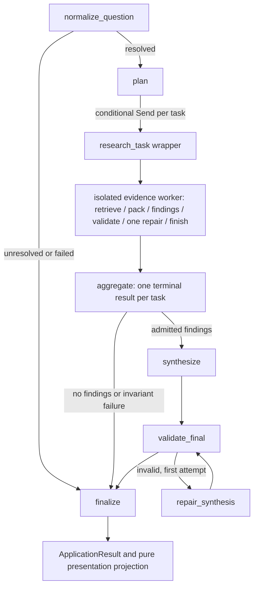

# Architecture

Atlas Localis has one offline Apple Silicon research application. Supervisor
is its orchestration role. `build_supervisor_graph` now composes the canonical
research workflow; it does not select a specialist persona or alternate research
path. The `workbench` package, current Ministral/E5/BGE identities and local data
remain unchanged. UI, CLI, evaluation, preflight and examples use `systems.runner.create_application`.

The actual wrapper invokes the complete compiled worker before returning only
`{results_by_task: {task_id: ResearchResult}}`. Its normal edge to aggregate is
the super-step barrier. Variable inner repair paths cannot commit an early join.
Expected task failures become terminal failed results; fatal graph/reducer errors
produce a failed application result without displaying an uncommitted draft.

## Ownership and contracts

| Module | Responsibility |
| --- | --- |
| `graphs/planning.py` | Whole-exchange conversation budget, identity/contextual normalization, one structured planner call, deterministic deduplication/IDs and full-question fallback. |
| `graphs/research_models.py` | Frozen extra-forbidden wire/domain schemas, exact excerpt identity, statuses, reducer, packets, answer units, results and allowlisted events. |
| `graphs/base_state.py` | Separate application/worker channel and input/output schemas; only task results use a concurrent reducer. |
| `graphs/researcher_graph.py` | Isolated evidence worker, one search, presented exact excerpts, structured findings, reference/date validation and at most one repair. |
| `graphs/synthesis.py` | Plan-order barrier, evidence consistency/provenance union, fair packet admission, structured synthesis/final validation and validated finding fallback. |
| `graphs/execution.py` | Per-run deadlines/cancellation, immutable task contexts, independent shared worker/model/accelerator admission, event sequencing and worker phase hooks. |
| `graphs/supervisor_graph.py` | Nodes/edges, conditional Send dispatch, task wrapper, task parent context; no public execution wrapper. |
| `prompting/citations.py` | Pure canonical evidence-to-numbered-citation rendering. |
| `systems/runner.py` | Factory, injected resources, explicit config/model/snapshot identities, host ownership, run admission, safe stream/invoke and resource cache. |
| `systems/presentation.py` | Pure canonical answer, citation/excerpt and coverage projection shared by presentation consumers. |
| `observability/lifecycle.py` | Application-owned scoped telemetry, terminal JSONL/metrics, flush and provider shutdown. |

The first turn makes no rewrite call. History or summary triggers one constrained
normalization call. Original question bytes remain authoritative; standalone intent
is separate. Null means an unresolved reference; invalid/failed rewriting is a
technical failure. The graph dispatches neither case. Context retains recent
whole user-led exchanges plus at most 2,000 summary characters within a 6,000
character budget, recording truncation. Context is never evidence.

The Stage 5 remediation conservatively asks for clarification when a singular
`it`/`its` follow-up follows an explicit two-item comparison without a named item
or subsequent assistant focus. This is a narrow syntactic ambiguity guard, not
general coreference resolution; other rewrite drift still needs semantic review.

Planning always makes one structured call, even for a simple question. It admits
1..3 independent self-contained tasks, deduplicates NFKC/case/whitespace question
text, ORs duplicate timeline flags, then assigns `t1..t3`. Rejected plans fall
back once to the entire standalone question with a safe cause notice. Deterministic
temporal-word detection preserves explicit chronology requests in fallback; it
is not a complexity gate. No task DAG, recursive planning or model plan repair.
For a one-task plan, code restores the entire standalone question rather than
dispatching model-added scope, recording `single_task_scope_restored` when changed.

## Isolated evidence worker

Worker input contains one task, matching snapshot pin and immutable limits.
Fresh worker channels contain no history, sibling findings, parent registry or
chat memory. The wrapper passes runnable config/callbacks to the subgraph.
Hybrid retrieval owns FTS/vector search, RRF, hydration and optional reranking;
packing reuses hydrated records without another open/rerank/search. At most five
whole chunks, three per document, reach generation. Oversized chunks are skipped.
Unicode offsets and hashes identify exactly presented local spans. Findings use
E aliases, code-assigned task-scoped IDs, canonical evidence keys and optional
verbatim dates. Both initial and repaired statements must be one verbatim span
from a cited excerpt. Prompts request whole relevant sentences/rows with their
qualifiers. This prevents the demonstrated relation changes and unsupported
additions; substring membership still cannot establish relevance or general
entailment if a model clips context. Narrow lexical checks reject absent numeric details, internal
capitalized name cues, quotations and selected certainty upgrades against only
the cited excerpts. Name cues normalize possessives and diacritics; first-word
capitalization and single-letter tokens are not entity evidence. These checks
cannot establish entailment, relevance, negation or historical truth.
`graphs/constrained_evidence.py` prepares bounded verbatim sentence/row choices
from the presented chunks. The native generation schema binds each statement
enum to its evidence alias; local admission checks membership in those same
choices and requires a date label in the selected statement and excerpt. Payload
shapes, evidence keys and strict original Pydantic parsing remain unchanged.
The same contextual schema is shown to the model and enforced by the decoder;
both worker packing and synthesis admission budget its full rendered cost.
Unused generic definitions are removed from these generation-only schemas.
Repeated source statements within a worker and repeated final finding references
are validation errors, handled by the existing single repair/fallback policy.
Sentence splitting is modest and does not certify semantic atomicity or complete
context. Native source selection prevents paraphrase invention; relevance and
source truth still require review.
Invalid findings get one same-evidence repair requiring each repaired statement
to be one verbatim plain span from a cited excerpt. This conservative repair
can return fewer findings and honest gaps; invalid repair still fails closed.
Failed tasks export no findings. Timeline is dated findings, with no extra model/tool call.

## Evidence and final delivery

Aggregate verifies exactly the expected task IDs and pinned snapshot, orders
results by plan and rejects conflicting evidence even if it would be omitted.
Identical excerpts union task provenance. At most twelve findings are admitted
round-robin across tasks, with all their support or none. Alias numbering follows
plan/finding order. Headers/schema/context/excerpts/output/repair reserve all count
under the conservative UTF-8-byte token bound. Omissions become coverage gaps.

Every nonempty admitted packet uses structured answer units referencing F aliases,
including a single task or a single survivor. Code derives citations from findings;
worker prose or citation lists cannot create sources. Validation checks references,
presented provenance, conflict membership and coverage of every admitted task.
Final units must concatenate their whole cited finding statements verbatim in
reference order, separated by one space. The model selects, orders and groups
findings but cannot introduce paraphrased factual wording. The same lexical
checks remain an additional invariant. This conservative synthesis trades fluency
for faithful delivery; unsupported or irrelevant initial findings still require
semantic review. It cannot certify historical truth.
Native synthesis generation is further constrained to one admitted finding per
unit, binding its text to its F alias. The model chooses order and selection.
Local validation and the existing repair/fallback remain active if native
constraints or output completeness fail.
One repair uses the same packet. Exhausted/failed synthesis falls back to validated
cited findings and a partial outcome; failed fallback integrity yields no factual
answer. Status/coverage/gaps and `passed`/`failed`/`not_run` validation remain explicit.
Reference validity and provenance do not prove entailment or historical completeness.

## Scheduler, admission and cancellation

Installed/tested boundary remains Python 3.12.7, LangGraph 1.0.9, langchain-core
1.2.15, langchain 1.2.10, Pydantic 2.12.5. Requirements retain those pins.
Synchronous nested streaming needs scheduler capacity four for the reviewed
three-task graph; the application enforces a floor of four, including
when a test runnable config requests one. Shared semaphores independently admit one worker,
one model call and one accelerator operation across canonical instances. The
accelerator gate conservatively encloses the full hybrid retrieval, serializing
CPU/read portions too. No overlap/performance benefit is claimed.

Defaults: 90 seconds/request, 210 seconds/task after admission, 900 seconds/run
including queue waits; at most ten generation attempts, plus bounded prompt/output
budgets. The HTTP adapter receives the smaller remaining request/task/run timeout.
Other synchronous/native calls use before/after elapsed checks. A deadline rejects
late output and prevents further work; it cannot interrupt native work. Admission
remains held until the call returns. Pass `cancel_event=threading.Event()` to
`Application.stream` or `invoke`; cancellation emits `cancelling` while draining.
Closing a partially consumed stream sets that event and joins the producer.
Supported consumers fully consume or explicitly close their stream. An unreturned
native call can therefore block close: no hard preemption is promised.

A transport timeout/disconnection cannot establish server idleness. Those failures
quarantine accelerator admission and return `resource_not_drained`, without claiming
decoding stopped. Restart the owning application process and inference runtime
before using that resource again. No automatic server kill or guessed idle probe
exists. Host ownership prevents another application process loading a competing stack.

## Shared execution, events and resources

`create_application(resources=Resources(model, retriever, snapshot_id))` injects
model-free resources. Production uses the existing configured llama.cpp/E5/BGE
stack, with no installation, acquisition or index rebuild. `Application.invoke`
consumes exactly the same stream as the UI, returning its `ApplicationResult`.
Raw graph values stay private. Events contain only allowlisted phase/task/stage
metadata and one `run_finished` result, including failure and cancellation. Event
sink or progress-display errors do not alter research. No reducers are replayed
in the UI; no draft, model rationale or token stream is presented. Citation
numbering is already canonical and the presentation projection copies data.

Cache keys include validated config, model settings, resolved snapshot path and
Lance version metadata/optional manifest. Resource initialization takes a host-local
nonblocking ownership lock before loading clients/models. Each store/search handle
checks out the same Lance version. The current legacy directory is identified
honestly by local path/version metadata; it has no invented dump date, model
revision or full corpus manifest. See [data lifecycle](data-lifecycle.md) for bundle provisioning and activation.
A loaded application stays pinned even if the active symlink changes. The shared
resource cache replaces idle resources on key changes, closes their clients and
telemetry, and refuses replacement while busy. Existing answers retain excerpts
and snapshot identity. Missing assets fail locally without downloads.

One process-wide run gate admits a question across tabs and application instances.
A second run receives `failed/resource_busy` without entering the graph. A different
process fails resource initialization with typed `ResourceBusy` before heavy loading;
CLI/evaluation report `resource_busy` and exit nonzero. They cannot start a second
model stack beside a resident UI. The ownership lock lasts until resource close.

All consumers use the same pure whole-exchange conversation selection: up to 100
recent input turns, then the 6,000-character history/summary budget (at most 2,000
summary characters), with explicit truncation. The UI never makes summary-model
calls. Clearing chat resets the transcript and conversation summary and restores
the welcome screen; the application keeps no chat memory.
Evaluation alone exposes recorded forced-single-task and rerank controls; single
research tasks still go through validated findings and final synthesis.

Application telemetry initializes before graph/client creation, uses a dedicated
scoped provider, honors tracing/metrics toggles and records terminal metadata with
the run ID. No global provider is replaced on cache reload. Export is opt-in via
`observability.phoenix_export_endpoint`, a numeric loopback HTTP endpoint; the viewer
address alone does not enable export. Lifecycle flush/shutdown and real task/phase
parentage are tested outside blanket mocks. Full Phoenix viewer/export acceptance,
and remaining data-build telemetry require further acceptance checks. No live viewer or factual quality claim follows from fake tests.

Retired: public graph selectors/flags, graph registries and graph run wrappers,
specialist/complexity routing, math, RAG/decomposer modules, input/output bridges,
standalone researcher consumer and timeline tool/model call. The internal evidence
worker and supervisor builder remain implementation details. Date parsing, BCE/
range/uncertainty preservation, grounding and deterministic date ordering remain
tested. `AgentState` has no consumers and is retired; useful evidence payloads remain.

See [testing and limitations](testing.md) for validation boundaries and reproducible checks.
