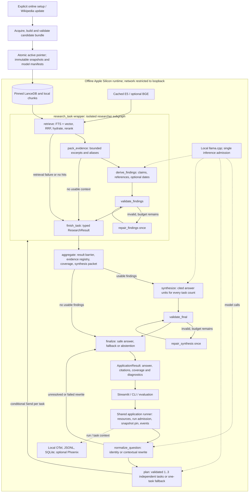

# Atlas Localis — CV-Ready Repository Migration Plan

Planning baseline: 17 October 2026. Architecture review completed: 18 October 2026. Repository: `amwaddell/atlas-localis`. Internal Python package: `workbench`.

This is a planning document, not an implementation. Its location follows the latest request, `docs/migration.md`, superseding the pasted brief's `cleanup.md`. No cleanup, service launch, dependency installation, asset download, Git checkpoint, or configuration change is part of this planning session.

Evidence comes from [the status audit](PROJECT_STATUS_AUDIT.md) and independent inspection of the current working tree: graph builders and callers, local diffs, configuration, model adapters, retrieval/data builders, UI, evaluation, tests, scripts, dependency declarations and installed LangGraph source. Audit runtime results are attributed below; they were not rerun for this review. Only this planning file is modified. Paths describe today's checkout; proposed paths are explicitly identified. LangGraph API evidence and the limits of small model-free probes are recorded in §4; live GitHub metadata and full-stack compatibility were not reverified.

## 1. Target End State

Atlas Localis is a fully local, offline-capable historical research application over a provisioned Simple English Wikipedia snapshot. One Streamlit interface accepts historical questions. One application graph uses a supervisor to plan one or more research tasks, runs a reusable local researcher workflow, and produces an evidence-grounded synthesis with inspectable citations. A simple question gets one task; complexity is internal, never a graph selector.

The supported platform is **macOS on Apple Silicon**, with one validated Python version and a documented memory/disk envelope established through measurement. Keep `src/workbench/` and stable useful contracts. Rename the public distribution to `atlas-localis` during packaging cleanup; this changes installation metadata, not imports. Do not rename the current checkout or move its existing virtual environment merely for branding.

Normal operation uses local llama.cpp, locally cached embedding/reranking models, LanceDB vector and FTS retrieval, local orchestration, Streamlit, and optional local Phoenix. Runtime never downloads missing assets, searches the web, fetches sources, or sends queries/traces to external hosts. Missing assets cause an actionable setup error. Setup and explicit updates may use the internet; this boundary must be enforced and tested, not just described.

Proposed public commands:

```bash
git clone https://github.com/amwaddell/atlas-localis.git
cd atlas-localis
./scripts/setup.sh
./scripts/run_ui.sh
# Later, explicitly online:
./scripts/update_wikipedia.sh
```

Setup provisions dependencies, models, and a validated knowledge snapshot. Launch starts only required local runtime processes and never installs anything. Updates build alongside the active snapshot and activate only after validation. The UI and a local status command identify the active dump and index fingerprint.

The README serves a 30–60-second visitor; `docs/developer/` explains the engineering. Curated screenshots, a representative cited answer, a real local trace, and a modest measured evaluation support the claims. A green model-free CI suite and documented local acceptance run establish reproducibility without pretending CI downloads the full corpus.

## 2. Current State Relevant to Migration

### Confirmed in the current source

| Finding | Evidence and migration consequence |
|---|---|
| Three public graph choices and duplicated assembly | `systems/runner.py`, `ui/components.py`, `scripts/run_researcher_eval.py` construct overlapping stacks. UI streams separately in `ui/graph_runner.py`. Centralize construction and execution semantics, preserving UI progress events. |
| Supervisor is a dispatcher plus an alternative decomposition path | `graphs/supervisor_graph.py` constructs RAG and optional researcher subgraphs. Its decomposition fan-out invokes **RAG**, while timeline routing uses the researcher. Complex questions therefore bypass researcher validation/repair. Replace dispatch choices with one task planner and one researcher contract. |
| Online behavior is real and default-enabled | `configs/defaults.yaml` enables DuckDuckGo. `rag_graph.py` branches on retrieval count, adds web snippets to prompts, and extracts URL citations. Supervisor has a web route. `tools/source_fetch.py` performs HTTP fetches but has no supported graph caller found. Remove capability and wiring, not just the default toggle. |
| Useful retrieval infrastructure exists | LanceDB FTS/vector adapters, deterministic RRF in `retrieval/hybrid.py`, hydration through `stores/chunk_store.py`, reranking, and substantial fixture tests. Retain these rather than changing databases. |
| Local HTTP is not inherently remote inference | `models/llamacpp_server.py` uses an OpenAI-compatible localhost API. This is a local llama.cpp adapter, not an OpenAI cloud requirement. Retain HTTP for the LLM with loopback enforcement. |
| Infinity adds avoidable operational burden | Defaults select HTTP embeddings and reranking. Both in-process implementations already exist. Infinity launcher scripts default to `0.0.0.0` and may execute `pip uninstall optimum` at startup. Replace this operational path after checking in-process correctness/performance. |
| Some configuration is aspirational | `context_builder.py` has no application caller found. YAML describes token-based `heading_aware` chunks, whereas `scripts/build_chunks.py` selects character-based `paragraph_aware`. UI/runner/evaluation use different defaults. Make retained settings effective and reject obsolete ones. |
| Current index builder cannot support safe refresh as-is | `data_build/index_vector.py` reads all chunks and retains all vectors as Python lists, then drops/recreates the target table when overwriting. Manifests lack model revision/checksum provenance. Stage builds away from active data and stream bounded batches. |
| Historical identity has a foundation | `tools/timeline.py`, `TimelineItem`, history questions, citation validation/repair, and date utility tests exist. `tools/utility/dates.py` is not wired into a graph. Do not describe a currently functioning date specialist. |
| Observability primitives need integration | OTel spans, JSONL, SQLite metrics, and Phoenix helpers exist. Normal UI setup calls `setup_tracing` without an exporter. Ingest/chunk scripts import nonexistent `create_phoenix_exporter` and silently catch failure. Repair lifecycle/configuration rather than replacing observability. |
| Public setup is incomplete | README uses a clone placeholder, references nonexistent `scripts/ingest_wikipedia_dump.py`, omits chunk construction and Infinity service setup, describes removed legacy modules, and asks users to choose a graph. `pyproject.toml` declares no application dependencies. |
| Public clutter is identifiable | `tools/wikiextractor` is a tracked gitlink without `.gitmodules`; direct XML ingestion has no caller dependency on it. Trivial smoke checks, a manual pytest substitute, a broken agent-trace notebook, stale graph docs and Day-N annotations need deliberate disposition. |

### Preserve the uncommitted work

At this review's start, `git status --short` shows modified `graphs/decomposer.py` and `graphs/supervisor_graph.py`, plus **both** untracked `docs/PROJECT_STATUS_AUDIT.md` and `docs/migration.md`. The original audit predates the plan. Preserve all four explicitly when checkpointing; an ordinary tracked-file diff does not preserve either document. The two tracked diffs total **331 insertions / 196 deletions**.

The decomposer changes add short `REF_A1` citation labels, reverse mapping, handling of `None` state fields, partial-result behavior, and aggregation. Supervisor changes normalize missing/`None` fields before UI/runner consumption. These solve relevant problems and should be checkpointed and carried forward deliberately.

They are not yet an accepted finished design:

- `tests/test_decomposer.py` imports `_format_sub_answers`, removed in the local implementation; this explains the audit's collection failure and is directly confirmed by inspection. Align tests with the intended contract; do not restore an obsolete helper merely to hide the mismatch.
- `prompting/templates/synthesize_answers.txt` still requests raw `[chunk_id]` preservation while the code supplies short labels. Real template execution needs regression coverage alongside fallback prompts.
- `_strip_invalid_brackets` removes unknown markers without proving remaining claims are supported; with an empty valid-ID set it returns text unchanged. Synthesis needs explicit invalid/uncited claim handling.
- Synthesis treats any nonempty worker answer as successful, including possible abstention text. Its single-success passthrough can hide missing subtasks; its exception fallback lists all valid IDs rather than only citations actually present. Preserve useful behavior while introducing explicit task status and honest partial coverage.
- Current fan-out uses threads and shared clients. Ordering is recovered by question text, which is weaker than stable task IDs. Context propagation, client/model safety, duplicate tasks, bounded concurrency, and cancellation require tests.

Further architecture findings from the current implementation:

- Supervisor rewriting is duplicated inside RAG: dispatch forwards chat history, so decomposed tasks can be rewritten again. Both rewrite implementations skip summary-only context. The template's 20-word *search query* instruction can drop constraints before planning; intent normalization and retrieval formulation need different contracts.
- Researcher always extracts a timeline before writing an answer. A timeline exception sets the shared `error`; validation then returns `valid=True` when any error exists or the answer is empty. Repair exhaustion can return invalid prose. Neither skipped validation nor a nonempty abstention is evidence of success.
- `_build_label_map` and synthesis's valid-ID union accept worker citation IDs absent from `opened`. The target registry must be constructed from locally hydrated evidence, never from model citation lists.
- `HybridRetriever` already hydrates candidates for reranking, then tools reopen selected chunks. Reuse these primitives but return ranked hydrated records to the worker instead of adding a second reranker. The unused context builder admits an oversized first chunk and estimates header cost before interpolation; it cannot be adopted unchanged as a hard budget gate.
- UI reconstructs state with `accumulated.update(update)`, bypassing reducers, and mutates the answer during numberization. Evaluation builds separate components and converts results to the legacy `AgentState`. UI-only history summarization makes semantics diverge further. These are consumer-boundary problems, not reasons to enlarge graph state.

### Audit evidence retained with limits

The audit reports real local Metal LLM execution, working E5/HTTP reranking/hybrid retrieval, a successful RAG answer, 277,095 processed articles, and 430,910 chunks matching the database. It reports 781 passing tests outside the decomposer file, one skipped, 23 deselected, and 31 Ruff violations. These are historical baseline observations, **not current green-suite claims**.

It also reports no ANN acceleration index beyond FTS, no vector build provenance, no tracked evaluation report, four ignored single-question reports, no root license or CI, and sparse public GitHub metadata. Tracked-file inspection supports the absence of root license, workflow, and committed data/run outputs. Full real supervisor/decomposition quality, clean-install compatibility, Phoenix UI export, peak memory, setup duration, and factual accuracy remain unverified. Existing assets working on this laptop do not establish fresh-clone reproducibility.

## 3. Key Architectural Decisions

Change classes: **N** necessary architecture; **S** simplification; **C** cleanup; **P** presentation; **O** optional future work.

| Decision | Current state | Target state, rationale, consequences |
|---|---|---|
| Canonical graph — N | Public RAG/researcher/supervisor selection | Retain `build_supervisor_graph` as the sole application builder and evolve the internal researcher; retire public RAG after migration. Explicit topology and ownership in §4. |
| Supervisor — N/S | Heuristic/LLM router chooses web, timeline, math, or RAG | Overall orchestration role: normalize, plan, dispatch, aggregate, synthesize, validate. Graph-visible phases; dispatch and small transforms remain helpers. Remove specialist routers. |
| Decomposition — N | SINGLE or string-list parsing; max five questions | Choose one structured planner call for 1..3 independent tasks; stable code-assigned IDs, exact duplicate handling and one full-question fallback. No complexity classifier, task DAG or LLM plan-repair loop (§4.2). |
| Researchers — N | RAG for fan-out; richer researcher only on timeline route | Every task runs one bounded hybrid retrieval → evidence packing → structured findings → validation/one-repair workflow. Dates are optional finding fields; no mini final answers or worker chat rewrite. |
| Concurrency — S | Four fan-out threads by default | One active worker and one accelerator operation by default, independently of LangGraph scheduler capacity. Installed nested sync streaming needs more than one scheduler slot (§4.1/4.5). |
| Synthesis — N | Label translation and merge; no equivalent final strict gate | Deterministic packet assembly, then structured answer units referencing findings, including for one task. Validate/repair once; explicit cited evidence fallback on failure (§4.6). |
| Citation integrity — N | IDs/density checks and UI numberization | Canonical snapshot/chunk/excerpt identity; temporary evidence/finding aliases; numbered citations derived in code. Separate validity, run provenance and unproven semantic support (§4.6). |
| Local-only runtime — N | Defaults allow external calls and model cache misses may download | Runtime model loads use explicit provisioned local paths and download-disabled options. Validate every network endpoint as numeric loopback, avoid ambient HTTP proxies, reject remote endpoints/redirects and irrelevant cloud exporter variables. Bind UI/LLM/Phoenix to loopback. Provisioning is the sole online acquisition path. |
| Web removal — N/C | DuckDuckGo/Tavily, source-fetch utility, web fields/prompts/renderers | Delete online tools, exports, provider config, API-key handling, fallback nodes, web routes and URL-citation feature. Keep corpus source URLs as provenance strings; ordinary citation inspection reads local evidence. No automatic requests or external previews. |
| Retrieval — retain/S | Keyword + vectors + RRF + rerank + hydration | Keep LanceDB and deterministic hybrid retrieval. Wire a tested context packing step with document diversity and prompt/output token budget. Keep stable chunk IDs. Do not add FAISS, a second FTS store or ANN merely for appearance; consider ANN only if measured query latency warrants it. |
| Chunking — S | YAML token strategy differs from actual character chunker | Standardize the existing tested paragraph-aware character chunker and explicit units. Preserve its algorithm/IDs unless evaluation justifies a change. Context token budgeting is separate from chunk construction. Configuration/manifest must match actual execution. |
| LLM serving — retain/S | Native llama.cpp launcher and HTTP adapter; optional Python-server comments | Standardize native Metal `llama-server`, the current Ministral-3 8B Q4_K_M as the initial candidate, loopback-only API and pinned binary/build provenance. Remove competing installation stories. Do not replace a working model without measured quality/resource benefit. Exact supported versions and licensing are implementation-time checks. |
| Embeddings — S | E5 HTTP default plus in-process adapter | Recommend cached in-process `SentenceTransformerEmbedder`, MPS with explicitly tested CPU fallback, loaded once per app resource cache. Keep E5 revision, 768 dimensions, normalization and query/passage prefixes. Verify parity against existing vectors before reusing the index. A new model/revision/prefix policy requires a new index. |
| Reranking — S | BGE HTTP plus in-process CrossEncoder | Retain reranking capability using the existing in-process adapter; benchmark on/off. Recommended initial baseline remains enabled to compare with today's stack; select the final default from relevance and memory/latency measurements. An explicit disabled setting is valid; a configured reranker that fails to load must not silently disappear. |
| Infinity topology — S | Two extra servers, undeclared setup, startup uninstall workaround | Remove HTTP embedding/reranking adapters and launchers after parity/resource validation. If in-process inference proves infeasible, document measured evidence and revise this decision explicitly before retaining a single strictly local service. Do not keep two permanent architectures as speculative portability. |
| Data lifecycle — N | Active directory and snapshot settings, no realized snapshot workflow | Immutable, versioned snapshot bundles with one atomic active pointer; stage and validate before activation. Keep XML/parquet/chunking primitives. Add provenance and bounded/resumable embedding. No scheduler, distributed pipeline or external registry. |
| Runtime assembly — S | CLI/UI/eval/preflight diverge | One application factory and execution/event adapter for UI/CLI/evaluation/preflight. Invoke consumes the same stream to its canonical result; no UI state reconstruction or hidden summarization. |
| Observability — retain/N | Useful primitives, inconsistent exporter lifecycle | One bootstrap obeys tracing/metrics settings, explicitly attaches optional local Phoenix exporter, propagates run/OTel context into worker tasks, flushes at shutdown. Failures in optional trace viewing do not prevent answering; remote export is rejected. |
| Historical scope — N/P | Timeline extraction and generic questions | Retain optional evidence-backed timelines. Prompts distinguish dates/ranges/uncertainty, direct evidence and synthesis; compare accounts only where retrieved evidence supports them. Simplewiki is an accessible local encyclopedia, not a primary-source archive or historiographical consensus engine. |
| Generic extension machinery — S/C | Registry, ToolSpec, protocols, LangChain adapters | Keep protocols, typed evidence and ToolSpec where active validation/instrumentation helps. Remove registry-driven provider/plugin promises and unused adapters only after caller analysis. Do not rewrite stable contracts to remove a small harmless abstraction. |

In-process loading by local filesystem path must not accidentally disable E5 prefix detection, currently inferred from `model_name`. Store the semantic model ID and prefix policy separately from the resolved cache path. Likewise validate CrossEncoder score shape/activation and device behavior rather than assuming HTTP and local scores are numerically interchangeable.

## 4. Proposed Final Architecture

### Architecture Review Conclusions

**Supervisor means the orchestration role of the entire application graph**, built by `build_supervisor_graph`; it is not an autonomous persona or a node that hides the whole run. Keep graph-visible normalization, planning, research, aggregation, synthesis and validation. Dispatch is a conditional-edge function; ID assignment, deduplication, date sorting and rendering are Python helpers. Nodes are justified by model calls, state boundaries or repair decisions, not by the desire for a larger diagram.

Affirm one canonical application, independent bounded tasks, the reusable researcher, hybrid retrieval, local resource limits, immutable snapshots and a shared runner. Change prose-producing workers to evidence-linked findings; eliminate the single-answer passthrough and repeated worker rewriting; fold optional timeline extraction into findings; replace ad hoc threads with LangGraph `Send`; replace overloaded `decomposer.py` ownership with small planning/synthesis modules. Retain short model-facing references, but stop translating citations through worker prose. Split Stage 2 into four checkpoints (§14).

Implementation measurements still decide JSON/schema reliability and output budgets on the local 8B model, planning overhead versus the forced-single-task control, one-query evidence coverage, context packing quality, deadlines, reranking default and safe resource overlap. The architecture is the baseline to test; relax a bound or add retrieval iteration only after a recorded quality/latency failure justifies it, with updated tests and documentation.

Technically this is **a bounded supervisor/worker research workflow with LLM planning and RAG workers**. “Multi-agent RAG” is only shorthand with that qualification. Workers have isolated task state and model-derived findings, but no autonomous tool selection, inter-agent conversation or open-ended research loop. The defensible engineering claim is observable orchestration and evidence handling, not a claim that every node is an agent.



Repair uses the same local LLM and evidence packet; omitted model arrows keep the diagram readable. The `research_task` wrapper returns only one terminal task result; its inner nodes never write parent channels. `finalize` handles all exits, validates any deterministic fallback, and creates the only public result. Resource initialization and progress presentation remain outside the graph.

### 4.1 Verified framework boundary

`requirements.txt` declares `langgraph>=0.2.0`, `langchain-core>=0.3.0`, `langchain>=0.3.0`; `pyproject.toml` declares no application dependencies. Installed metadata identifies **LangGraph 1.0.9 and langchain-core 1.2.15**. Do not imply every version admitted by those lower bounds supports the target. Stage 2a records and constrains the tested environment; Stage 4 produces the full clean-install lock. No upgrade is required just to obtain `Send`.

Installed `langgraph/types.py`, `graph/state.py` and `pregel/main.py` confirm `Send`, `StateGraph` reducers, separate input/output schemas, nested invocation, `stream` modes `updates`/`values`/`custom`, and subgraph streaming. The official [Graph API](https://docs.langchain.com/oss/python/langgraph/graph-api#send), [subgraph guide](https://docs.langchain.com/oss/python/langgraph/use-subgraphs) and [streaming guide](https://docs.langchain.com/oss/python/langgraph/streaming) corroborate these concepts. Current upstream examples may use newer APIs; this plan does **not** require newer `stream_events` variants or an unverified per-node timeout API.

Read-only, model-free probes in the existing environment confirmed dynamic dispatch into a nested worker, different inner path lengths, one aggregate invocation after all results, and deterministic ordering with scheduler limits 1 and 2. A separate synchronous streaming probe stalled with `subgraphs=True, max_concurrency=1`, including a trivial graph without nested work; it was interrupted. Installed source submits a streaming waiter to the same executor, consistent with starvation at one slot. A three-worker probe with **four scheduler slots and a separate one-worker admission gate** completed, emitted nested updates/values, and aggregated once. This is narrow API evidence, not application or cancellation acceptance. Preserve a bounded-time regression in Stage 2c; never equate scheduler threads with simultaneous inference or patch private LangGraph internals to work around this.

### 4.2 Intent normalization and planning

`ConversationInput` holds the original question plus ordered prior user/assistant turns; the current user turn is not duplicated in history. The runner applies one deterministic history budget (recent complete turns plus any explicitly supplied prior summary), records truncation, and passes the same input in UI/CLI/evaluation. Remove UI-only model summarization for this release: it adds hidden calls, cost and drift. Older references outside the retained context require clarification. Prior assistant prose and summaries are context for interpreting the question, **never evidence**.

`normalize_question` always exists as a graph boundary but calls no model for a first turn without context. With history **or a summary**, make at most one constrained rewrite call: preserve entities, date bounds, comparisons, exclusions and uncertainty; resolve references without shortening into a keyword query. Store the original unchanged and the standalone question separately. Validate nonempty/length-bounded output; a model-declared unresolved reference produces an insufficient-evidence result with a clarification message. A technical/invalid rewrite produces `failed` with `rewrite_failed`, not a guessed antecedent. No rewrite repair loop. Use a minimal rewrite payload `{standalone_question: str | null}`: null explicitly means an unresolved reference; code derives identity/resolved/unresolved status and diagnostics, never a model rationale. Structural checks cannot establish semantic equivalence; include paired-turn drift judgments in evaluation.

The planner receives original intent, standalone question and the same bounded context, with the original authoritative and history explicitly untrusted as factual evidence. Synthesis receives original and standalone questions and relevant conversational context for wording; workers receive only fully specified tasks. A worker never rewrites the conversation again.

| Routing alternative | Assessment |
|---|---|
| A: one planner produces 1..N tasks | **Choose this.** One small structured call, one result contract, no classifier/planner disagreements. Simple questions pay a planning call; measure its cost. |
| B: deterministic complexity gate before planning | Saves that call for some simple cases but creates brittle language rules and two paths for omissions, multi-turn intent and evaluation. Keep forced-single-task as an evaluation control, not a public router. |
| C: LLM complexity gate then planner | Adds a serial call on complex questions and another unreliable decision for an 8B model. Reject. |

`ResearchPlan` contains `tasks` and application-generated `warnings`; it references the run's normalized input instead of duplicating question strings. The model emits only a small `tasks` JSON object, validated by Pydantic v2 with forbidden extra fields. `ResearchTask` has code-assigned `task_id` (`t1`, `t2`, `t3`, stable in plan order), a short `label` for progress, a self-contained `question` including scope/time constraints, and `needs_timeline: bool`. No redundant objective field, confidence number, persona, task-type taxonomy or dependency list. IDs and warnings are not entrusted to the model.

Bounds and validation:

- **1..3 tasks**, replacing the current cap of five. Three gives useful comparison/facet coverage while bounding local latency and synthesis context. Default to one; split only independently searchable facets, not every clause or start/end date. A broader request groups facets into at most three scopes. Preserve the original question for synthesis/coverage review: code cannot detect every facet the planner omitted, so human evaluation must measure that loss.
- Independent tasks only. If a question needs discovering an entity before searching it, do not invent that entity or build a task DAG. Keep one broad task; this release may report a gap. Iterative discovery is an evaluated future extension.
- Enforce maximum field lengths, nonblank questions, boolean flags, total output-token budget and count before dispatch. Trim whitespace and deduplicate normalized question text (Unicode normalization, case and whitespace); combine duplicate timeline flags with OR. Assign IDs **after** deduplication. Do not embed tasks or call another model for semantic duplicate detection; measure semantic redundancy separately.
- A valid one-task plan uses exactly the same dispatch/worker/aggregation/synthesis path. Empty, oversized or otherwise malformed plans are rejected rather than silently dropping requested facets. Apply only deterministic normalization/deduplication, **no LLM plan repair**. On parsing, schema or planner-call failure, issue one task with the entire standalone question, preserve explicit timeline intent conservatively, and record `planner_fallback` with its cause. Planning failure alone is not research failure.
- Prefer a small JSON schema response when the pinned llama.cpp build/adapter supports it; otherwise prompt for JSON and call `model_validate_json`. Existing `LlamaCppServerModel.generate` filters settings and has no structured-output forwarding; do not assume LangChain's `with_structured_output` exists on this custom adapter. Stage 2a adds/tests the narrow capability or the explicit validated-JSON fallback. No regex extraction of arbitrary prose, permissive `SINGLE` prefixes or unbounded repair protocol.

### 4.3 State and ownership contracts

Use `TypedDict` for graph channels with explicit input/output schemas and initialized defaults. Use Pydantic v2 for validated domain payloads and model boundaries; freeze published objects and use immutable tuples or defensive copies for nested collections (a frozen model alone does not freeze a list). Ordinary dataclasses suit runtime services/context. Avoid inheriting every workflow from today's all-optional `RAGState` and avoid a general-purpose messages/tool-call scratchpad.

| Contract / state | Contents and ownership |
|---|---|
| `RunContext` (runner-owned) | Run ID, monotonic deadlines/cancellation, resource gates and event sink. Services/model clients/store handles are dependencies, never serializable graph state. Pin one immutable snapshot per run; fingerprints record code/config/prompts/models/corpus and experimental overrides. |
| `ApplicationState` | `input`, `normalized_question`, `plan`, reducer-backed `results_by_task`, `synthesis_packet`, `draft`, `final_validation`, `repair_count`, `result`. Typed phase payloads replace dozens of unrelated optional keys. Only phase owners write non-reducer channels. |
| `WorkerInput` | One task, snapshot identity and immutable limits. The wrapper verifies these against its injected run resources. No parent state dict, chat history, sibling findings or parent registry. |
| `WorkerState` | Task/input, retrieval outcome, packed evidence, findings draft, validation report, repair count, terminal `ResearchResult`. Fresh for each dispatch; no cross-task message memory/checkpointer. |
| `ResearchResult` | `task_id`, `status`, validated `findings`, `evidence`, `gaps`, structured `warnings`, optional typed `error`, diagnostics (counts/timings/usage). No mini answer, raw reasoning or independently maintained citations list. Failed tasks export no eligible findings. |
| `Finding` | Code-assigned task-scoped ID, one bounded factual `statement`, nonempty `evidence_refs`; optional `date_text` only for a dated event. No model probability masquerading as confidence. Validation guarantees reference integrity, not truth. |
| `EvidenceRecord` | Stable key `(snapshot_id, chunk_id, start, end)` for an exact presented text span; document/title/section, text/hash, local source metadata. Offsets use Python Unicode character positions into the immutable full chunk. Provenance includes which task retrieved/opened/presented it. No model-supplied source records. |
| `SynthesisPacket` | Original/standalone intent and bounded context, ordered plan/results/statuses/gaps, admitted findings with short aliases, their bounded evidence excerpts, provenance registry and budget omissions. Aggregate builds this once; synthesis and repair use the same immutable packet. |
| `ApplicationResult` | Run outcome, canonical answer units and citation references, rendered answer/citation map, task coverage, gaps/conflict annotations, diagnostics and fingerprints. Raw graph drafts stay internal. This replaces evaluation's lossy conversion through `AgentState`. |

Only `results_by_task` needs a concurrent reducer. Merge new mappings without mutation; disjoint keys combine, identical duplicate terminal results are idempotent, conflicting results for one task ID raise an invariant error. The reducer is associative/commutative on valid inputs and never silently chooses the last writer. No append-reduced shared evidence list, token counters or mutable global run object. Aggregate computes registry, coverage and totals from unique terminal results in **plan order**, independently of completion order. Initialize fresh state for every question; no persistent LangGraph checkpointing/resume is required for this release.

### 4.4 The researcher is a bounded evidence workflow

Evolve `researcher_graph.py` because it already has retrieve/open/validation/one-repair boundaries. Reuse tested functions/types from both current graphs; do not preserve the current answer/timeline/error semantics merely to retain node names. RAG's conversational rewrite moves to the application, not into the worker. Retire public `rag_graph.py` after caller migration.

1. **`retrieve`** uses the task question directly for one hybrid search: keyword + query embedding/vector search → deterministic RRF → bounded candidate hydration → optional reranking. Retain the existing `HybridRetriever` ownership of these operations with child spans; do not create a graph node for every library call or rerank twice. Adapt its internal result to expose ranked hydrated chunks and retrieval diagnostics so opening need not repeat database work. Missing selected chunks are recorded, not silently swallowed.
2. **`pack_evidence`** selects a diverse bounded set, creates exact excerpts/offsets and task-local aliases `E1…`, and records which text reaches generation. Initial limits: existing candidate pools (20 keyword, 20 vector, merge at most 50), at most five presented chunks per task, at most three per document. Prompt budget includes rendered headers, schema/instructions, question and reserved output plus margin. Skip or deterministically excerpt oversized chunks; never force an over-budget first chunk. Stage 2b enforces budgets; Stage 3 calibrates tokenizer/device/performance choices.
3. **`derive_findings`** makes one low-temperature structured call: at most eight atomic statements, each referring to supplied `E` aliases, and up to three concise gaps. If `needs_timeline`, dated findings carry the source's date expression. A response may explicitly contain no supported findings. One query will not answer every question, but there is no evidence yet that an extra worker rewrite or iterative search justifies latency and branching. Release bound is **one search per task, three per run**; no ReAct loop, tool menu or second search hidden in repair.
4. **`validate_findings`** checks schema, lengths, references, presented-span provenance and date-field consistency. Unknown references are errors, not filtered away. Empty findings with a valid insufficient-evidence response do not need a repair. Invalid structured output gets one `repair_findings` call using exactly the same evidence and explicit errors; revalidate. Repair may remove unsupported statements, never “keep the facts and just fix IDs.” If still invalid, fail the task; do not salvage arbitrary fragments of unparseable JSON.
5. **`finish_task`** assigns finding IDs, derives status, packages only validated findings and their evidence, and records unused/opened counts separately. No hits or no relevant supported findings is `insufficient_evidence`; technical failures are `failed`. A task with useful findings but acknowledged missing scope is `insufficient_evidence` with nonempty findings, so synthesis can use the supported portion. `complete` requires usable findings and no known task gap, not proof of historical completeness.

Timeline is a projection of dated findings, **not another mandatory LLM call** or separate specialist. Reuse useful `TimelineItem` tests/prompts, merge their grounding requirements into the findings schema, and retire the graph's `TimelineTool` call/export once all callers migrate. Deterministic post-processing preserves original date strings, era, ranges, precision and approximation; sorts only what can safely be ordered. Today's date helper collapses ranges to starts, so reuse only safe pieces with tests. Do not force BCE/uncertain dates into Python `datetime` or turn “c. 500” into an exact day. A missing requested chronology is a gap, not silently successful empty output.

### 4.5 Dispatch, barrier and local resource constraints

After planning, a conditional-edge helper returns `Send("research_task", WorkerInput(...))` for each validated task. `research_task` is a small adapter that acquires a worker slot, invokes the compiled worker subgraph with isolated input and inherited runnable callbacks/config, catches expected task exceptions, and returns `{results_by_task: {task_id: result}}`. It must remain a boundary wrapper, not contain planning/retrieval/synthesis itself. A normal edge from that wrapper to `aggregate` provides the fan-in after all dispatched wrapper executions in the super-step finish. Inner repair loops have finished before a wrapper returns; thus variable worker path lengths do not create an early join. Test this explicitly rather than relying on a diagram.

Aggregate verifies exactly the expected task-ID set and snapshot identity. Unknown/conflicting task IDs are invariant failures. Ordinary worker failures/timeouts arrive as terminal results so siblings can finish. Never rely on LangGraph automatically converting thrown worker exceptions into partial success: an escaping exception can abort the super-step. Whole-run cancellation or fatal graph failure yields a runner-owned terminal result; do not pretend a lost super-step's updates were committed. Unexpected missing results are a failed barrier, not evidence of absence.

| Resource | Release policy |
|---|---|
| Active questions | One admitted run for this single-user app. Shared runner resources/gates across Streamlit reruns/tabs; CLI/evaluation must not launch competing full model stacks. Acquire a host-local resource-ownership lock before heavy loading and hold it for the resource-cache lifetime; use a separate in-process single-run gate across UI tabs. CLI/evaluation returns `failed` with `resource_busy` before graph entry while another process owns those resources. This prevents loading a second full model stack beside a resident UI; closing its resource owner releases the lock. |
| Worker workflows | One active worker by default; logical `Send` fan-out still provides isolated tasks, IDs and a join. Slots >1 are a measured opt-in, not a consequence of task count. |
| LangGraph scheduler | For installed sync nested streaming, start with `max_concurrency=4` (three possible dispatched wrappers plus a waiter); separate admission gates enforce resource policy. Verify wrapper/subgraph streaming with a deadline in Stage 2c. This is **not** four decodes. |
| LLM generation | One process-wide inference admission gate, bounded wait and request deadline. Configure local llama-server capacity consistently; planner/normalizer/worker/repair/synthesis all use it. Do not hold a model gate while invoking an entire subgraph. |
| Embeddings / reranking | Reuse loaded resources. Serialize access to each instance; initially use one shared accelerator gate across E5, BGE and llama.cpp calls to avoid overlapping Metal work/unified-memory spikes. CPU fallback also starts bounded. Stage 3 may relax overlap only with peak-memory/latency measurements. |
| LanceDB reads / CPU helpers | Read-only pinned handles; serial baseline. Up to two independent read operations may overlap only after client safety and benefit are demonstrated. No bespoke thread pool for trivial packing/date logic; bound library CPU thread pools if measurements show oversubscription. |

Use explicit request, task and run budgets, covering queue waits as well as computation. Provisional limits for measurement: 90 seconds per LLM call, 210 seconds per task after admission, 900 seconds per run including waiting; never start a call past remaining time. Model-call count is bounded by `optional rewrite + 1 plan + N*(1 findings + at most 1 repair) + 1 synthesis + at most 1 final repair`, at most **10** for N=3. Context/output-token budgets independently cap work. No automatic whole-graph retries; transport retries cannot multiply this budget invisibly.

Check cancellation before admission and between operations. The current synchronous HTTP/native model calls cannot be assumed forcibly cancellable: a caller timeout or cancelled future does not stop a C/Metal kernel or guarantee llama.cpp stopped decoding. Mark timed-out work ineligible, discard late results, retain its resource slot until actual completion/server-idle confirmation, and report “cancelling” while draining. Do not kill unrelated services. A hung native call may require restart of the owned runtime; hard preemption is not promised. A per-task timeout can still allow sibling completion once resources are safe; a user cancel stops the run and schedules no synthesis.

### 4.6 Evidence, citations and synthesis

The evidence lifecycle is explicit:

```text
snapshot chunk -> retrieved candidate -> hydrated local chunk
 -> exact presented excerpt (EvidenceRecord + task-local E alias)
 -> validated Finding with canonical evidence references
 -> aggregate registry + synthesis finding aliases F1… + supporting excerpts
 -> answer units referencing F aliases -> canonical finding/evidence references
 -> deterministic numbered citations and local source panels
```

Keep chunk IDs unchanged. Canonical evidence identity includes snapshot and excerpt offsets; different excerpts from one chunk remain distinct evidence records. Deduplicate identical records and union their task provenance deterministically. Same key with different text/hash is a fatal consistency error. A chunk used only for reranking is not presented evidence. A model citation list can never create a registry entry. Model-visible aliases are temporary, packet-scoped conveniences, never persisted source identity. This preserves the useful short-reference idea without `REF_A1` substitution across mini-answer strings or fallback lists of every known ID.

Workers generate claims against `E` aliases; code resolves them to canonical evidence keys only after validation. Synthesis primarily consumes **structured findings plus the exact supporting excerpts**, not worker-written essays. Packing admits at most twelve findings total, reserves space fairly across tasks, and keeps a finding with all its support or omits the whole finding with a budget gap. This also bounds the deterministic fallback to twelve units. Budget selection is deterministic in plan order with round-robin allocation, not whichever worker finishes first. The synthesis reference whitelist is only the admitted packet, not all retrieved/opened chunks. Label assignment follows plan/finding/evidence order, so completion order cannot change references.

`aggregate` deduplicates evidence, retains task-scoped findings even when statements coincide, and performs coverage accounting and packet construction. Shared sources cannot erase a task's provenance or count as independent corroboration. It does not claim to detect all semantic conflicts. `synthesize` receives task statuses/errors/gaps even when a task supplies no findings; failed/missing output is never evidence that a historical event did not occur. With any usable findings, **always synthesize**, including one task: findings are not a final answer, and a single surviving task may leave other tasks unanswered.

Use a small validated `AnswerDraft` with at most twelve answer units, each `{text, finding_ids}`; `finding_ids` uses short `F` aliases. Each unit is a short claim or tightly related comparison with at least one supporting finding. The model does not emit citation markers, source IDs, arbitrary Markdown links or factual headings. Code attaches citations from referenced findings, and controlled headings/gap notices supply presentation structure. Optional conflict groups contain at least two finding IDs and are treated as model-reported disagreements, not independently verified contradictions. Treat quoted corpus text and prior conversation as data, never instructions that can change schemas, citation rules or tool access. The prompt must preserve conflicting accounts/uncertainty and cite both sides; do not majority-vote duplicated encyclopedia chunks. Runtime cannot prove that the wording represents every disagreement correctly.

`validate_final` checks schema, nonempty bounded units, all finding/evidence references, registry provenance, absence of embedded invented markers, and coverage of tasks with admitted findings. Omitted tasks and known worker/budget gaps must remain visible. It cannot detect every uncited clause hidden inside a unit. On failure, one `repair_synthesis` uses the **same** packet and may remove/rewrite unsupported claims. Validate again. Unknown IDs are never stripped to make prose appear valid.

On synthesis exception or invalid output after repair, discard the draft and deterministically render the already validated findings grouped by task, with their citations and explicit gaps; flag `delivery=evidence_fallback` and run outcome `partial`. Apply the same mechanical final checks to this fallback. If no usable findings exist, skip generation and finalize an honest insufficient-evidence/technical-failure message. If even registry/fallback integrity fails, return `failed` and no factual answer. An unnecessary planner task still appears in coverage; synthesis may de-emphasize it but cannot silently relabel its failure as success. Planning redundancy is evaluated, not “fixed” by hiding tasks.

Three different guarantees must remain separate:

| Property | Runtime enforcement / limit |
|---|---|
| **Validity** | Every rendered reference resolves; answer-unit references determine the citations list. No phantom markers or independently inferred citations. |
| **Provenance** | Each reference points to text retrieved, hydrated and presented in this task/run/snapshot, then admitted to synthesis through a validated finding. Recorded offsets/hash allow local inspection after snapshot updates. |
| **Support / entailment** | A valid reference can still be irrelevant, and synthesis can overstate a finding. Prompts, exact excerpts, atomic units and one repair reduce risk; deterministic checks cannot prove entailment. Human claim/excerpt review and held-out evaluation measure worker support, synthesis faithfulness and uncited material assertions separately. |

Numbering is a **pure presentation projection**, once per final result: assign numbers by first appearance, group by `(snapshot_id, chunk_id)` for the UI, and retain all cited excerpt spans/finding associations under that source. Store canonical units/references alongside rendered text; do not mutate graph state with `numberize_result`. CLI/UI/evaluation use the same projection and canonical result. Opening a citation reads the pinned local chunk and highlights the cited spans, never the current active snapshot by accident.

### 4.7 Failure and completion semantics

Worker statuses remain **`complete`, `insufficient_evidence`, `failed`**; separate reason codes/errors avoid many overlapping statuses. Run outcomes add **`partial` and `cancelled`**, since these represent user-visible aggregate/control outcomes. Validation reports use `passed`, `failed`, or `not_run`; skipped/error paths must never masquerade as passed. `complete` means bounded workflow/coverage checks passed, not that factual accuracy has been proven.

| Condition | Required behavior |
|---|---|
| Planner fails or produces unusable plan | One full-question task plus warning; can still finish complete. |
| Retrieval returns no hits | Worker insufficient, zero findings; do not call generation or repair. |
| Hits exist but no relevant support / valid model abstention | Worker insufficient; record gaps. Useful validated partial findings may be retained. |
| Retrieval/hydration/model exception, invalid findings after repair | Worker failed with typed stage/reason; skip downstream generation as appropriate. Partial missing-chunk opens may proceed with warnings, but total hydration failure is technical failure. |
| Some tasks complete or supply usable partial findings | Synthesize supported material and display uncovered tasks. Aggregate outcome partial if any task has gaps/failure or synthesis omits required coverage. |
| All tasks insufficient and no findings | Insufficient-evidence answer; no synthetic historical conclusion and no citations. |
| No findings and at least one technical failure | Failed answer attempt with task breakdown; cannot conclude the corpus lacks the answer. |
| Synthesis failure / final validation exhausted | Validated evidence fallback, partial; otherwise failed with no unsupported draft displayed. |
| Unresolved conversational reference | Insufficient-evidence outcome with `ambiguous_reference` and a concise clarification request; no research dispatched. Technical rewrite failure is failed. |
| Cancelled run / fatal barrier or registry invariant | Cancelled / failed terminal application result respectively. Do not render an in-progress draft as an answer. |

Warnings are bounded machine-readable codes with safe messages, not exception dumps in the UI. Keep full technical diagnostics locally under the run ID. UI shows plan labels, task statuses/source counts, coverage and operational issues; no model rationale or hidden reasoning.

### 4.8 Shared execution, events and module ownership

`systems/runner.py` constructs a single application from validated config, resources and snapshot resolver; exposes `invoke(ConversationInput) -> ApplicationResult` and `stream(ConversationInput) -> ApplicationEvent…`. Implement invoke by consuming the same execution stream through its terminal result, not by maintaining a second lifecycle. Inject fake resources/event sink for tests. Cache expensive resources by explicit model/config fingerprint and store handles by snapshot identity; current Streamlit underscore-prefixed arguments must not silently erase invalidation keys.

The thin event adapter consumes LangGraph `updates` and terminal `values` (nested streaming where verified). Node-entry progress can use bounded typed `custom` events or an injected event sink; the custom model HTTP client does not magically emit LangChain token streams. Allowlist application events such as `run_started`, `normalizing`, `plan_ready`, `task_started`, `task_stage`, `task_finished`, `synthesizing`, `validating`, `run_finished`; include run/task IDs and a monotonic event sequence. “Planning…” is a start event, not a label shown only after planning completes. Coalesce noisy updates; keep source counts/statuses, never pass raw state/prompts/drafts/debug streams to UI. Event delivery failure must not change research semantics.

Transient progress is not a graph-state log. Persist only final task outcomes, coverage, diagnostics and result. Obtain final state from the graph's terminal value/output; **never** replay reducer updates with UI `dict.update`. Exactly one `run_finished` carries the canonical result (including handled failure/cancellation). Tests compare invoke and streamed terminal results after excluding timestamps/run IDs, and verify no private state is exposed. User cancellation goes to the runner, not to arbitrary UI generator abandonment. Evaluation uses identical history normalization, graph, resource policy and final validation; experiment controls are explicit recorded overrides, never public graph choices.

Ownership after migration: `supervisor_graph.py` composes application nodes/edges and dispatch; proposed `graphs/planning.py` owns normalization/planning; `graphs/research_models.py` owns task/result/evidence/draft schemas; proposed `graphs/synthesis.py` owns packet assembly, synthesis and finalization; `researcher_graph.py` owns the worker. `prompting/citations.py` owns evidence-reference checks and pure rendering helpers. `base_state.py` contains only graph channel schemas. Retain `agents/state.py` evidence types where useful and migrate consumers deliberately; retire `AgentState` if evaluation was its last caller. `decomposer.py` is a temporary compatibility surface during Stage 2, then retired after its label/partial-result protections have explicit successor tests. This is a responsibility split prompted by changing contracts, not a package-wide reorganization.

Observability mirrors these boundaries (§12): model/retrieval spans are children of their graph operation, task spans carry run/task/snapshot IDs, and the shared runner owns bootstrap, terminal logging and flush. Establish real parentage and failure-event tests in Stage 2c/2d; Stage 6 finishes Phoenix integration and demonstration, rather than postponing trace architecture until then.

## 5. Proposed Repository Structure

Names below preserve current modules where practical. Planning/research-model/synthesis modules, `provision.py`, `pipeline.py`, `snapshots.py`, test tier directories, lock files and developer docs are proposed additions/moves. Avoid wholesale moving existing tests just to match this illustration.

```text
atlas-localis/
├── README.md
├── LICENSE                         # Owner-selected project license
├── pyproject.toml                  # Authoritative package/dependency metadata
├── requirements*.txt               # Generated locked runtime/dev/Phoenix inputs
├── configs/
│   ├── defaults.yaml               # Effective offline runtime/build settings
│   └── artifacts.yaml              # Pinned models, default dump, hashes, licenses
├── scripts/
│   ├── setup.sh                    # Thin environment bootstrap -> Python provisioner
│   ├── update_wikipedia.sh         # Thin explicit-online update entry point
│   ├── run_ui.sh                   # Offline start/health/owned-process cleanup
│   ├── start_model_server.sh       # Native local llama.cpp only
│   ├── preflight.py
│   ├── run_agent_chat.py           # Optional canonical CLI, no graph selection
│   ├── run_researcher_eval.py       # Existing filename may stay; canonical app
│   ├── trace_smoke_test.py
│   └── build_*.py / run_ingest_wikipedia.py  # Thin diagnostic wrappers if useful
├── src/workbench/
│   ├── core/                       # Config, protocols, types, run context
│   ├── systems/runner.py            # One resource/application factory
│   ├── graphs/
│   │   ├── supervisor_graph.py      # Canonical application graph
│   │   ├── planning.py              # Proposed: intent normalization and bounded plan
│   │   ├── research_models.py       # Proposed: validated domain contracts
│   │   ├── synthesis.py             # Proposed: packet assembly, draft, finalization
│   │   ├── researcher_graph.py      # Internal evidence workflow
│   │   └── base_state.py
│   ├── models/                     # Local llama.cpp adapter, errors, token budgets
│   ├── retrieval/                  # Existing hybrid/FTS/vector/local reranking
│   ├── stores/                     # ChunkStore and snapshot-consistent access
│   ├── agents/state.py             # Useful evidence types; retire legacy AgentState if unused
│   ├── prompting/                  # Local research templates and citation policy
│   ├── tools/                      # Search/open; deterministic date helpers if useful
│   ├── data_build/
│   │   ├── provision.py            # Acquisition and setup stage orchestration
│   │   ├── pipeline.py             # Shared fixture/full snapshot build
│   │   ├── snapshots.py            # Validation, activation, retention/status
│   │   └── ...                     # Existing XML/chunk/embedding/index primitives
│   ├── evaluation/
│   ├── observability/
│   └── ui/
├── tests/                          # Existing focused tests retained/adapted
│   ├── fixtures/
│   ├── integration/                # Tiny local data/loopback tests, no weights
│   └── acceptance/                 # Explicit real-model/manual environment gate
├── evaluations/
│   ├── history_v1.jsonl            # Small labeled suite, gold evidence references
│   ├── judgments/                  # Human rubric and reviewed claim labels
│   └── reports/                    # Selected sanitized measured results
├── notebooks/                      # Few runnable ingestion/chunk/retrieval studies
├── docs/
│   ├── migration.md
│   ├── PROJECT_STATUS_AUDIT.md      # Historical evidence, not current setup guide
│   ├── assets/                     # Curated screenshots and diagrams
│   └── developer/
│       ├── index.md
│       ├── architecture.md
│       ├── research-and-evidence.md
│       ├── data-lifecycle.md
│       ├── local-runtime.md
│       ├── evaluation.md
│       ├── observability.md
│       └── development.md
├── .github/workflows/ci.yml
├── data/                           # Ignored runtime artifacts, not checked in
│   ├── models/
│   ├── raw/wikipedia/<dump-date>/
│   ├── processed/<snapshot-id>/
│   └── indexes/
│       ├── active -> snapshots/<snapshot-id>
│       └── snapshots/<snapshot-id>/{lancedb,manifest.yaml}
└── runs/                           # Ignored logs/metrics/raw evaluation runs
```

Snapshot manifests reference immutable matching processed files; promotion covers the logical bundle, not just vectors. No second independently switchable processed-data pointer. Do not package large model/corpus assets into wheels or Git. Ensure small default configs/templates are available through the supported source installation; validate editable and intended distribution behavior explicitly.

## 6. Feature Disposition Matrix

Checks indicate intended actions; multiple checks mean preserve useful behavior while changing its packaging.

| Existing capability/component | Keep | Refactor | Merge | Remove | Reason |
|---|---:|---:|---:|---:|---|
| Public RAG graph | | | ✓ | ✓ | Merge useful nodes into worker, retire public graph/module after migration. |
| Researcher graph | ✓ | ✓ | | | Internal worker with optional timelines and consistent validation. |
| Supervisor graph | ✓ | ✓ | | | Replace specialist dispatcher topology with planning/coordination. |
| Decomposer local changes | ✓ | ✓ | ✓ | | Preserve intent/coverage/provenance regressions; move responsibilities to planning/synthesis, then retire module. |
| Heuristic/LLM specialist routers | | | | ✓ | Duplicate task planning and expose removed web/math routes. |
| Streamlit conversation/history | ✓ | ✓ | | | Preserve useful multi-turn behavior and progress. |
| UI/CLI graph selectors | | | | ✓ | One application workflow. |
| CLI/UI/eval construction | | ✓ | ✓ | | One shared factory with consistent defaults. |
| WebSearchTool/DuckDuckGo/Tavily | | | | ✓ | Violates runtime boundary. |
| SourceFetchTool | | | | ✓ | Unused online utility, unnecessary attack/maintenance surface. |
| Web citation fields/renderers/extractors | | | | ✓ | Local evidence only; retain article provenance URLs as data. |
| Calculator specialist | | | | ✓ | Active but off-target; historical date comparison needs no generic math agent. |
| DateNormalizerTool | ✓ | ✓ | | | Keep only scoped deterministic date utility if timeline handling uses it; otherwise defer/remove unused tool export. |
| Timeline extraction | ✓ | ✓ | ✓ | | Optional dated findings; merge grounding/schema behavior and retire separate mandatory tool/model call. |
| Query rewriting/history handling | ✓ | ✓ | ✓ | | One intent-preserving contextual rewrite; shared bounded history. Remove UI-only model summarization. |
| Hybrid RRF, FTS, vector search | ✓ | | | | Strong tested local retrieval foundation. |
| ChunkStore/evidence types | ✓ | ✓ | | | Retain, pin to snapshot and stable provenance. |
| Context builder | | ✓ | ✓ | | Integrate useful budget/diversity behavior, remove inert config. |
| llama.cpp adapter and current GGUF | ✓ | ✓ | | | Working local Metal foundation, harden startup and provenance. |
| In-process E5/CrossEncoder | ✓ | ✓ | | | Existing simpler local model path; validate parity/resources. |
| HTTP embedder/reranker and Infinity launchers | | | | ✓ | Remove after replacement gate passes. |
| Citation policy/numberization/repair | ✓ | ✓ | | | Extend strict final-stage handling; factual quality measured separately. |
| OTel/Phoenix/JSONL/SQLite | ✓ | ✓ | | | Preserve and integrate, strictly local. |
| XML ingest, parquet, deterministic chunking | ✓ | ✓ | | | Preserve algorithms; improve build lifecycle and memory bound. |
| Snapshot settings/manifests | ✓ | ✓ | | | Make provenance and atomic promotion real. |
| Evaluation reports/measures/questions | ✓ | ✓ | | | Counts are diagnostics; add relevance and human evidence judgments. |
| Generic registry/unused adapters | | | | ✓ | Remove only after confirming production and example callers migrated. |
| Protocols/ToolSpec used by retained tools | ✓ | | | | Useful boundaries and validation, no blanket abstraction purge. |
| Legacy citation rendering | | | | ✓ | No supported persisted-result migration requirement established; current run results remain renderable. |
| Useful notebooks | ✓ | ✓ | ✓ | | Curate data/chunk/retrieval evidence; consolidate redundant vector exploration. |
| Broken agent trace notebook / trivial smoke | | | | ✓ | Replace with real app trace and meaningful acceptance checks. |
| WikiExtractor gitlink | | | | ✓ | No current ingestion dependency, missing submodule metadata. Preserve local checkout safely first. |
| Ignored local data/models/runs/cache | ✓ | | | | Not public clutter; no automatic deletion. |

## 7. File-Level Cleanup Inventory

This inventory is an implementation map, not authorization to delete working files without inspecting current callers. Verify with `rg` and `git ls-files` at each stage. No `legacy/` package exists to delete; README's claim of one is stale.

| Action | Current/proposed files | Implementation instruction |
|---|---|---|
| Preserve then split ownership | `graphs/{decomposer,supervisor_graph}.py`, proposed `graphs/{planning,research_models,synthesis}.py`, `tests/test_decomposer.py`, synthesis template | Checkpoint first. Stage 0 aligns current behavior; 2a adds contracts, 2c moves planning/synthesis and `Send` composition; 2d retires decomposer only after successor tests/callers migrate. |
| Modify canonical worker/state | `graphs/researcher_graph.py`, `graphs/base_state.py`, `agents/state.py`, `prompting/citations.py`, research/timeline/rewrite templates | Adopt isolated task state and structured findings/excerpt provenance, optional dated findings, typed failures and bounded repair; keep useful existing types. |
| Merge then retire | `graphs/rag_graph.py` | Move intent rewrite to application; reuse retrieval/open primitives in worker. Replace prose-answer contract with findings; migrate behavior tests/imports first. |
| Remove after callers migrate | `graphs/routing/{__init__,constants,heuristic,llm_router}.py` | Remove specialist route tests only after replacing their coverage with planner/worker behavior tests. |
| Remove online code | `tools/web_search.py`, `tools/source_fetch.py`, `tests/test_web_search.py`, `tests/test_source_fetch.py` | Remove exports in `tools/__init__.py`, all factories, graph fields, prompts, logging/report/UI branches and dependencies. Replace tests with negative offline/endpoint coverage. |
| Modify/merge assembly | `systems/runner.py`, `ui/components.py`, `ui/graph_runner.py`, `scripts/run_agent_chat.py`, `scripts/run_researcher_eval.py`, `examples/simple_usage.py`, graph-specific `run_*` wrappers | One factory and execution lifecycle, no graph choice; preserve equivalent invoke/stream results. |
| Modify UI | `ui/streamlit_app.py`, `ui/renderers.py`, `ui/chat_state.py`, `ui/graph_runner.py` | Consume allowlisted events and canonical terminal result; pure citation projection, explicit cache keys, shared history policy. Remove state replay, UI-only summarization, web/selector/legacy-renderer paths. |
| Modify configuration/package | `core/config.py`, `configs/defaults.yaml`, `pyproject.toml`, `requirements*.txt` | Validate effective nested settings, local endpoints, one runtime, supported Python, dependencies and obsolete keys. Revisit minimum-version-only ranges with a tested lock. |
| Modify local models/retrieval | `models/llamacpp_server.py`, `data_build/embeddings.py`, `retrieval/{rerankers,hybrid,context_builder}.py` | Offline local-path loads, explicit E5 identity/prefixes, device checks, resource reuse and context budget enforcement. |
| Retire after parity gate | `data_build/http_embedder.py`, `retrieval/http_reranker.py`, `scripts/start_embedding_server.sh`, `scripts/start_reranker_server.sh`, `scripts/start_model_stack.sh` | Replace real consumers and service-compatibility tests first. Preserve required LLM lifecycle in the simplified launcher. |
| Modify data builders | `data_build/{ingest_wikipedia,chunking,index_vector,index_keyword,manifests}.py`, `scripts/{download_wikipedia.sh,run_ingest_wikipedia.py,build_chunks.py,build_vector_index.py,build_keyword_index.py}` | Reuse primitives, eliminate direct active overwrites and import-time observability setup, accept explicit staging paths, add bounded batch progress/provenance. Shell downloader becomes thin wrapper or is removed after shared acquisition replaces it. |
| Add shared lifecycle | Proposed `data_build/{provision,pipeline,snapshots}.py`, `scripts/setup.sh`, `scripts/update_wikipedia.sh`, `configs/artifacts.yaml` | One stage engine reused by setup/update and tiny fixture tests; no shell duplication of data logic. |
| Modify diagnostics/startup | `scripts/preflight.py`, `scripts/start_model_server.sh`, `scripts/run_ui.sh`, `scripts/trace_smoke_test.py` | Complete failure matrix/nonzero exit; no installs, downloads or unowned process termination during runtime; actual exporter test. |
| Modify observability | `observability/{tracing,phoenix,logging,metrics}.py`, `core/run_context.py`, retained ToolSpec instrumentation | Shared bootstrap, local exporter, settings, context propagation and lifecycle. Retain stub only if useful supported import/test behavior requires it. |
| Modify evaluation | `evaluation/{datasets,measures,reports}.py`, `tests/test_report_output.py`, proposed `evaluations/` | Preserve output helpers; consume canonical ApplicationResult instead of lossy AgentState conversion. Add conversation fixtures, findings/evidence support judgments and reproducible metadata. |
| Remove trivial/misleading checks | `scripts/smoke.py`, `tests/test_smoke.py`, `scripts/run_tests.py` | Existing print/assertion and fixture-unaware runner add no credible test evidence. |
| Consolidate optional diagnostic | `scripts/langgraph_smoke.py`, `tests/test_langgraph_smoke.py` | Fold useful compile/export assertions into application/observability tests; remove toy-only remainder. |
| Merge then retire timeline call | `tools/timeline.py`, timeline prompt, timeline/schema tests | Move dated-event grounding into structured findings and deterministic date projection. Retire tool/export only after graph, examples and tests migrate; do not delete useful temporal coverage. |
| Remove off-target utility | `tools/utility/calculator.py`, `tests/test_calculator.py` and exports | Once math route is gone; retain meaningful date behavior tests separately. |
| Investigate then remove/retain | `core/registry.py`, `tests/test_registry_builds.py`, unused interface/adapter methods | Check registration, examples and external API promises; direct constructors suffice for supported application. Remove registry-only tests with registry. Keep useful protocols. |
| Curate notebooks | `00_local_model_smoke`, `01_explore_articles`, `01_explore_chunking`, `02_retrieval_pipeline_explorer` | Keep if reproducible under final setup, remove machine paths and stale output, explain purpose. Renumber only if helpful. |
| Merge/remove notebooks | `02_retrieval_debug.ipynb`, `03_agent_traces.ipynb` | Merge genuinely useful vector diagnostics into explorer; delete broken removed-API trace notebook after real trace documentation replaces it. Git history supplies archive. |
| Remove gitlink carefully | `tools/wikiextractor` | Confirm no caller; preserve any nested uncommitted/unpushed work outside removal. Parent gitlink removal must not casually erase the populated independent checkout. |
| Replace/move docs | `docs/{adding-graphs,adding-tools,configuration,observability}.md` | Remove graph/plugin extension product concept; merge accurate content into specified developer docs, update links in the same change. |
| Presentation cleanup | README, package/module docstrings, config headers, script banners, service names, `.gitignore`, descriptive test names | Remove Day-N/NEW/CHANGED archaeology without changing tested behavior. Rename `test_day8_cleanup.py` descriptively; preserve useful absence/import invariants where still relevant. |
| Add public evidence | Proposed `.github/workflows/ci.yml`, `docs/assets/`, developer docs, reviewed reports, root `LICENSE` | License choice requires owner decision; do not infer rights from nested WikiExtractor license. |

`scripts/map_architecture.py` can remain an optional developer diagnostic after its usage text is corrected. Generated output is not authoritative architecture documentation. Keep `.vscode/settings.json` if portable. The audit and this plan remain historical migration records, linked from developer context rather than the README first screen. Sanitize machine-specific information before public presentation where appropriate; do not rewrite the audit into an unqualified current-state claim.

## 8. Documentation Information Architecture

### README

Purpose: explain the project, show evidence and enable the supported quick start. Proposed order: name/one-sentence promise and platform; application screenshot; one representative complex question with compact cited answer/task preview; architecture visual; measured results and limitations; technology choices; setup/run; links to developer depth and license. Keep detailed flags, schemas, troubleshooting and extension instructions out of the main narrative.

### `docs/developer/`

| Exact proposed document | Contents and decision evidence |
|---|---|
| `index.md` | Reading paths, supported commands, distinction between current docs and migration/audit records. |
| `architecture.md` | One canonical graph, internal worker boundary, shared assembly, run state and task contracts; diagram and why a supervisor/why no graph plugins. |
| `research-and-evidence.md` | Planning examples, task bounds/isolation, timeline/date semantics, retrieval/RRF/reranking/context packing, synthesis, citation lifecycle and unsupported-claim policy; why IDs alone cannot prove groundedness. |
| `data-lifecycle.md` | Why Simplewiki, licensing/attribution, exact snapshot schema, source/checksum provenance, build DAG, embedding compatibility, staging/promotion/rollback/retention and failure recovery. |
| `local-runtime.md` | Supported Apple Silicon environment, one-command setup and separate launch/update, llama.cpp/model choice, local E5/BGE, RAM/disk measurements, effective config reference and enforceable offline boundary. |
| `evaluation.md` | Suite and annotation rubric, retrieval vs generation quality, benchmark commands, ablations, hardware/config/version metadata, published results and limitations. |
| `observability.md` | One trace lifecycle, local Phoenix startup/export, JSONL/SQLite fields and locations, task context, trace navigation, privacy/retention, tracing disabled/unavailable behavior. |
| `development.md` | Dependency lock regeneration, test tiers/markers, CI, fixture build, coding checks, safe snapshot/model changes, notebooks and troubleshooting. Include only realistic internal extension guidance. |

Record meaningful decisions beside the relevant design using **problem → alternatives → choice → tradeoffs → limitations**. Examples: in-process inference versus Infinity, current GGUF versus a smaller model, LanceDB versus a second store, reranking on/off, constrained concurrency versus unconstrained fan-out, immutable full rebuild versus incremental refresh. No separate ADR bureaucracy is required for every setting.

### Screenshots / visual assets

- `docs/assets/application.png`: a real historical answer, numbered citations and one opened local source; demonstrate usable grounding.
- `docs/assets/research-tasks.png`: a complex question with two or three task summaries and completion/gap status; show useful decomposition without exposing private reasoning.
- `docs/assets/architecture.svg` or a maintained Mermaid source: compact supervisor/worker/local-data flow and provisioning boundary; one diagram consistent with developer architecture.
- `docs/assets/phoenix-trace.png`: actual nested planning, worker retrieval/reranking/generation and synthesis spans from the showcased run.
- A short textual demo transcript beside the images, including question, snapshot, model/config fingerprint, answer and cited excerpts; makes the demo inspectable and accessible.
- A generated small evaluation table from a checked-in reviewed report; do not create decorative unmeasured performance badges.

Use the same representative run where possible. Capture after acceptance passes; redact local absolute paths and unrelated questions. Add useful alt text and readable image dimensions. A video is optional.

## 9. Setup and Provisioning Design

Choose **thin shell entry points plus Python orchestration**, reusing the current Python data builders. `scripts/setup.sh` locates the repository independent of caller CWD, validates the host/prerequisites, creates the intended `.venv` safely and installs the validated locked dependencies. It then invokes `python -m workbench.data_build.provision setup`. Shell owns bootstrap; Python owns acquisition manifests, stage dependencies, artifact validation and progress. Avoid a task framework or two separate implementations of indexing.

Prerequisites are an Apple Silicon Mac, supported macOS, Xcode command line tools, a selected supported Python (start validation with 3.12, matching the audited environment), and a known llama.cpp installation route. Prefer a tested Homebrew native llama.cpp recipe on a documented version, or a pinned local build when exact reproducibility requires it. Setup checks for Homebrew/toolchain and gives exact remediation if unavailable; it must not silently install system tools or modify a Conda/global Python. “One command” means one orchestrator after explicit platform prerequisites, not an invisible OS installer.

Provisioning stages:

1. Validate architecture, Python version, writable paths, free disk, available memory, toolchain and llama.cpp version/features. Detect incompatible pre-existing `.venv`; report a safe recovery path instead of deleting it. Present model/data download sizes and license references in normal setup output.
2. Create/verify project environment; install project plus locked runtime and selected optional local-observability dependencies. Make `pyproject.toml` authoritative; generate exact transitive constraints/locks for tested macOS arm64 Python. Remove stale alternative llama-cpp-python/Infinity installation paths. Record resolved versions.
3. Acquire the GGUF by immutable repository revision/path and checksum. Acquire complete E5/BGE snapshots at pinned revisions into an explicit model cache. Record semantic IDs, revisions, hashes, normalization, prefixes, dimensions and required tokenizer/config files. Validate load offline, not merely file presence. Download only enabled components.
4. Acquire the **pinned default dump** for reproducible setup. Resolving “latest completed dump” belongs to explicit update. Record dump date, canonical dated URL, publisher checksum where available, local SHA-256 and licensing/attribution. Downloads use `.part` files, fail on HTTP errors and verify identity before rename. Resume only the same immutable source; never append bytes from a changed `latest` artifact.
5. In a candidate snapshot, parse XML → articles parquet → deterministic chunks → bounded batches of embeddings/LanceDB writes → FTS index. Use the existing algorithms and tests. Journal stage inputs/config fingerprints and completed embedding shards or batches with row ranges/checksums. A restart reuses verified stages/shards rather than recomputing everything.
6. Validate nonzero article/chunk counts, unique IDs, schema, complete ID-set equality, finite vectors/expected dimension, embedding fingerprint, FTS/vector sample queries, evidence hydration and manifest references. Build no optional ANN acceleration until justified. Activate only after all integrity checks pass.
7. Run non-mutating preflight and a small real-model canonical smoke against the built snapshot. Verify offline local loads and one cited answer. Temporary processes are owned and cleaned up on success, failure and interrupt. Output active snapshot, provisioned model IDs, measured elapsed/disk use and the launch command.

Resumability is based on hashes plus successful validation, not filename existence. If a model or chunking fingerprint changes, invalidate only its dependents; changing the LLM does not require re-embedding Wikipedia. Changing embedding model/prefixes does. An existing legacy index can be reused only after compatible sampled retrieval/vector checks and explicit provenance marked `legacy_unverified`; never manufacture historical build revisions. A clean new verified build is the final reproduction baseline.

Failures identify stage, cause, artifact path and resume command, exit nonzero, and leave active data unchanged. Set clear bounded HTTP timeouts/retries for acquisition; distinguish unavailable source, insufficient disk, checksum mismatch, unsupported model load and inference failure. Startup never invokes pip or a downloader. A setup rerun must skip verified multi-gigabyte assets and completed builds.

The audit's selected GGUF is about **5.20 GB**, the E5 cache about **1.13 GB**, BGE about **2.29 GB**, compressed dump about **0.34 GB**, processed data about **0.35 GB**, and existing index allocation about **1.7 GiB**. These are mixed logical/allocated baseline observations, not a reliable final total. Budget additionally for environment, tokenizer files, partial downloads, staging, embedding checkpoints and an old/new snapshot overlap. Use **25–40 GiB free disk as a provisional planning allowance**, then replace it with measured peak requirements. No credible build-duration or minimum unified-memory figure exists yet: benchmark sample throughput, report an estimate, then publish actual clean setup timings and the lowest validated memory configuration. Treat 16/24/32 GB memory profiles as experiments, not supported claims.

## 10. Wikipedia Update Design

`scripts/update_wikipedia.sh` invokes the same pipeline in update mode. It never upgrades dependencies/models implicitly. It resolves the latest **completed** Simplewiki pages/articles dump through published metadata, pins the resulting dated source, validates download/checksums and creates a candidate snapshot ID such as `<dump-date>-<build-fingerprint>`.

The manifest schema should contain:

```yaml
schema_version: 1
snapshot_id: <dump-date>-<build-fingerprint>
status: validated
source: {project: simplewiki, dump_date: ..., url: ..., publisher_checksum: ..., sha256: ...}
build: {git_commit: ..., dirty: false, config_hash: ..., started_at: ..., completed_at: ...}
chunking: {algorithm: paragraph_aware, version: ..., units: characters, settings: ...}
embeddings: {model_id: ..., revision: ..., dimension: 768, normalized: true,
             query_prefix: 'query: ', passage_prefix: 'passage: '}
artifacts: {articles: ..., chunks: ..., lancedb: ..., checksums: ...}
counts: {articles: ..., chunks: ..., vector_rows: ...}
validation: {id_sets_match: true, fts_probe: passed, vector_probe: passed}
```

Also persist dependency/llama.cpp provenance and model-manifest references for evaluation runs. A dirty developer build may record that fact and a diff fingerprint rather than claim a clean commit. Dataset manifests should not be polluted with per-query state.

Update transaction:

1. Acquire a local build lock; a second update fails clearly. Read the active snapshot and never mutate it.
2. Resolve source and fingerprint. If the exact source/build is already validated, report no update needed. If only embeddings/chunk config differs, explain why rebuilding is required.
3. Download to dated raw storage and stage immutable processed artifacts/index. Resume only validated matching stage inputs. Stream batches and checkpoint expensive embedding outputs; do not keep every vector in Python memory.
4. Build FTS on the newly completed vector table. Validate the complete logical bundle, manifest, source provenance and representative local queries; perform a canonical answer smoke. Do not expose `status: building` snapshots to runtime.
5. Create a temporary relative symlink next to `data/indexes/active` and atomically replace the active symlink on the same filesystem. Resolve the snapshot once per new application run; a run already using the old snapshot finishes against it.
6. Preserve previous snapshot and write a local activation record. If activation fails, old pointer remains valid. If post-activation diagnostics fail, restore the old pointer and report failure. Provide explicit status and rollback commands through the shared lifecycle module.
7. New runs use the new snapshot; invalidate UI resources by snapshot ID and rebuild handles only between runs. Existing answers retain snapshot ID and local evidence so viewing a citation does not accidentally query a different corpus.

**Migration caveat:** today `active` is a real directory. Atomic symlink replacement cannot simply overwrite that nonempty directory. Perform a one-time controlled conversion with the application stopped: verify and move the intact directory into a uniquely named legacy snapshot, write honest compatibility metadata, install the pointer and verify recovery. Keep a rollback route if interrupted; never recursively delete active storage to make the symlink operation succeed.

Retention is explicit, not automatic on setup: keep active and at least one previous validated bundle. A prune command first lists candidates, checks no active/referenced snapshot is removed, and preserves required processed files and citation access. For this portfolio, requiring the app to stop before pruning is simpler than implementing reader leases. Failed staging directories are inspectable/resumable; only an explicit cleanup command removes them. Keep model caches and unrelated local runs outside this prune scope.

The UI shows “Simple English Wikipedia · dump YYYY-MM-DD · snapshot …”; a local status command returns the manifest path, model compatibility and active pointer. Snapshot/version metadata makes both updated knowledge and old evaluation results understandable.

## 11. Test and Evaluation Strategy

### Unit, fixture integration and local acceptance

Preserve ingestion fixture, deterministic/boundary chunking, ChunkStore, RRF, vector/FTS, typed tools, citation extraction/numberization, timeline schema, model error, chat, report and observability tests. Adapt assertions to the canonical contract rather than deleting substantive coverage with graph filenames.

Replace specialist routing/three-graph tests with structured one-/multi-task planning, malformed JSON, duplicate tasks, stable code-assigned IDs, three-task bound, partial/all failure, insufficient evidence, structured synthesis fallback, final repair exhaustion and invoke/stream equivalence coverage. Retire web/provider and calculator tests with removed features. No skip/ignore of `test_decomposer.py` counts as green.

Model-free tests must never instantiate/download real sentence-transformers models. Use deterministic model/retriever fakes for graph behavior; real tiny LanceDB fixture data for persistence/retrieval; explicit markers for real models. Add tests for:

- Actual planner/findings/synthesis templates and validated-JSON fallback; transient E/F alias round-trips, shared chunks/different excerpt spans, invented/numeric/empty-registry references, and rejection of cited-but-never-presented evidence.
- Findings support fixtures and answer-unit linkage; invalid worker/final output never becomes valid through marker stripping or skipped validation. Single-task synthesis, no findings, synthesis exception/fallback, omitted task coverage and conflict pairs.
- `Send` reducer associativity/idempotence on valid inputs, conflicting result detection, out-of-order completion, variable worker repair paths, exactly one join, missing-result invariant failure and fresh-run isolation.
- Bounded-time nested sync streaming regression for the pinned LangGraph: scheduler capacity independent of worker/accelerator gates, including the observed one-slot starvation case. Assert maximum concurrent model/accelerator use with blocking fakes; cancellations/timeouts discard late results and retain resource admission until drained.
- Context packing within total prompt budget, per-document diversity, missing chunks, snapshot consistency, BCE/CE and uncertain timeline data without false precision.
- Runtime config rejects remote LLM/Phoenix URLs and obsolete web settings; environment/proxy/redirect inputs cannot re-enable egress. Local-path model loading cannot fetch on cache miss.
- Fixture pipeline acquisition failure, checksum corruption, retry/resume invalidation, interrupted embedding shard, vector/schema mismatch, failed validation, activation/rollback and legacy directory conversion. Prove old active snapshot survives injected failures.
- Resource initialization/cache invalidation by model/config/snapshot, one active-run admission, worker isolation, request/task/run budgets, trace/task parentage and run context propagation.
- First-turn rewrite makes no model call; history-only/summary-only/multi-turn normalization, ambiguous references, original date/exclusion preservation and history truncation. No worker rewrite or UI-only summary call.
- Stream/invoke terminal-result equivalence and exactly one terminal event on handled failures; raw graph drafts/private fields never reach UI events, and no consumer reimplements reducers.
- Real OTel exporter tests bypass the blanket tracing mock in `tests/conftest.py`; stubs alone do not establish real tracing.
- Streamlit AppTest using fake resources: no graph selector, clear missing-assets error, cited answer/source rendering, task status and unchanged history semantics.

Keep existing `integration` marker for service/model tests until migrated. Introduce explicit `acceptance` for full assets and `fixture_integration` for no-weight local tests; update `pyproject.toml` defaults to exclude real acceptance/integration. Avoid contradictory `addopts` filtering: documented full-system commands must override defaults explicitly, e.g. `python -m pytest -o addopts='' -m acceptance`. A real acceptance selection should fail with a missing-assets message, not silently skip everything.

CI runs a locked model-free install, Ruff lint/format checks, unit tests and lightweight fixture integration without weights or Wikipedia downloads. Linux hosted runners are acceptable for platform-neutral logic only; use macOS hosted CI for host-specific shell/path checks where feasible. A Linux CI pass is not a Linux support promise. No secrets, LLM service or Phoenix cloud required. Validate meaningful test collection and treat warnings deliberately rather than blanket suppressing the current strict warning policy.

Local full-system acceptance on supported Apple Silicon covers simple, complex, timeline, multi-turn and unanswerable questions; known citations must open local excerpts. Include a worker failure and disabled/unavailable optional Phoenix. Run after fully provisioning, disconnect external networking while retaining loopback, record attempted outbound traffic for the application, subprocesses and browser, and prove both successful answers and **no attempted non-loopback connections**. Include empty-cache/missing-asset negative tests under controlled temporary paths: application fails without trying a download. Disable Streamlit usage statistics and audit Phoenix/model-library/background checks in the actual browser session. A search for HTTP strings or successful disconnected answer alone is insufficient proof.

### A small defensible evaluation

Retain the 20 existing history questions as a seed, not a gold benchmark. Create a versioned **24-case** suite: six factual/single-task, six comparative/causal multi-task, six chronology/temporal questions, and six insufficient-evidence or out-of-snapshot cases. Make at least four of these conversation cases (including a summary-only case and an ambiguous follow-up), without increasing the suite size. Reuse suitable existing questions and add only missing coverage. Select against a pinned corpus; verify that supposed unanswerable cases really lack sufficient evidence. Mark a small development subset before tuning and keep the remainder held out.

For each case record expected scope/key facts, acceptable uncertainty, task facets, relevant article/section/chunk IDs with supporting excerpts, snapshot, and human review notes. Conversation cases store ordered prior turns/optional summary, the latest question and expected referents/constraints; evaluate the whole application input, not a pre-rewritten question. Separately label intent preservation, finding-to-excerpt support and final-unit-to-finding faithfulness. Label a bounded pooled candidate set from keyword/vector/hybrid runs, so relevance judgments do not privilege one retriever. Gold chunk IDs are snapshot-specific; preserve article/section references for relabeling after updates. Question date ranges are not truth labels for every possible answer.

| Dimension | Measure and interpretation |
|---|---|
| Retrieval | Recall@10 against annotated relevant evidence and nDCG@10 over graded pooled relevance; report annotation incompleteness and per-case results. |
| Citation mechanics | References resolve to presented run evidence with valid offsets/hash; invalid references, repair/fallback rate and provenance violations. Target 100% mechanically valid displayed citations, including evidence fallback; never render a failed draft. Human review measures uncited clauses. |
| Citation correctness/groundedness | Human-label material claim/citation pairs as supported, partial, unsupported; compute citation precision and claim coverage separately. More citations do not mean greater truth. |
| Planning | Human facet coverage, redundant/self-contained tasks, unnecessary split and malformed/fallback rates; rewrite drift and planning latency. No exact gold decomposition required. |
| Answer utility | Small 0–2 rubric for factual correctness, completeness relative to question, temporal coherence and uncertainty; save judgments and examples. |
| Operations | End-to-end/retrieval/reranking/generation wall time, tokens, model load time, peak memory, failure/abstention rate, snapshot and hardware. Separate cold from warm; report median and tail only with sample sizes. |

Run bounded retrieval comparisons (keyword/vector/hybrid, hybrid with/without reranking) on all labeled cases; run final-answer comparisons for automatic planning versus a forced single-task **evaluation-only** control on the multi-task subset. A later reranking comparison must not change model/corpus simultaneously. Record deterministic seeds/settings where supported; local generation may still vary. Repeat a small fixed subset three times to expose variability, not a huge full-grid benchmark.

No cloud judge. Human annotation is appropriate at this scale; optionally double-review a handful with another person and report reviewer count honestly. Publish a compact sanitized JSON/Markdown report and rubric with command, code commit, artifacts, dates, raw denominators, failures and limitations. Keep bulk runs ignored. Never claim the audit's four one-question reports validate all 20 questions. Freeze quality acceptance criteria before the held-out run; report misses without hiding them or tuning on the holdout. Hard gates are operational reproducibility, evidence-ID integrity and honest failure behavior, not an invented accuracy percentage.

“Green” means full model-free collection/checks pass without legacy exclusions, fixture lifecycle failures are covered, a locked clean setup completes on a supported Mac, offline full-system acceptance passes, and the evaluated release has a traceable reviewed report with its limitations visible.

## 12. Observability Plan

Initialize telemetry once at the application boundary, before graph/client creation. Respect tracing/metrics/log-level/output settings consistently in UI, CLI, evaluation and data builds. Use service name `atlas-localis`, run type/task IDs and snapshot/config/model fingerprints. Branding changes intentionally start a new series; old local logs need no rewrite.

Target trace (node names and operation spans reflect §4; a skipped rewrite records no model call):

```text
atlas_localis.question
  normalize_question
  plan                         # dispatch is a short event after plan, not a fake long span
  researcher.task [task_id=t1] # wrapper encloses the complete worker subgraph
    retrieve
      keyword / embedding.query / vector / rrf / hydrate / rerank
    pack_evidence
    derive_findings
    validate_findings
    repair_findings / validate_findings [only when needed]
  researcher.task [task_id=t2]
    ...
  aggregate                    # registry, coverage and synthesis packet
  synthesize
  validate_final
  repair_synthesis / validate_final [only when needed]
  finalize                     # includes evidence_fallback if needed
```

Graph-phase spans correspond to actual execution, with smaller retrieval/model operations nested underneath. Do not keep a dispatcher span open artificially just to parent workers; their wrapper spans share the question parent. Task IDs, framework namespace, run ID and snapshot identify each branch. Bind the question's OTel context and a fresh immutable task context inside each wrapper, pass runnable callbacks/config into the worker, and detach in `finally`. The installed executor copies contextvars, but verify real OTel parentage and concurrent run isolation rather than relying on that alone. No shared mutable task ID in a global RunContext.

Stage 2c/2d establishes this structure with a real in-memory exporter outside blanket tracing mocks; Stage 6 completes Phoenix export/viewer verification and captures a real trace. Manual spans plus optional OpenInference must not duplicate operations. Queue wait, task execution, model duration and run wall time are distinct; sum tokens by unique model-call IDs, not again at every parent. Record schema/repair failures, planner fallback, context truncation, retrieved/opened/presented counts, final coverage, resource admission and cancellation/drain. No raw reasoning/rationale attributes; full prompt/evidence capture is an explicit local diagnostic option, not a UI event.

Phoenix remains optional, local and disabled cleanly when not requested. Validate the exporter endpoint including environment overrides; prevent cloud destinations and ambient proxies. A missing local viewer yields a visible diagnostic and local log/metric continuity, not silent success claims or a failed research request. Real exporter flush/shutdown must work from owned process lifecycle. Remove nonexistent helper imports and broad import-time exception paths.

Structured logs and metrics share run/task IDs; trace URLs must identify the actual recorded trace when supported, otherwise label a link as opening the local viewer. Document that local logs may retain questions/evidence; provide explicit local retention controls and sanitized exports. Disable external telemetry/background checks in the chosen runtime and verify rather than assume library defaults.

The README trace screenshot should show a **real** multi-task question, nested retrieval/reranking/generation, task coverage, synthesis and final validation, readable timings and one identifiable run. A toy LangGraph smoke trace cannot stand in for this evidence.

## 13. README Presentation Plan

Lead with **Atlas Localis** and an illustrative one-sentence description: “A fully local historical research system that coordinates evidence-backed Wikipedia research with a supervisor and local models.” State macOS/Apple Silicon and offline-after-provisioning near the first screen.

Within the first screen, show the application answering an interesting comparative or causal historical question with citations. A compact task preview should make coordination visible. Follow with a small architecture visual showing local evidence retrieval and synthesis; link the deeper design rather than enumerating every module.

The next screen should answer why this project is technically interesting: bounded task planning, hybrid retrieval and evidence provenance, local resource constraints, safe knowledge rebuilds, test/evaluation evidence and observable execution. Use a short technology summary tying tools to responsibilities: LangGraph coordination, llama.cpp Metal inference, E5/BGE local models, LanceDB hybrid storage, Streamlit interface and local OTel/Phoenix.

Show a few measured metrics with exact setup and corpus links, including a limitation or failure case. Do not equate citation count with correctness or describe encyclopedia synthesis as primary historical scholarship. Describe current verified behavior, not the migration target before it ships.

Quick start should be clone → setup → launch, preceded by the actual validated prerequisites and resource requirements. Show update as a separate explicit online action. Link developer runtime/data/evaluation docs and the license. Add screenshots only after the relevant stages pass; no broken badges, placeholder URLs or “pick a graph” wording.

## 14. Migration Stages

Sequence dependencies: **0 → 1 → 2a → 2b → 2c → 2d → 3 → 4 → 5 → 6 → 7 → 8**. Architecture documentation is updated within every architectural stage; Stage 7 curates the finished information architecture and presentation. Each stage ends with a coherent checkpoint and explicit remaining issues. Stage 2 is split to separate contracts, worker, orchestration and consumers; new components coexist internally behind temporary adapters until consumer cutover, never as an added public graph option. Core event/trace tests are part of 2c/2d; Stage 6 completes exporter/viewer integration. Stage 4 is deliberately substantial: keep internal review checkpoints for acquisition, fixture builds, promotion and real provisioning without releasing an unsafe intermediate updater.

Before Stage 4 supplies immutable bundles, Stage 2 uses one resolved read-only legacy store path and recorded fingerprint marked `legacy_unverified`, with no refresh during a run; fixtures exercise the final snapshot contract. Do not manufacture historical provenance or advertise safe hot updates before Stage 4. Temporary adapters preserve the old callers' interface around tested new components; they are removed in 2d, not maintained as competing implementations.

### Stage 0 — Preserve work and establish a truthful baseline

**Objective:** protect local changes and make the test baseline interpretable.

**Why now:** all later refactoring depends on uncommitted synthesis/None-safety work that currently prevents collection.

**Specific work:** inspect Git status/diff and nested WikiExtractor status; make a narrowly scoped checkpoint of the two graph changes, audit and plan, or an external patch plus explicit inclusion of untracked files if committing is inappropriate. Create a migration branch from that checkpoint. These are future implementation actions, not actions taken by this plan. Never use `git reset --hard`, `git clean`, blanket staging or an implicit stash. Align decomposer tests/template with short-label behavior and add regressions for known failure cases. Establish current Ruff/unit baseline without broad formatting. Record immutable metadata for existing assets without asserting unknown provenance.

**Expected files/components affected:** two modified graph files, decomposer tests, synthesis template; initial `docs/developer/{index,research-and-evidence,development}.md` and baseline notes.

**Tests/checks:** full collection; focused decomposer/citation/supervisor/chat tests; complete model-free pytest; Ruff inventory. Do not start old launchers or trigger model downloads.

**Definition of done:** original changes recoverable, named branch/checkpoint recorded, decomposer collection restored, useful synthesis behavior covered and remaining failures documented precisely.

**Risks / things not to break:** never discard local fixes; do not “fix” grounding by deleting invalid markers or weaken assertions to regain green. Offline removal is next; current runtime is not yet advertised as offline.

### Stage 1 — Enforce the offline runtime boundary

**Objective:** remove online question-answering behavior and prevent silent network fallback.

**Why now:** establishes the hard constraint before merging workflows and simplifies their topology.

**Specific work:** trace and remove web/source-fetch tools, config, exports, fallback nodes, router labels/prompts, URL citation output, UI/report branches, dependencies and associated tests. Reject external runtime endpoints, remote exporters, redirects/proxies and model download attempts. Bind local services to loopback, disable Streamlit analytics and separate provision-time network activity. Fix telemetry endpoint safety without yet redesigning the whole trace tree. Keep model acquisition explicitly separate; do not remove valid corpus source links as data.

**Expected files/components affected:** online files and consumers in §7, config/model factories, local loaders, observability endpoint handling, Streamlit runtime settings, negative offline tests and `local-runtime.md`.

**Tests/checks:** full model-free tests and Ruff; remote endpoint/environment/proxy/cache-miss tests; fake simple/low-evidence/decomposed questions cannot invoke internet tools. Real disconnected validation is recorded as pending until provisioning supports it.

**Definition of done:** no runtime path to online research/provider APIs; missing evidence abstains locally; unsafe endpoint/config inputs fail explicitly; developer docs accurately distinguish setup/update from operation.

**Risks / things not to break:** localhost HTTP for llama.cpp is required; HTTP libraries and provisioning URLs are not automatically dead dependencies. Do not claim privacy based solely on deleting DuckDuckGo.

### Stage 2a — Establish contracts and the framework boundary

**Objective:** make state, provenance, limits and failure semantics executable before replacing orchestration.

**Specific work:** add the §4 domain schemas and separate application/worker channel schemas, immutable publication rules, task-result reducer, evidence keys, budget/error models and pure citation projection. Define runner input/result/event interfaces. Inspect and constrain the actually supported LangGraph/core versions without a gratuitous upgrade; add a bounded-time `Send`/nested-stream/barrier compatibility fixture. Define the custom model's structured-JSON capability and explicit Pydantic-validated fallback; do not assume `with_structured_output`. Prepare actual templates with schema/version tests. Existing offline consumers remain working behind narrow internal adapters; no new public graph selector.

**Files:** proposed `graphs/research_models.py`, `base_state.py`, citation/prompt modules, model settings/adapter if needed, dependency constraints, contract tests and `architecture.md`/`research-and-evidence.md`. Preserve useful `agents/state.py` types.

**Checks / done:** invalid plans/results/references rejected; defaults initialized without shared mutable values; reducer conflict/idempotence tests; excerpt round-trips and pure numbering; fake model response/schema tests; installed-version compatibility recorded. Full model-free collection/tests and Ruff. No application cutover, new models, downloads or index rebuild. Record residual baseline failures instead of disguising them.

### Stage 2b — Build the canonical evidence worker

**Objective:** a reusable isolated researcher whose output is useful for synthesis and independently testable.

**Specific work:** evolve `researcher_graph.py` to retrieve → pack → derive findings → validate → at most one repair → typed result. Adapt hybrid retrieval to expose ranked hydrated evidence without duplicate reranking/open work. Enforce hard rendered context limits and presented-span provenance now. Use one task query/search, at most five chunks/eight findings, explicit status/gaps and typed technical failures. Merge optional timeline into dated findings and deterministic date projection; no worker chat rewrite, mini final answer or autonomous retrieval loop. Existing consumers may use a temporary adapter that renders validated findings, but cannot fake success by wrapping old answer prose as findings.

**Files:** worker, retrieval/context helpers, search/open/timeline/date tooling as justified, prompts/citations, worker/schema/temporal tests and research/evidence docs. Do not retire old module imports before the consumer checkpoint.

**Checks / done:** fixture/fake worker proves isolated calls, hard budgets, no-hit vs technical failure, invalid/empty findings, one-repair exhaustion, cited-but-not-presented rejection, precise/uncertain/BCE/range dates, total/partial hydration failure and no model call for empty evidence. Full model-free tests/Ruff; a worker can run without real models/corpus. Device/reranking measurements remain Stage 3.

### Stage 2c — Compose canonical orchestration and synthesis

**Objective:** a complete application graph using the tested worker and explicit failure boundaries.

**Specific work:** implement §4 normalization, 1..3-task planning/fallback, `Send` wrapper dispatch, one result barrier, registry/packet assembly, structured synthesis, final validation/one repair and safe finalization. Put planning in `planning.py`, packet/synthesis/finalization in `synthesis.py`; keep graph composition in `supervisor_graph.py`. No specialist/complexity router, dependent task DAG or one-task passthrough. Add independent scheduler/worker/accelerator admission, run/task/request budgets and cooperative cancellation/drain semantics. Establish node/event/span hooks and real OTel parentage tests now. The canonical builder can be exercised through a test harness while old consumers await 2d; there is no second public product.

**Files:** application graph, planning/synthesis modules, run context/resource boundary, model instrumentation, graph/failure/event/trace tests and architecture/research docs.

**Checks / done:** first-turn/history/summary-only inputs; malformed/oversized/duplicate plan; isolated out-of-order tasks and different repair path lengths; exactly one aggregate; typed partial/all failure; one-task and partial-coverage synthesis; conflict/omission/budget handling; synthesis failure/invalid repair fallback; final references all resolve to presented evidence. Verify nested streaming under actual scheduler settings with timeouts, one accelerator operation using blocking fakes, cancellation/late-result rejection, and in-memory trace parentage outside blanket mocks. Full model-free tests/Ruff. No runtime stack replacement or data changes.

### Stage 2d — Migrate all consumers and retire competing paths

**Objective:** one public application and one execution lifecycle across UI/CLI/evaluation/preflight.

**Specific work:** finish shared factory/admission/resource caching and invoke-over-stream execution. UI consumes allowlisted progress plus terminal `ApplicationResult`, never reducer updates/raw drafts; remove graph selection and UI-only model summarization. CLI/evaluation use the same input/history policy, canonical result, citation projection and recorded override handling; migrate report helpers off lossy `AgentState` conversion. Use explicit model/config/snapshot cache keys. Establish single-run locking, terminal failure/cancellation events and telemetry lifecycle. Remove obsolete graph factories/wrappers, routing/math, public RAG and decomposer compatibility only when callers and tests migrate. Finish removal of separate timeline-tool callers without losing timeline coverage.

**Files:** `systems/runner.py`, UI components/runner/chat/renderers, CLI/evaluation/preflight/examples, remaining retired graph/tool exports, report schemas/tests and architecture/development docs.

**Checks / done:** no public graph name/config switch or alternate construction; fake-resource UI and CLI/evaluation produce equivalent canonical results; final event exactly once; private reasoning/drafts absent; history/snapshot/cache isolation and cancelled-run drain tested. Caller inventory plus full model-free tests/Ruff; retain substantive old behavior coverage. Temporary adapters removed. This completes Stage 2; Stage 3 changes model deployment independently.

### Stage 3 — Simplify and validate local model/retrieval runtime

**Objective:** one native LLM service plus reused in-process embedding/reranking resources.

**Why now:** stable graph contracts allow component changes to be measured independently of orchestration redesign.

**Specific work:** implement offline local-path model loading with semantic IDs/revisions/prefixes, explicit device policy, cached resources and inference bounds. Validate E5 parity and BGE order/score behavior; retain tested LanceDB/RRF/hydration. Calibrate the Stage 2b context-packing budget with actual tokenizer measurements and diversity/quality experiments. Standardize actual paragraph chunk settings. Benchmark memory/startup/latency on the supported Mac; select reranking default from evidence. Retire Infinity clients/launchers and competing server instructions only after replacement passes. Simplify LLM lifecycle with process ownership, health/model identity checks and no startup installations.

**Expected files/components affected:** embeddings/rerankers/context builder/model client, config, shared runner, UI cache, launchers, component tests; `local-runtime.md`, `research-and-evidence.md`, decision notes.

**Tests/checks:** fake offline loader/config/device tests, deterministic retrieval/context tests, existing-vector parity sample with cached models, real local reranking and canonical simple/complex probes, measured memory/latency; full model-free suite/Ruff.

**Definition of done:** validated simpler stack works with current compatible assets; old services are unnecessary, configured failures are visible, and measured limitations/default choices are recorded.

**Risks / things not to break:** E5 prefixes with local paths, query/passage normalization, snapshot compatibility, shared model thread safety and cumulative unified-memory use. If measured infeasibility changes topology, revise the decision/docs explicitly before deleting the working alternative.

### Stage 4 — Reproducible setup and safe Wikipedia lifecycle

**Objective:** one-command provisioning and a separate safe refresh/rollback workflow.

**Why now:** the chosen runtime/model stack can now be pinned and provisioned once.

**Specific work:** authoritative packaging/dependencies, tested lock files, artifact manifest, thin shell commands and shared Python stage engine. Implement bounded/checkpointed vector builds, checksum-aware downloads, immutable bundles, provenance/status, validation and atomic active-pointer promotion. Handle today's real `active` directory through a recoverable one-time conversion. Add process cleanup and truthful preflight. Preserve existing large assets and checkpoints; make pruning explicit. Validate model/data licensing and attribution; request the owner's root-license choice only if not established.

**Expected files/components affected:** packaging/config artifacts, `data_build/`, setup/update/build/launch/preflight scripts, fixture lifecycle tests; `data-lifecycle.md`, `local-runtime.md`, `development.md`.

**Tests/checks:** failure-injected fixture build, download identity/checksum/resume, embedding progress resume, old/new bundle parity, failed activation/rollback, legacy-directory conversion, disabled missing assets; locked clean install, fresh supported-Mac setup, idempotent setup rerun and real explicit update. Use isolated data paths for destructive tests.

**Definition of done:** verified fresh setup and resumability, explicit update cannot break active data, snapshot provenance is inspectable, actual time/disk/memory requirements recorded, launch performs no acquisition.

**Risks / things not to break:** never overwrite the active table; activation and UI caches must agree; no unknown legacy provenance fabricated; no pip changes to global environments or automatic pruning of owner assets.

### Stage 5 — Credible tests, evaluation and CI

**Objective:** a trustworthy release evidence gate and a small reviewed benchmark.

**Why now:** graph/runtime/snapshot fingerprints are stable enough for meaningful measurements.

**Specific work:** finish coverage migration, test markers and fixture integration; eliminate Ruff/collection failures without weakening coverage. Add model-free locked CI, 24-case versioned suite/gold evidence/rubric, canonical evaluation runner, bounded ablations and human judgments. Publish selected sanitized reports with failures and limits. Freeze criteria before held-out runs.

**Expected files/components affected:** tests/conftest/config/CI, evaluation modules/script, `evaluations/`, relevant dependency locks; `evaluation.md`, `development.md`.

**Tests/checks:** exact CI commands locally, full model-free suite/Ruff, tiny pipeline, real acceptance selection, dataset/report schema validation, complete suite and bounded ablations with artifact/hardware metadata.

**Definition of done:** CI can collect/run without model access; no legacy exclusions; one reproducible reviewed release report includes relevance, support/coverage, planning and latency evidence plus limitations.

**Risks / things not to break:** no cloud judges, no metric inflation from citation counts, no changing multiple variables per ablation or hiding failed cases. Do not enforce arbitrary benchmark pass percentages after seeing results.

### Stage 6 — Make observability demonstrate the architecture

**Objective:** one actual local trace from question through researchers to final validation.

**Why now:** graph ownership, event boundaries and in-memory trace parentage were established in 2c/2d; stable runtime/evaluation now makes real exporter/viewer validation meaningful and comparable.

**Specific work:** finish the shared bootstrap/exporter lifecycle, honor toggles, remove remaining nonexistent helper imports, and verify task/run/OTel propagation, parent-child spans and non-duplicated metrics against Stage 2 contracts. Validate optional Phoenix success/failure and real flush/shutdown. Expose accurate local trace links and capture a representative real run for later screenshot selection.

**Expected files/components affected:** observability modules, run context, shared runner, worker dispatch, ToolSpec/UI/eval hooks, trace smoke/tests; `observability.md`, architecture trace descriptions.

**Tests/checks:** real SDK/in-memory parentage and attribute tests outside global mocks; JSONL/SQLite tests; local Phoenix exporter/viewer smoke; tracing/metrics disabled and viewer unavailable; full model-free suite/Ruff and representative real graph run.

**Definition of done:** a genuine local trace matches the canonical graph, all task spans share the right run/snapshot context, optional viewer failure is harmless, remote export remains impossible.

**Risks / things not to break:** tracing initialization order, Streamlit reruns, leaked exporters, sensitive logs, proxy/environment overrides and double-counted overlapping time/tokens.

### Stage 7 — Curate UI, documentation and public repository

**Objective:** a coherent, polished public project whose presentation is backed by evidence.

**Why now:** screenshots/docs/results can accurately describe verified behavior.

**Specific work:** finish focused Atlas Localis UI; concise README and developer information architecture; remove stale docs/legacy renderers/unused registry and scripts after caller checks; curate notebooks and safely retire WikiExtractor gitlink. Apply branding without package/directory rename. Capture real screenshots/transcript/trace, publish measured table and platform/resource limits. Add owner-selected root license, source/model attribution and proposed GitHub description/topics. Local Git remote URL and public metadata changes are explicit owner-authorized actions, not incidental source edits.

**Expected files/components affected:** UI, README, docs/assets, old docs/notebooks/scripts/tests, package description/banners; root license if selected. Keep audit/plan as historical records.

**Tests/checks:** Streamlit fake tests plus real UI walkthrough, notebook import/API validation and selected offline execution, full model-free suite/Ruff, tracked-artifact/caller inventory, Markdown/image/link checks and old-brand search with an explained allowlist.

**Definition of done:** a visitor understands the local supervisor story within one minute; docs link correctly and reflect current commands; no unsupported features or generated bulk appear publicly; evidence is real and legible.

**Risks / things not to break:** nested repository work, unrelated user changes, old result provenance, source attribution and legally ambiguous license selection. Avoid repository-wide prose churn without purpose.

### Stage 8 — Final independent CV-readiness validation

**Objective:** verify the repository as a newcomer and reviewer would encounter it.

**Why now:** validates the entire assembled experience, not isolated development components.

**Specific work:** follow README from a clean checkout/environment on supported Apple Silicon, exercise setup rerun/interruption recovery/update/rollback, run offline browser/UI acceptance with traffic observation, verify trace and evaluation reproduction, inspect public metadata and selected artifacts. Fix only discovered release blockers with relevant regression coverage/docs. Record exact release commit/artifacts and limitations. Complete §15 and propose a release checkpoint; never push/publish merely to finish the checklist.

**Expected files/components affected:** acceptance record/report and narrow verified fixes; any affected developer/README instructions updated with the fix.

**Tests/checks:** all CI checks, clean-install and real-model acceptance, source/citation review, network observation, failed-update safety, documented commands, links/images, stale-name/import/config searches, tracked secrets/large artifacts and final Git diff/status.

**Definition of done:** every required acceptance item has evidence; deferred items are explicitly out of scope; clean committed release tree after owner-approved checkpointing; no unsupported green claims.

**Risks / things not to break:** do not delete existing caches to simulate fresh setup; use isolated paths. Lack of a second Mac is a disclosed validation limitation, not something to conceal. Missing hardware/network privileges require precise pending checks, not fake completion.

## 15. Final Acceptance Checklist

- [ ] One canonical workflow; no UI/CLI graph selection, web fallback or math specialist.
- [ ] Supervisor is the explicit application graph; one structured plan yields 1..3 independent tasks with robust full-question fallback; no complexity router or task DAG.
- [ ] Every worker has isolated state and returns validated evidence-linked findings; one retrieval and at most one repair per task.
- [ ] `Send` aggregation is deterministic by task ID, handles typed task failures and passes variable-path/barrier/streaming regressions under independent scheduler and resource limits.
- [ ] Timelines are conditional, cited and honest about uncertain dates; synthesis distinguishes evidence, inference and gaps.
- [ ] Every final citation resolves to a presented excerpt in the pinned snapshot with provenance/offset checks; no worker citation list can mint evidence.
- [ ] One-task and multi-task findings undergo the same synthesis/validation; repair exhaustion yields validated evidence fallback or no factual answer. Mechanical validity is never described as entailment.
- [ ] Original intent and bounded chat context are preserved consistently; first turns skip rewrite inference, workers never rewrite chat, ambiguous references and rewrite failures are explicit.
- [ ] UI/CLI/evaluation share one construction/execution path, immutable canonical results and pure numbering; allowlisted events expose no hidden reasoning/drafts.
- [ ] Default model/accelerator concurrency is one; task/run deadlines, cancellation drain and partial coverage are tested and resource changes measured.
- [ ] LLM/embedding/reranker/FTS/vector/observability are local; all endpoints and environment overrides are constrained.
- [ ] Browser, application and subprocess offline traffic observation shows no attempted external connections; missing models cannot auto-download.
- [ ] No runtime pip install/uninstall, model acquisition, external source fetch or hidden provider fallback.
- [ ] Clean supported Apple Silicon setup succeeds using locked dependencies and pinned source/model artifacts.
- [ ] Setup rerun reuses verified assets; interruption and corruption paths recover with clear stage-specific errors.
- [ ] Published supported OS/Python/hardware and resource/time estimates match actual measurements.
- [ ] Update identifies latest completed dump, validates and stages full bundle; failed build leaves active snapshot intact.
- [ ] Active snapshot/status/provenance and rollback work; legacy-directory conversion is recoverable; pruning is explicit and safe.
- [ ] Full model-free test collection, unit/fixture integration and Ruff checks pass without obsolete exclusions.
- [ ] CI uses no model downloads/secrets; real-model acceptance is documented and completed locally.
- [ ] Reviewed small benchmark and ablations are reproducible, versioned and include denominators, failures and limitations.
- [ ] Real local Phoenix trace matches architecture; optional viewer absence and disabled telemetry behave correctly.
- [ ] README communicates the seven CV-readiness points in one minute and uses real demo/evaluation evidence.
- [ ] Developer docs explain alternatives/tradeoffs, commands, configuration, data lifecycle, offline guarantees and limitations.
- [ ] Screenshots/transcript/cited excerpts agree with one identifiable run; links/images/alt text work.
- [ ] No stale graph-extension claims, removed API examples, Day-N annotations or unexplained old branding outside explicit historical records.
- [ ] No placeholder clone URL or misleading resource/support claims; internal `workbench` is intentionally retained.
- [ ] Dead dependencies/exports/scripts/notebooks/gitlink retired only after caller and local-work checks; useful tests/algorithms remain.
- [ ] Root license selected by owner; Wikipedia/model attribution and redistribution obligations documented accurately.
- [ ] GitHub description/topics/remote reviewed against `atlas-localis`; public changes executed only within owner authorization.
- [ ] No tracked weights/corpus/cache/raw logs/secrets; selected reports/assets sanitized; final tracked/untracked Git state reviewed.
- [ ] Release commit is clean and identifiable; original uncommitted work remains recoverable; all deviations and unresolved checks disclosed.

## 16. Deferred / Explicitly Out of Scope

Windows/Linux/Intel Mac/CUDA support, hosted/cloud deployment, remote LLM/embedding/reranking, production auth/multi-tenancy, mobile clients, live web research, graph/plugin marketplaces, agent personas, distributed orchestration, scheduled data platforms, incremental Wikipedia delta ingestion, huge benchmarks, cloud judges and public model/data hosting are outside CV readiness.

ANN acceleration, iterative retrieval/dependent task DAGs, persistent graph checkpoint/resume, automatic conversation summarization, temporal retrieval indexes, richer date normalization, primary-source collections, historiographical conflict specialists, a different LLM/embedding model, speculative parallelism and video demos are optional only when measurements or a clear research use case justify them. Keep concise design notes; do not implement them to fill a portfolio feature list. Root-license choice and actual hardware measurements are required release decisions, not permission to assume values.

# Stage Execution Prompts

Each prompt below is intended for a fresh local session. Paths are baseline hints: inspect current files and applicable repository instructions first. Every stage preserves unrelated modifications and never wipes uncommitted work. A stage completion report must distinguish executed tests from pending checks; absence of assets/permissions is not a pass. No prompt authorizes remote publication or destruction of owner data.

## Prompt — Stage 0: Preserve and baseline

```text
Implement Stage 0 of docs/migration.md for Atlas Localis. Read that plan, docs/PROJECT_STATUS_AUDIT.md and applicable repository instructions first. Target: one Apple Silicon, offline-after-provisioning historical research app, supervisor -> bounded tasks -> local researcher workers -> cited synthesis. Keep the workbench Python package and strong retrieval/citation/data/observability code.

Inspect git status/diff before editing, especially src/workbench/graphs/decomposer.py and supervisor_graph.py. Explicitly include the originally untracked docs/PROJECT_STATUS_AUDIT.md and docs/migration.md in any checkpoint/backup; tracked diffs alone do not preserve them. They originally contain uncommitted REF-label synthesis and None-safety fixes; never overwrite, reset, clean or implicitly stash them. Inspect nested tools/wikiextractor Git state read-only. Preserve unrelated changes. Make a narrowly scoped recoverable checkpoint and migration branch if consistent with current instructions; do not blanket-stage or push. If committing is unavailable, preserve a patch and all relevant untracked files and explain the alternative. Do not modify Git state merely to match a stale baseline.

Allowed changes: baseline synchronization of decomposer tests, actual synthesis template and narrowly necessary synthesis correctness fixes, plus initial docs/developer/index.md, research-and-evidence.md and development.md. Investigate the removed _format_sub_answers import; retain the intended label-aware contract rather than reinstating obsolete API just for tests. Cover actual template/fallback paths, None state, invalid/empty citation sets and partial results. Document unresolved semantics rather than weakening grounding checks.

Run full pytest collection, focused decomposer/citation/supervisor/chat tests, complete model-free tests and Ruff inventory with the existing environment. Do not install/download, launch old service scripts, rewrite README, delete assets or start architecture migration. Unexpected modifications must be preserved and differences recorded; ask only if necessary to resolve a destructive conflict. Finish with checkpoint/branch identity, files changed/removed, decisions, exact tests/results, remaining failures and deviations. Do not claim the runtime is offline yet.
```

## Prompt — Stage 1: Offline boundary

```text
Implement Stage 1 of docs/migration.md. First read the plan, applicable instructions, current Git status/diff, Stage 0 outcomes and the actual runtime call sites. Atlas Localis must become one Apple Silicon historical research workflow: supervisor planning -> local researchers -> grounded synthesis. Provision/update may be online; asking questions must never use internet access. Retain workbench imports and the preserved REF-label/None-safety work.

Inspect graphs, routers, tools/exports, runner/UI/eval factories, config, prompts, citations/renderers, model loads, launchers, dependency files and observability environment overrides before editing. Remove web_search/source_fetch implementations and their consumers, DuckDuckGo/Tavily/API-key configuration, count-based web fallback, web routes, URL-answer citation feature and obsolete web tests. Replace coverage with local insufficient-evidence and negative egress tests. Retain corpus provenance URLs as inert metadata and local HTTP required for llama.cpp.

Allowed scope includes runtime endpoint validation, loopback binding, proxy/redirect protections, offline model loads, remote-export rejection, disabled Streamlit analytics and documentation of setup/runtime separation. Keep acquisition URLs solely in explicit setup/update tooling. Do not perform canonical graph consolidation, change model identity/chunk IDs, rebuild indexes, rename workbench, delete owner assets or install dependencies. Update docs/developer/local-runtime.md and any affected architecture/config guidance in this same stage.

Run full model-free tests and Ruff, plus fake low-evidence/decomposed flows, remote URL/environment/proxy cases and missing-cache behavior. If full disconnected verification needs later provisioning/hardware privileges, report it as pending. Preserve unrelated modifications and never reset/clean/stash them. Reconcile unexpected repository state by tracing actual callers, recording deviations and stopping only a dependent destructive action. Finish with files changed/removed, decisions, exact tests/results, residual network surfaces, known issues and deviations; no remote publication.
```

## Prompt — Stage 2a: Contracts and framework compatibility

```text
Implement only Stage 2a of docs/migration.md. Read §2–4, §7, §11–12 and the stage definition, applicable repository instructions, current Git status/diff and Stage 0/1 evidence first. Preserve the two originally modified graph files, audit, plan and all unrelated work; never reset/clean/stash or blanket-stage. Atlas Localis remains one offline Apple Silicon historical research application; keep workbench imports, model/corpus identity and existing local assets.

Inspect current graph/state/prompt/citation/model contracts and installed LangGraph/core source before editing. Add validated Pydantic domain payloads for ConversationInput, normalized intent, ResearchPlan/Task, Findings, excerpt EvidenceRecords, ResearchResult, SynthesisPacket/AnswerDraft and ApplicationResult; use separate TypedDict application/worker channels. Follow §4's minimal fields and explicit status/error/coverage semantics. IDs are code-assigned, evidence is snapshot/chunk/offset identified, model aliases are transient. No giant inherited RAGState, shared mutable worker lists or registry populated from citation strings. Implement pure citation rendering and a nonmutating task-keyed reducer with idempotent identical values and explicit conflicting-write failure.

Establish the custom model's narrow structured-JSON capability or explicit schema-validated JSON fallback; do not call an assumed with_structured_output API. Record/constrain the supported installed versions; no upgrade or dependency installation is required here. Add bounded-time compatibility fixtures for Send, nested workers, variable paths, one barrier and terminal state. The reviewed LangGraph 1.0.9 sync subgraph stream stalled at max_concurrency=1; scheduler capacity must remain separate from worker/model gates. Do not patch private scheduler internals or declare full application compatibility from a toy probe.

Keep existing offline entry points testable with narrow temporary adapters; do not add a public graph or begin worker/orchestration cutover. Update architecture.md and research-and-evidence.md with contracts and tradeoffs. Run meaningful schema/reducer/alias/offset/numbering/template/adapter tests, compatibility fixtures, full model-free suite and Ruff. Finish with files changed, tests/results, compatibility evidence, remaining issues and deviations. No downloads, service launch, data rebuild or publication.
```

## Prompt — Stage 2b: Isolated evidence worker

```text
Implement only Stage 2b of docs/migration.md after reading §4 and Stage 2a contracts/evidence, current Git status/diff and applicable instructions. Preserve original graph changes and unrelated modifications. Keep offline enforcement, workbench imports, stable chunks/model identity and existing assets. Inspect researcher_graph.py, rag_graph.py, HybridRetriever, search/open tools, context builder, timeline/date helpers, prompts/citations and their tests.

Evolve the internal worker into retrieve -> pack_evidence -> derive_findings -> validate_findings -> at most one repair -> finish_task. It consumes one self-contained ResearchTask with pinned snapshot/limits, never parent state/history/sibling results. One hybrid search per task: FTS/vector/RRF/hydration/reranking, with bounded candidate pools and no duplicate reranker. Reuse hydrated records and pack exact source excerpts with task-local E aliases; enforce complete rendered prompt/output budgets and per-document diversity. Do not retain the current oversized-first-chunk exception.

Produce at most eight structured atomic findings tied to actual presented excerpts, not a mini final-answer string. Code assigns stable finding IDs and maps aliases only after validation. Optional timeline dates are finding fields with deterministic honest era/range/precision handling, not an extra mandatory model/tool call. Retain useful temporal tests. No worker chat rewrite, query expansion, iterative retrieval, web tool or ReAct loop. Empty evidence skips generation; distinguish no support from technical failure. Invalid findings get one repair against unchanged evidence; invalid after repair is failed, never valid through marker stripping. Supported partial findings carry explicit gaps/insufficient status.

Keep existing consumers testable through a temporary rendering adapter if needed; never wrap old unvalidated prose as structured evidence. Update research-and-evidence.md and worker architecture. Test isolation, search/call bounds, budgets, unknown/not-presented references, no-hit/partial/total hydration failure, model/schema failures, repair exhaustion and BCE/uncertain/range chronology with deterministic fakes/fixtures; run full model-free tests and Ruff. Finish with changes, tests, remaining adapters/risks and deviations. Do not migrate all consumers, replace model deployment, install/download, rebuild data or publish.
```

## Prompt — Stage 2c: Supervisor orchestration and synthesis

```text
Implement only Stage 2c of docs/migration.md. Read §4 in full, §11–12, Stage 2a/2b evidence, current repository instructions/status/diff and real call sites first. Preserve all unrelated work and the original local graph fixes. Atlas Localis has one intended offline Apple Silicon application graph; supervisor is its orchestration role, not a giant node/persona. Workbench and current model/data identity remain unchanged.

Compose graph-visible normalize_question, plan, research_task wrapper/subgraph, aggregate, synthesize, validate_final, bounded repairs and finalize. Dispatch is a conditional-edge helper returning Send per task. Use 1..3 independent tasks, one structured planner call with deterministic validation/deduplication/code-assigned IDs and one full-question fallback; no complexity gate, specialist routes, task DAG, recursive planning or LLM plan repair. First turns skip rewrite inference; contextual normalization sees original intent and bounded history/summary, preserves constraints and explicitly handles unresolved/failed references. Workers never rewrite chat.

Use the tested isolated worker. Each wrapper returns only its terminal task-ID result to the reducer; catch expected task failures so the fan-in can complete. Aggregate once in plan order, check expected IDs/snapshot, reject conflicting evidence, build registry from presented local excerpts and fairly bounded synthesis packets. Synthesize structured answer units referencing findings for every task count, including one survivor. Code derives citations; no free-form worker essays, string-based success checks, cited-but-unopened evidence, unknown-marker stripping or one-task bypass. Validate all references and coverage, repair once using the same packet; exhausted/failed synthesis yields validated cited findings with gaps or no factual answer. Distinguish complete/partial/insufficient/failed/cancelled and not_run validation.

Separate scheduler capacity from worker/model/accelerator admission. Start with one worker and one accelerator operation; use the verified scheduler capacity appropriate for nested sync streaming (four in the reviewed three-task setup), not max_concurrency=1 as an inference policy. Bound calls/tokens/request/task/run time and handle cancellation/late-result drain honestly; no hard cancellation promise for synchronous native work. Establish allowlisted event hooks and real OTel task parentage with per-task immutable context and passed runnable config. Put planning in planning.py, schemas in research_models.py, synthesis/finalization in synthesis.py; supervisor_graph.py composes. Keep temporary old consumer adapters until 2d without exposing a new public graph.

Update architecture.md/research-and-evidence.md. Run bounded-time Send/nested-stream/barrier/reducer tests, variable repairs and out-of-order results, simple/chat/summary-only/malformed/duplicate plans, partial/all failure, one-task synthesis, conflict/omission/budget cases, repair exhaustion/evidence fallback, worker isolation and accelerator-gate tests, cancellation/drain and real in-memory trace tests outside blanket mocks. Run full model-free suite/Ruff. Report changes, exact checks, limitations and deviations. No model deployment change, downloads, data rebuild or publication.
```

## Prompt — Stage 2d: Shared consumers and retirement

```text
Implement only Stage 2d of docs/migration.md after inspecting §4/§7/§11–12, prior stage evidence, current Git status/diff and repository instructions. Preserve original and unrelated work; never reset/clean/stash. Keep offline boundaries, tested task/evidence/status contracts, workbench imports, local assets and model/snapshot identity.

Inspect systems/runner.py, all UI factories/streaming/chat/renderers, CLI, evaluation/report conversion, preflight/examples and graph-related tests. Finish one application factory with injected test resources, explicit model/config/snapshot cache keys, snapshot pinning, single-run admission and resource gates. Implement invoke by consuming the same stream to ApplicationResult. UI is a presentation adapter: allowlisted run/task/progress events and one terminal canonical result, no dict.update reconstruction of reducer state, no raw prompts/hidden reasoning/drafts/token streams, no mutating numberization. Use the same pure citation projection and bounded conversation policy in CLI/evaluation. Remove UI-only model summarization and evaluation's lossy AgentState conversion; experimental forced-single-task/rerank overrides remain recorded evaluation controls.

Migrate every supported consumer to the canonical application. Remove public graph dropdowns/flags, graph registries/wrappers, specialist/complexity routers and math path. Retire rag_graph.py, decomposer.py and temporary adapters only after callers and substantive tests migrate; preserve successor coverage for local label/None/partial-result protections. Retire separate timeline tool calls/exports while retaining dated finding/date tests. Do not replace removed capabilities with alternate public workflows. Establish terminal cancellation/failure events and shared telemetry lifecycle; late results must not become displayed answers.

Update architecture/development/evaluation guidance. Test identical invoke/stream terminal results with normalized metadata, fake UI/CLI/evaluation parity, snapshot/history/cache isolation, busy admission, cancellation drain, exactly one terminal event and private-state redaction; run caller inventory, full model-free suite and Ruff. Report changed/retired files, remaining callers/adapters (none for completion), exact tests, risks and deviations. Do not replace the model stack, install/download, rebuild indexes, broadly rebrand or publish.
```

## Prompt — Stage 3: Local runtime simplification

```text
Implement Stage 3 of docs/migration.md. Read plan, current instructions/status/diff, earlier stage notes and actual model/retrieval construction first. Preserve Atlas Localis's canonical offline supervisor -> researcher tasks -> validated synthesis, workbench imports, task/citation contracts, stable chunks and local-only endpoint restrictions.

Inspect SentenceTransformerEmbedder, HTTPEmbedder, CrossEncoderReranker, HTTPReranker, shared factory/UI resource cache, hybrid retrieval/ChunkStore/context builder, model client and launchers. Recommend/implement native Metal llama.cpp plus cached in-process E5 and BGE, using only already available local assets for real checks unless additional provisioning has been explicitly authorized. Keep semantic model ID separate from filesystem path so E5 prefixes/normalization survive. Enforce cached local loads and tested MPS/CPU policy, shared-resource reuse and bounded inference. Calibrate the already enforced context token/diversity limits using actual tokenizer and quality measurements; align paragraph-aware character chunk configuration without gratuitously changing chunk IDs. Preserve separate scheduler/worker/accelerator gates and measure any proposed overlap, including peak unified memory.

Measure existing-vector embedding parity, rerank order/score behavior, memory, cold/warm latency and simple/complex canonical answers. Decide reranking default with recorded evidence. Remove Infinity adapters/launchers/startup-uninstall paths only after the replacement passes. Standardize safe native LLM health/identity/process lifecycle with no runtime pip/downloads. If in-process execution is infeasible, retain the working path temporarily and document the measured alternative decision instead of silently maintaining two architectures.

Allowed changes: model/retrieval/embedding factories, effective config, UI cache, relevant launchers/tests and docs/developer/local-runtime.md plus research-and-evidence.md. No data rebuild, active index overwrite, package rename or unrelated cleanup. Run focused fake offline-loader/device/context/retrieval tests, full model-free suite/Ruff and the real cached-asset probes; report unavailable measurements honestly. Preserve unrelated modifications and never wipe local work. Finish with files changed/removed, decisions/defaults, measured results, exact tests, remaining issues and deviations. No publication.
```

## Prompt — Stage 4: Provisioning and safe refresh

```text
Implement Stage 4 of docs/migration.md. Inspect repository instructions, Git status/diff, completed stage evidence, current dependencies, build primitives, model provenance, paths and actual active-index layout before editing. Atlas Localis remains an Apple Silicon offline supervisor/researcher/synthesis app with workbench imports and the validated local model/retrieval stack. Online acquisition is allowed only in explicit setup/update. Preserve current assets and unrelated user modifications; never reset/clean them.

Implement thin scripts/setup.sh and scripts/update_wikipedia.sh over shared Python provisioning/pipeline/snapshot modules, reusing XML ingest, paragraph chunking, embedding and LanceDB/FTS primitives. Make packaging authoritative and generate tested exact locks, pinned model/dump artifact metadata and license references. Setup validates platform/Python/toolchain/environment/free space, safely provisions local assets and reports stage failures. It must not silently modify global/Conda environments or delete an existing venv. Use immutable dated downloads, checksums, .part files, safe matching-source resume, stage fingerprints and bounded checkpointed embedding batches.

Build immutable matching articles/chunks/index bundles beside active data. Validate counts, ID sets, vector schema/model compatibility, retrieval and canonical smoke before same-filesystem atomic active-symlink promotion. Inspect today's real active directory and design recoverable stopped-app conversion; never delete it to make room. Implement status, rollback and explicit safe prune, preserving old-run citation access. Launchers/preflight must perform no acquisition and clean up only owned processes. Update data-lifecycle.md, local-runtime.md and development.md in this stage. Preserve unknown legacy provenance honestly.

Run isolated tiny fixture acquisition/build/resume/corruption/interruption/activation/rollback/conversion tests, full model-free suite/Ruff, controlled locked clean install, fresh supported-Mac setup, idempotent rerun and explicit refresh if authorized resources are available. State any missing hardware/network/license decision precisely; do not guess success. Do not auto-prune old data, upgrade models during update, change graph architecture, publish or select a project license without owner direction. Finish with changed/removed files, lifecycle decisions, exact tests/results, measured resources/timings, known issues and deviations.
```

## Prompt — Stage 5: Tests and measured evaluation

```text
Implement Stage 5 of docs/migration.md. First read repository instructions, current Git status/diff, earlier stage evidence, actual test markers/fixtures, evaluation modules/script, 20-question seed data and available snapshot/model manifests. Atlas Localis is one offline Apple Silicon historical research app: supervisor -> bounded researchers -> validated cited synthesis. Preserve workbench, stable artifact fingerprints and all earlier offline/lifecycle decisions.

Complete meaningful test migration and model-free locked CI. Retain ingestion/chunk/RRF/store/citation/chat/report/model/observability behavior coverage, remove only tests for deliberately retired capabilities, and fix collection/lint problems without skip-based greenwashing. Separate unit/fixture integration from explicit real-model acceptance, accounting for pytest addopts. CI must not fetch models/Wikipedia or require secrets; document platform-neutral CI versus Apple Silicon acceptance.

Build the plan's small versioned 24-case history suite from suitable existing questions plus missing single-task, comparative, temporal and insufficient-evidence coverage; at least four cases include prior turns/summary, including ambiguity, within the same 24 cases. Annotate scope, relevant evidence/excerpts, snapshot and rubric; separate development/held-out cases before tuning. Use the canonical app factory for evaluation and keep forced-single-task and reranking controls evaluation-only. Run bounded retrieval/reranking/planning ablations, rewrite-drift judgments, worker finding/excerpt support and final-unit/finding faithfulness review, and latency/resource measurement. Record planner fallback, repair, synthesis fallback and coverage failures separately; measure the cost of always planning simple questions. Publish sanitized selected reports with exact code/config/model/corpus/hardware, denominators, errors and limitations. Existing citation/timeline counts remain diagnostics, not factual accuracy scores. No cloud judges.

Allowed changes: tests, CI, dependency dev lock/config as needed, evaluation modules/script/datasets/reports and docs/developer/evaluation.md/development.md. No model or data identity changes, runtime feature expansion, wholesale UI/README rewrite or hidden held-out tuning. Run exact CI checks locally, all model-free tests/Ruff, fixture lifecycle tests, report/dataset validation and feasible real acceptance/benchmark commands. Preserve unrelated work; inspect and explain unexpected state, never reset/clean. Finish with files changed/removed, evaluation decisions, tests/results, actual measurements, incomplete reviews/checks and deviations. No publishing.
```

## Prompt — Stage 6: Local observability

```text
Implement Stage 6 of docs/migration.md. Inspect instructions, Git status/diff, existing canonical execution, OTel/Phoenix/logging/metrics code, run contexts, worker dispatch, tracing mocks, config and prior stage evidence before editing. Preserve Atlas Localis's Apple Silicon offline supervisor -> local researcher tasks -> final validated synthesis, workbench imports, safe snapshots, effective settings and local-only endpoints.

Consolidate telemetry bootstrap before graph/client creation. Wire optional real local Phoenix export, remove nonexistent helper imports/import-time fallback traps, respect tracing/metrics settings, flush/shutdown correctly across CLI/UI/eval/data builds and Streamlit reruns. Propagate run/task/snapshot and OTel parent context across workers using separate immutable task contexts; verify inherited runnable config/callbacks and detach context in finally. Do not share a mutable task ID or leak contexts between runs. Preserve the Stage 2 trace contract: normalization/plan, a dispatch event, task wrapper spans with retrieval/embed/RRF/hydrate/rerank/pack/findings/validation, aggregate/synthesis/final validation/repair/finalize. Timeline is dated findings, not a separate model span. Do not invent a long-lived dispatch parent; task wrappers inherit the question context. Avoid duplicate auto/manual spans and double-counted timings/tokens. Keep local logs/metrics useful with disabled or unavailable Phoenix; reject remote exporters and proxy/environment bypasses.

Allowed changes: observability/run context, instrumentation hooks in runner/graphs/tools/UI/eval, trace smoke/tests and docs/developer/observability.md plus affected architecture guidance. Expose accurate local viewer/trace links. Do not redesign orchestration, change model/data identities, delete historical local traces, enable cloud telemetry or capture a toy trace as application evidence.

Run real SDK/in-memory parentage and lifecycle tests outside blanket mocks, JSONL/SQLite tests, local Phoenix exporter/viewer smoke, disabled/unavailable cases, full model-free suite/Ruff and a real representative multi-task run when assets permit. Record actual trace identity and any pending viewer checks. Preserve unrelated modifications and never wipe uncommitted work. Reconcile unexpected state with current call paths and document deviations. Finish with changed/removed files, observability decisions, exact tests/results, trace evidence, known issues and deviations; do not publish.
```

## Prompt — Stage 7: Public presentation and cleanup

```text
Implement Stage 7 of docs/migration.md. Inspect repository instructions, Git status/diff, current UI/docs/notebooks/scripts/tracked files, actual callers and completed evaluation/trace/setup evidence before editing. Atlas Localis is an Apple Silicon offline historical research app with one supervisor/researcher/synthesis workflow. Preserve workbench imports, current tested architecture, original user work and local assets. Never reset/clean or casually remove a nested repository.

Finish the focused Streamlit UI: question, cited answer, local source excerpts, optional task/status/timing/trace view and active snapshot; no graph dropdown or hidden reasoning. Restructure concise recruiter-facing README and the exact developer documentation architecture in the plan. Update docs from actual behavior, not unshipped targets. Capture real app/task/trace visuals and sanitized transcript, compact measured evaluation table, supported platform/resource limits, clone/setup/run/update commands and developer links.

Trace usage before removing stale extension docs, toy smoke/manual test runner, broken agent-trace notebook, redundant vector notebook, unused registry/adapters and compatibility rendering. Keep useful notebook studies/tests/abstractions. Inspect nested tools/wikiextractor uncommitted/unpushed work and preserve it before parent gitlink removal; do not recursively erase it. Apply Atlas Localis public branding/service names and descriptive test/comment cleanup without renaming src/workbench or the current checkout/venv. Retain audit/plan as historical records. Add root license only if owner choice is established; document source/model attribution. Prepare GitHub description/topics and remote-URL recommendation, but do not change external metadata or publish without authorization.

Run full model-free tests/Ruff, fake/real UI walkthrough, selected notebook validation, imports/caller inventory, old-brand search with justified historical allowlist, Markdown/local links/images and tracked-bulk/secret checks. Update affected developer docs in the same change. Preserve unrelated modifications, inspect unexpected state and report any safely deferred deletion. Finish with files changed/removed, presentation/cleanup decisions, tests/results, evidence artifact paths, known issues and deviations. No push/publication.
```

## Prompt — Stage 8: Release acceptance

```text
Perform Stage 8 of docs/migration.md. Read instructions, plan, current Git status/diff, README/developer guides and all prior acceptance/evaluation/trace records first. Target is Atlas Localis: one Apple Silicon historical research app, offline supervisor -> bounded local researchers -> grounded cited synthesis, workbench imports, safe versioned Wikipedia lifecycle, tested local models and optional local observability. Verify the shipped result rather than assuming earlier checks remain valid.

Use a clean isolated checkout/environment and separate asset paths on supported Apple Silicon to follow README clone/setup/launch, setup rerun, interruption/resume, explicit Wikipedia refresh, injected failed rebuild and rollback. Do not delete owner caches/assets to simulate freshness. Run full model-free/fixture checks and Ruff plus explicit real acceptance selection. Verify simple/complex/timeline/multi-turn/insufficient-evidence behavior, local citation excerpts, final evidence integrity, snapshot status, reviewed evaluation reproduction and real Phoenix trace/optional-viewer failure.

Disconnect external networking while retaining loopback and observe browser/application/subprocess attempted egress. Test missing-asset failure without download. Check every docs/migration.md acceptance item, links/images, branding allowlist, obsolete config/imports, dependencies/locks, tracked bulk/secrets/license/attribution and public metadata read-only. Allowed edits are a clear acceptance record and narrow release-blocking fixes with relevant regression tests and matching documentation. Do not add features, redesign architecture, change benchmark criteria, auto-prune data, choose an unspecified license, push or publish.

Preserve unrelated modifications and never reset/clean/stash them. If hardware, network observation, licensing or external authorization is missing, complete independent work and mark exact checks pending; never call them passed. Finish with files changed/removed, release decisions, exact commands/results, setup/resource measurements, offline/update/trace/evaluation evidence, known limitations and deviations. Report release commit/tree status and whether every required CV-readiness gate is satisfied; propose any remaining owner action concretely without pretending it happened.
```
